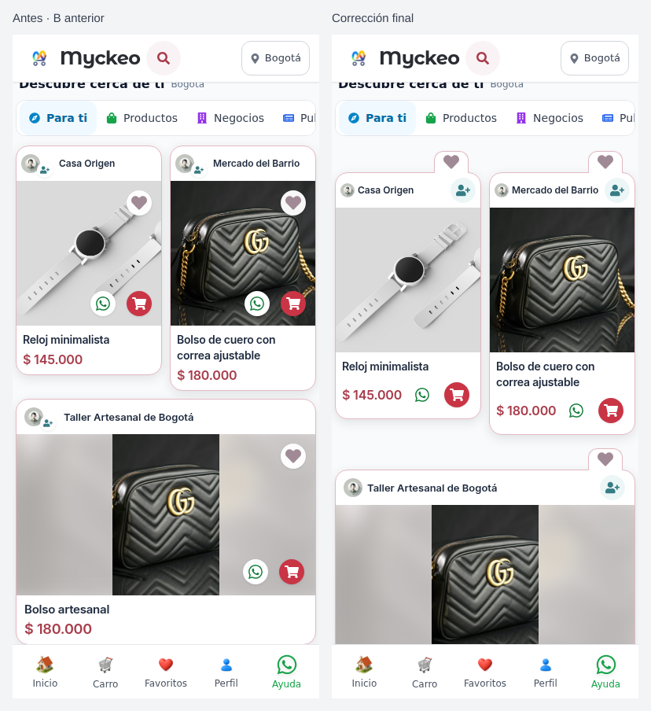
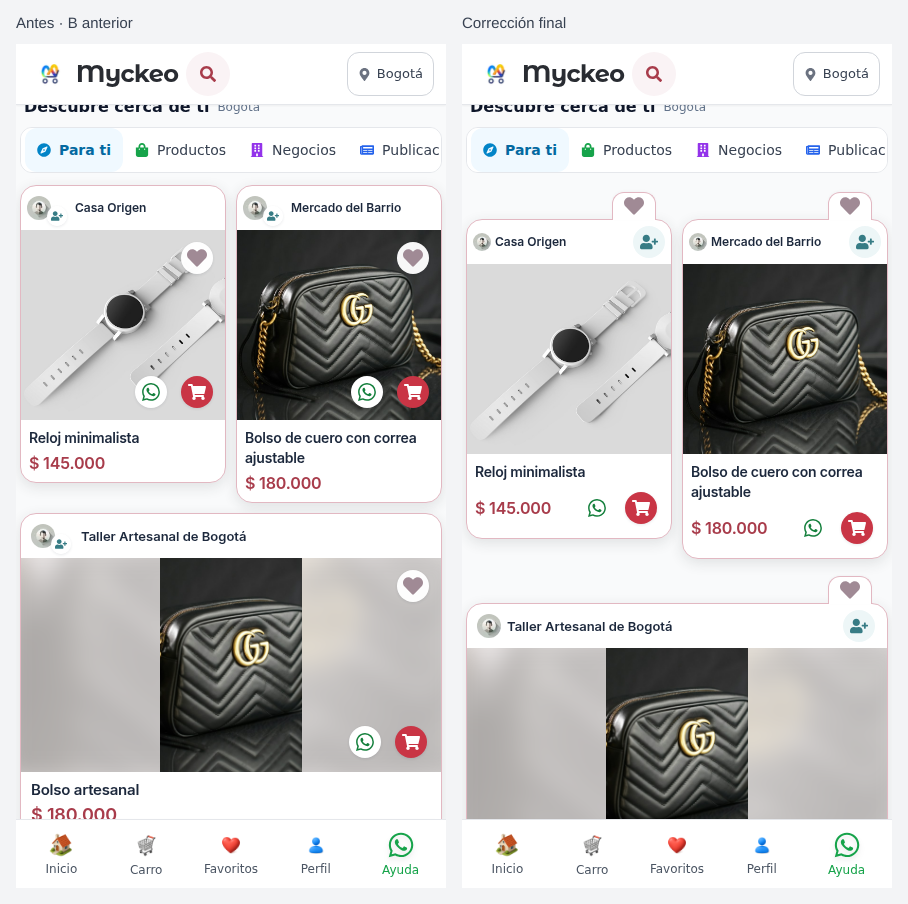

# Myckeo — Distribución definitiva de acciones móviles

**Estado: `MYCKEO_MOBILE_FEED_ACTIONS_LAYOUT_FINAL_READY`**

Fecha: 16 de noviembre de 2026, Colombia.

## Corrección aplicada

Se implementó directamente la distribución solicitada en el componente productivo de `/`:

- **Header de 44 px:** avatar, nombre del negocio y Seguir fijo a la derecha. El nombre puede ocupar hasta dos líneas dentro de esa misma altura y termina en elipsis si no cabe.
- **Favorito como oreja del borde superior:** pestaña blanca con borde rosado, adherida al borde antes del radio derecho. No ocupa la fotografía ni el header. Su superficie visible mide 44 × 28 px y el objetivo táctil conserva **44 × 44 px**.
- **WhatsApp y carrito junto al precio:** el grupo comercial original se muestra en el footer, alineado a la derecha. WhatsApp queda visualmente ligero y el carrito mantiene el acento rubí. Se eliminó el bloque de acciones sobre la foto y el contacto secundario redundante de la antigua distribución `split`.

No hay acciones sobre la fotografía. Los badges informativos de variantes, etiqueta y agotado siguen presentes.

## Archivos modificados

| Archivo productivo | Cambio |
| --- | --- |
| [`ProductCard.tsx`](../src/ui/components/productos/ProductCard.tsx) | Span local para truncar el nombre en dos líneas; retirada de los controles fotográficos y del antiguo contacto secundario; se reutilizan las acciones comerciales que ya existían junto al precio |
| [`feedProductCard.module.css`](../src/ui/components/productos/feedProductCard.module.css) | Sustitución del bloque de acciones B por el nuevo layout móvil, oreja y footer responsive |

Los callbacks, selección de variantes y código del modal de agregado son **idénticos** al estado anterior. `FollowButton`, `AddFavorites`, stores, acciones de servidor, APIs y los otros **618 archivos de `src` permanecen sin cambios**. No se añadieron ni eliminaron archivos productivos. [Integridad de fuentes](mobile-feed-actions-layout-final/source-integrity.json) · [Diff exacto](mobile-feed-actions-layout-final/production-change.diff).

Pruebas nuevas y composición de evidencia: `e2e/mobile-feed-actions-layout-final/{playwright.config.ts,browser.ts,actions.spec.ts,evidence.cjs}`. Informe y capturas: este documento y `docs/mobile-feed-actions-layout-final/`.

## Header y nombre del negocio

Seguir conserva su botón original de 44 × 44 px, con una posición propia al extremo derecho. El nombre dispone del espacio restante con `min-width: 0`; su área de enlace sigue teniendo 44 px de alto. El texto interior usa dos líneas de 16 px en C2 estrecho y 18 px en tarjetas amplias, manteniendo la familia, tamaño y peso de la tipografía existente.

La posición obligatoria de Seguir reduce el ancho por línea respecto al control integrado al avatar de B. Para mostrar más texto sin aumentar el header se aprovechan dos líneas:

| Viewport C2 | Ancho por línea anterior → nuevo | Caracteres visibles del negocio largo, aproximados |
| --- | --- | --- |
| 390 px | 130 → 112 px | **19 → 27** |
| 430 px | 150 → 132 px | **22 → 27** |

Se usó «Cooperativa de Productores Artesanales de Bogotá». Los caracteres se estimaron con rangos del texto renderizado y espacio de elipsis; no son resultados de pruebas de usuarios. «Casa Origen» y «Mercado del Barrio» siguen completos. El texto accesible y los destinos de los enlaces no se alteraron.

## Oreja de Favorito

El botón original permanece montado una sola vez y se posiciona sobre el borde, completamente antes del header. La pestaña visible tiene fondo blanco, borde `#E2B8C2`, radios superiores de 12 px y una sombra mínima. Se sitúa a 15 px del extremo derecho para unirse al tramo recto del borde sin invadir el radio de la tarjeta.

Se reservan **34 px de margen superior local**. Sumados al gap mínimo de 10 px entre filas, dejan los 44 px necesarios para el objetivo táctil. Esto evita que el botón intercepte la tarjeta anterior. La parte transparente del objetivo no tapa textos ni imagen; el contorno de foco se dibuja hacia dentro para respetar el espacio reservado.

Se midieron **cero intersecciones con el header, nombre e imagen**, y cero cruces de objetivos táctiles entre tarjetas, en todos los anchos móviles comprobados. No se desplazó el favorito hacia el lateral exterior, por lo que no invade la columna vecina ni genera scroll horizontal.

## Precio y acciones comerciales

Se conserva el formato monetario, «Desde», variante única y precio C2 de **16 px** y B3 de **18 px**. Las acciones de WhatsApp y carrito tienen objetivos de **44 × 44 px**; se alinean al extremo derecho del bloque de precio. Las cifras normales de `$ 145.000` y `$ 180.000` caben en la misma fila que ambos controles incluso en tarjetas de 186 px.

Cuando el importe completo y los 88 px mínimos de los botones no caben juntos, el grupo de acciones pasa a una segunda línea, alineado a la derecha y sin gap vertical añadido. El precio no se recorta ni se reduce. Para `$ 123.456.789` esto ocurre en C2, mientras que en B3 amplio cabe en una fila. El grupo con «Desde» se alinea como un bloque completo.

El overlay comercial se eliminó del JSX: no es una copia oculta sobre la imagen. Las acciones y sus handlers se reutilizan en su ubicación comercial original. No hay duplicados accesibles ni botones dentro de los enlaces de producto o negocio.

## Comparación real antes/después

Misma ruta `/`, contenido sintético, fotografías realistas, ancho, escala y scroll de **100 px** en ambas versiones. Las composiciones conservan los píxeles originales; el visor puede reducir su presentación. Las tarjetas de alturas diferentes no se redimensionan para aparentar igual tamaño.





[Comparación de una tarjeta clara](mobile-feed-actions-layout-final/screenshots/comparison-card-p1.png) · [Tarjeta oscura](mobile-feed-actions-layout-final/screenshots/comparison-card-p2.png) · [Galería completa](mobile-feed-actions-layout-final/comparison.html).

Casos finales con la oreja completa: [variantes y Desde](mobile-feed-actions-layout-final/screenshots/after-edge-p4.png), [agotado](mobile-feed-actions-layout-final/screenshots/after-edge-p5.png), [negocio y precio largos](mobile-feed-actions-layout-final/screenshots/after-edge-p7.png) y [variante única agotada](mobile-feed-actions-layout-final/screenshots/after-edge-p8.png).

## Alturas y coste de espacio

La tarjeta mantiene altura automática. La fila comercial normal pasa de 22 a 44 px para alojar controles táctiles y añade **22 px** al cuerpo. El header de negocio no crece y las fotografías no se reducen.

| Viewport | Primera tarjeta: antes → después | Fotografía: antes = después | Header: antes = después |
| --- | --- | --- | --- |
| 320 | 275,56 → **297,56 px** | 310 × 167,56 px | 44 px |
| 360 | 297,19 → **319,19 px** | 350 × 189,19 px | 44 px |
| 390 | 292 → **314 px** | 184 × 184 px | 44 px |
| 430 | 298 → **320 px** | 204 × 190 px | 44 px |
| 768 | 307,45 → **329,45 px** | 369 × 199,45 px | 44 px |

**El margen de 34 px para la oreja es adicional a esas alturas.** En una tarjeta normal, el espacio vertical asignado al elemento aumenta 56 px en total: 22 px del footer y 34 px de reserva exterior. Se reutiliza el gap existente para completar el área de la oreja; no se añadió una banda blanca dentro del header.

En precios largos que obligan a separar la fila de acciones, el cuerpo crece 44 px: a 390 px el caso largo pasa de 312 a 356 px; a 430, de 318 a 362 px, más el mismo margen de oreja. Los bloques con «Desde» o etiqueta de variante ya tienen más contenido y su crecimiento puede ser menor. No se fuerza una altura uniforme.

Este coste de espacio es explícito: la corrección despeja por completo la fotografía y mantiene objetivos de 44 px sin solapamientos. El orden, C2/B3 y la composición del feed se conservan; los contenidos posteriores se desplazan por el espacio que requieren las acciones.

## Responsive y escritorio

Se comprobaron **320, 360, 390, 430, 768, 769 y 1024 px**, con ausencia de desbordamiento horizontal, precios completos y controles alcanzables. La oreja, el nuevo footer y la distribución del nombre solo se aplican hasta 768 px.

| Escritorio | Diferencia de píxeles | Resultado |
| --- | --- | --- |
| 769 px | **0** | Misma presentación anterior |
| 1024 px | **0** | Misma presentación anterior |

[Comparación 769](mobile-feed-actions-layout-final/screenshots/comparison-769.png) · [Comparación 1024](mobile-feed-actions-layout-final/screenshots/comparison-1024.png).

También coinciden las posiciones y estilos calculados del componente de escritorio. El span del nombre usa `display: contents` fuera del móvil. Las variantes `default` y `business_profile`, el header compacto con lupa, la búsqueda en capa y las tarjetas de publicaciones, negocios y servicios no recibieron cambios de presentación.

## Validaciones ejecutadas

**Referencia: 7/7 pruebas. Corrección final: 11/11, sin retries ni flaky.**

- Geometría en los siete anchos: controles de al menos 44 × 44 px, Seguir a la derecha, Favorito antes del header y cero acciones sobre la foto.
- Sin cruces de acciones entre sí, con nombre o precio, ni entre distintas tarjetas. La oreja no tapa header o fotografía.
- Seguir con Enter, estado «Siguiendo» y dejar de seguir.
- Favorito con Espacio y clic, `aria-pressed`, añadido, eliminación y persistencia local.
- WhatsApp: destino y apertura conservados; no se enviaron mensajes.
- Carrito: producto base con cantidad 2; variante disponible con cantidad limitada al stock 3; opción y productos agotados deshabilitados.
- Usuario anónimo: solicitud de inicio de sesión para Seguir, cancelación y destino de login originales. Favoritos conserva su comportamiento local anterior.
- Navegación a ficha y negocio comprobada por separado, sin interceptación de los botones.
- Nombres y precios largos, «Desde», variantes, agotados y badges.
- `pnpm typecheck`: pasa.
- `pnpm lint`: pasa con el aviso previo de `_body` sin usar en `src/app/activar/ActivationBootstrap.test.tsx:347`.
- Lint focalizado del TSX y los nuevos archivos de pruebas: sin avisos ni errores.

[Pruebas previas](mobile-feed-actions-layout-final/before-results.json) · [Pruebas finales](mobile-feed-actions-layout-final/after-results.json) · [Interacciones](mobile-feed-actions-layout-final/after-commerce.json) · [Anónimo](mobile-feed-actions-layout-final/after-anonymous.json) · [Navegación](mobile-feed-actions-layout-final/after-navigation.json) · [Casos especiales](mobile-feed-actions-layout-final/after-edges.json) · [Mediciones resumidas](mobile-feed-actions-layout-final/summary.json).

## Entorno y reproducción

Se usó el servidor existente de Next.js 15.5.9, PID **647629**, en `/home/nico/red-social`, accediendo a `http://127.0.0.1:3000/`. No se reiniciaron procesos ni se borraron cachés o instalaron rutas de prueba. [Identidad del servidor](mobile-feed-actions-layout-final/server.json).

Las sesiones, respuestas de acciones y destinos de prueba se controlaron en el navegador. Se reutilizaron los mismos datos, scores y fotografías de [la comparación social anterior](MYCKEO_MOBILE_FEED_SOCIAL_ACTIONS_REVIEW.md). Se validó el componente productivo y sus callbacks con datos sintéticos, sin escrituras productivas ni cambios al backend.

No se modificaron ranking, paginación, lógica comercial, stores, Server Actions, APIs, Prisma, Cloudinary, autenticación, CI o infraestructura.

Con el servidor local activo:

```bash
pnpm exec playwright test --config=e2e/mobile-feed-actions-layout-final/playwright.config.ts
node e2e/mobile-feed-actions-layout-final/evidence.cjs
pnpm typecheck
pnpm lint
```

`FEED_ACTIONS_BEFORE=1` se utilizó antes de editar. No debe ejecutarse sobre la corrección para sustituir la referencia histórica.

**Sin commits, pushes ni despliegues.**
