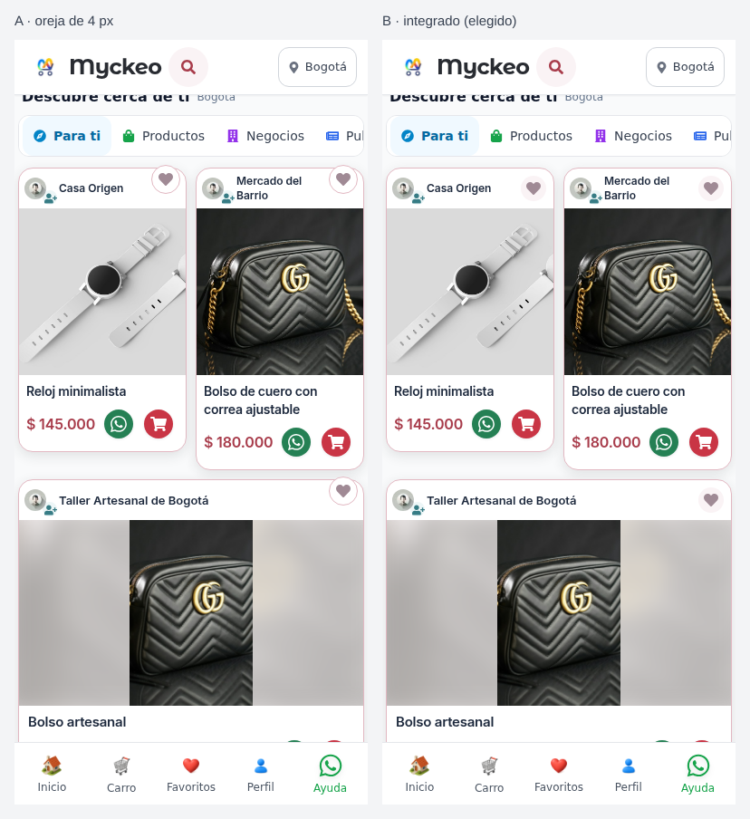
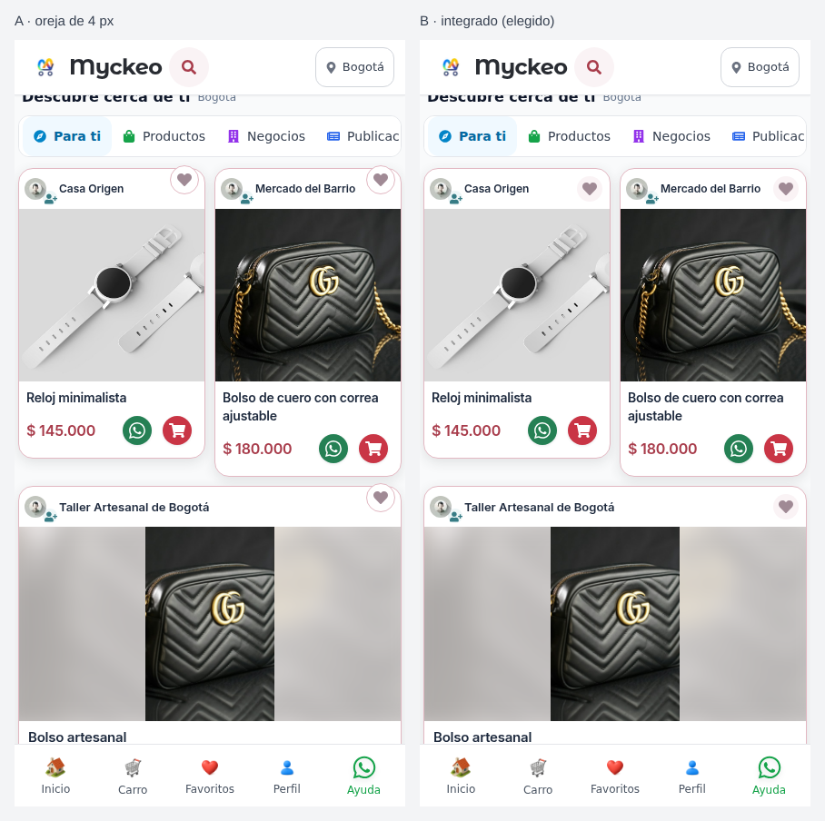

# Myckeo — Refinamiento final de acciones móviles

**Estado: `MYCKEO_MOBILE_FEED_ACTIONS_LAYOUT_REFINED_READY`**

Fecha: 16 de noviembre de 2026, Colombia.

**Recomendación definitiva: B, aplicada en desarrollo.** Favorito queda dentro del header; el borde vuelve a ser continuo y se elimina la reserva exterior de 34 px. Seguir se presenta como un distintivo pequeño junto al avatar, conservando su botón y objetivo táctil de 44 × 44 px. WhatsApp y carrito tienen la misma geometría junto al precio.

## Comparación A/B

Se implementaron ambas opciones en el CSS del componente productivo y se capturaron desde la ruta `/` del servidor Next.js. No se usaron tarjetas sustitutas ni estilos inyectados para representar las variantes.

- **A:** círculo de Favorito de 32 px que asoma **solo 4 px** por encima del borde. Su objetivo táctil es de 44 × 44 px, empieza 10 px antes del header y aprovecha el gap existente. No requiere margen adicional.
- **B:** Favorito completamente contenido, círculo visible de 28 px sobre fondo rosado tenue, corazón de 16 px y objetivo táctil de 44 × 44 px. Es la versión aplicada.
- **Ambas:** header de 44 px, mismo espacio para negocio y Seguir, mismas fotografías y footer comercial. Sin controles sobre la foto.





[Galería](mobile-feed-actions-refined/comparison.html) · [A original 390](mobile-feed-actions-refined/screenshots/A-390.png) · [B original 390](mobile-feed-actions-refined/screenshots/B-390.png) · [A original 430](mobile-feed-actions-refined/screenshots/A-430.png) · [B original 430](mobile-feed-actions-refined/screenshots/B-430.png).

Las composiciones conservan la escala original, el mismo contenido y scroll de 100 px. Los PNG individuales son capturas de 390 y 430 px de ancho; las composiciones añaden solo rótulos y separación exterior.

| Criterio | A | B |
| --- | --- | --- |
| Limpieza | Oreja discreta, aún interrumpe el borde | Borde continuo y control contenido |
| Nombre del negocio | Mismo espacio que B | Mismo espacio que A |
| Favorito | Sutil, pero atrae la mirada al borde | Más natural y estable dentro del header |
| WhatsApp / carrito | Geometría idéntica | Geometría idéntica |
| Compacidad | Sin reserva exterior; asoma 4 px | Sin reserva exterior ni salientes |
| Coherencia visual | Aceptable | Mejor continuidad con radios, colores y sombra actuales |

**Se elige B por limpieza y equilibrio**, no por novedad. La oreja de A ya es pequeña, pero no aporta una mejora de legibilidad o compacidad frente al control contenido. Esta valoración corresponde a revisión visual de las capturas; no es una prueba de preferencia con usuarios.

## Tamaño real de las acciones comerciales

Medidas obtenidas del DOM y de los pseudo-elementos pintados en los cinco anchos móviles:

| Propiedad | WhatsApp | Carrito |
| --- | --- | --- |
| Objetivo táctil y caja | **44 × 44 px** | **44 × 44 px** |
| Base circular visible | **32 × 32 px** | **32 × 32 px** |
| Icono | **18 × 18 px** | **18 × 18 px** |
| Alineación | Mismo eje vertical | Mismo eje vertical |
| Separación entre cajas | 0 px, sin solapamiento | 0 px, sin solapamiento |
| Fondo / icono disponible | Verde `#258054` / blanco | Rubí `#C93545` / blanco |
| Sombra disponible | `0 1px 3px #1c283c1a` | `0 1px 3px #1c283c1a` |

El carrito agotado conserva sus grises y ausencia de sombra para comunicar que está deshabilitado; mantiene exactamente la misma geometría. El color y estado siguen diferenciando las acciones, con igual tamaño de base e icono.

Se mantienen a la derecha del bloque inferior, junto al precio. Cuando un importe largo no cabe con ambos botones, las dos acciones pasan juntas a otra línea y siguen alineadas a la derecha. No se recorta el importe ni se reduce la tipografía.

## Espacio para el negocio y compacidad

Seguir utiliza los primeros 44 px del header; visualmente es un distintivo junto al avatar, sin ocupar una columna adicional. El avatar no era un enlace independiente y sigue siendo decorativo respecto al botón. El nombre conserva su enlace independiente y dos líneas; Favorito ocupa los últimos 44 px. Ningún objetivo táctil invade el nombre ni el otro botón.

| Viewport | Ancho por línea anterior | A | B | Nombre largo: caracteres visibles aproximados, anterior → A / B |
| --- | --- | --- | --- | --- |
| 320 | 216 px | 222 px | 222 px | 48 → 48 / 48 |
| 360 | 256 px | 262 px | 262 px | 48 → 48 / 48 |
| 390 | 112 px | 96 px | 96 px | 27 → 27 / 27 |
| 430 | 132 px | 116 px | 116 px | 27 → 27 / 27 |
| 768 | 275 px | 281 px | 281 px | 48 → 48 / 48 |

Referencia: «Cooperativa de Productores Artesanales de Bogotá». Las estimaciones se obtienen de rangos de texto renderizado, descontando el espacio de elipsis. En C2 se ceden 16 px por línea para contener Favorito; este ejemplo mantiene los mismos caracteres por cómo se distribuyen sus palabras. Otros nombres pueden truncarse antes. «Casa Origen» y «Mercado del Barrio» se muestran completos a 390 y 430 px; el segundo usa dos líneas a 390 px. El texto accesible conserva siempre el nombre completo.

La altura de las tarjetas, del header y de las fotos coincide con la referencia. Se elimina el **margen superior de 34 px por tarjeta**. La primera tarjeta mide 314 px a 390 y 320 px a 430, igual que antes, pero ya no consume esos 34 px exteriores. No se altera C2, el ítem impar B3 ni el ritmo de columnas.

## Archivos modificados en esta iteración

**Único archivo productivo:** [`feedProductCard.module.css`](../src/ui/components/productos/feedProductCard.module.css), bloque final limitado a `max-width: 768px`.

Se conservaron los cambios que ya existían al iniciar esta tarea. Se compararon hashes de **620 archivos de `src`**: solo cambió ese CSS; los otros **619** siguen idénticos, sin archivos eliminados. [`ProductCard.tsx`](../src/ui/components/productos/ProductCard.tsx), `AddFavorites`, `FollowButton`, handlers, stores, ranking, paginación, publicaciones, negocios, servicios, header, buscador y lógica comercial no recibieron cambios en esta iteración.

[Diff exacto frente al punto de partida](mobile-feed-actions-refined/production-change.diff) · [Integridad de fuentes](mobile-feed-actions-refined/source-integrity.json).

Archivos de validación añadidos:

- `e2e/mobile-feed-actions-refined/playwright.config.ts`
- `e2e/mobile-feed-actions-refined/refined.spec.ts`
- `e2e/mobile-feed-actions-refined/interactions.spec.ts`
- `e2e/mobile-feed-actions-refined/evidence.cjs`
- Este informe y `docs/mobile-feed-actions-refined/`, con capturas, mediciones, resultados, galería y copias completas del CSS anterior, A y B en `sources/`.

A queda disponible como artefacto de desarrollo, sin selector ni banderas añadidas al producto. La fuente aplicada coincide con `sources/option-B.css`.

## Validación y límites

**Referencia: 7/7. A: 7/7. B aplicada: 11/11.** Las ejecuciones finales pasan sin retries.

- **320, 360, 390, 430, 768, 769 y 1024 px:** sin scroll horizontal; precios completos; objetivos táctiles de al menos 44 × 44 px; sin controles anidados, intersecciones entre controles, con nombres/precios o entre tarjetas; controles accesibles mediante hit testing.
- Mismo tamaño real para ambas acciones comerciales en móvil, incluida alineación, base circular e iconos. Cero acciones sobre la fotografía.
- Nombres largos de negocio/producto, `$ 123.456.789`, «Desde», variantes, variante única agotada y producto agotado.
- Fotografías claras y oscuras, proporciones distintas y ausencia de imagen.
- Usuario autenticado: Seguir/dejar de seguir, Favorito añadir/quitar y persistencia local; teclado con Enter y Espacio.
- Anónimo: Favorito local, solicitud de sesión al seguir, cancelación y destino original de login.
- WhatsApp: href y apertura originales; sin envío de mensajes.
- Carrito: cantidad 2, selección de variante, límite de stock 3, variante sin stock y productos agotados deshabilitados.
- Enlaces a producto y negocio comprobados por separado.
- `pnpm typecheck`: pasa.
- `pnpm lint`: pasa con el aviso preexistente de `_body` sin usar en `src/app/activar/ActivationBootstrap.test.tsx:347`.
- Lint focalizado de los tres TS de validación: pasa sin avisos.
- `git diff --check`: pasa.

[Resultados A](mobile-feed-actions-refined/A-results.json) · [Resultados B](mobile-feed-actions-refined/B-results.json) · [Medidas resumidas](mobile-feed-actions-refined/summary.json) · [Interacciones](mobile-feed-actions-refined/B-commerce.json) · [Anónimo](mobile-feed-actions-refined/B-anonymous.json) · [Navegación](mobile-feed-actions-refined/B-navigation.json) · [Casos especiales](mobile-feed-actions-refined/B-edges.json).

Casos visuales: [claro](mobile-feed-actions-refined/screenshots/B-edge-p1.png), [oscuro](mobile-feed-actions-refined/screenshots/B-edge-p2.png), [variantes](mobile-feed-actions-refined/screenshots/B-edge-p4.png), [agotado](mobile-feed-actions-refined/screenshots/B-edge-p5.png), [nombres y precio largos](mobile-feed-actions-refined/screenshots/B-edge-p7.png), [variante única agotada](mobile-feed-actions-refined/screenshots/B-edge-p8.png).

Se usó Next.js 15.5.9 en `http://127.0.0.1:3000/`, con las fixtures y fotografías de la revisión anterior. Sesiones, respuestas de Server Actions y destinos externos se controlaron desde Playwright. Se ejecutan los componentes y callbacks originales con datos sintéticos; esta revisión no verifica persistencia real de backend ni integraciones externas. No se hicieron escrituras productivas.

## Escritorio intacto

| Ancho | A frente a referencia | B frente a referencia |
| --- | --- | --- |
| 769 px | **0 píxeles diferentes** | **0 píxeles diferentes** |
| 1024 px | **0 píxeles diferentes** | **0 píxeles diferentes** |

También coinciden estilos calculados, tamaños y posiciones registrados por la validación del componente. Los cambios productivos quedan dentro del breakpoint móvil. El header compacto con lupa, buscador en capa, precio refinado, bordes y sombras previos permanecen intactos.

Reproducción de B con el servidor de desarrollo activo:

```bash
pnpm exec playwright test --config=e2e/mobile-feed-actions-refined/playwright.config.ts
node e2e/mobile-feed-actions-refined/evidence.cjs
pnpm typecheck
pnpm lint
```

Las referencias `before-*` y las capturas A son evidencia histórica; no se deben sobrescribir al ejecutar B.

**Sin commits, pushes ni despliegues. Sin cambios a Prisma, Cloudinary, CI o infraestructura.**
