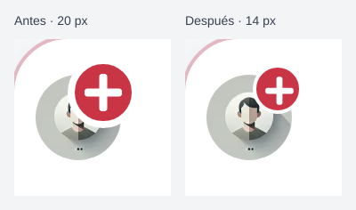
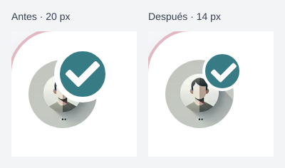
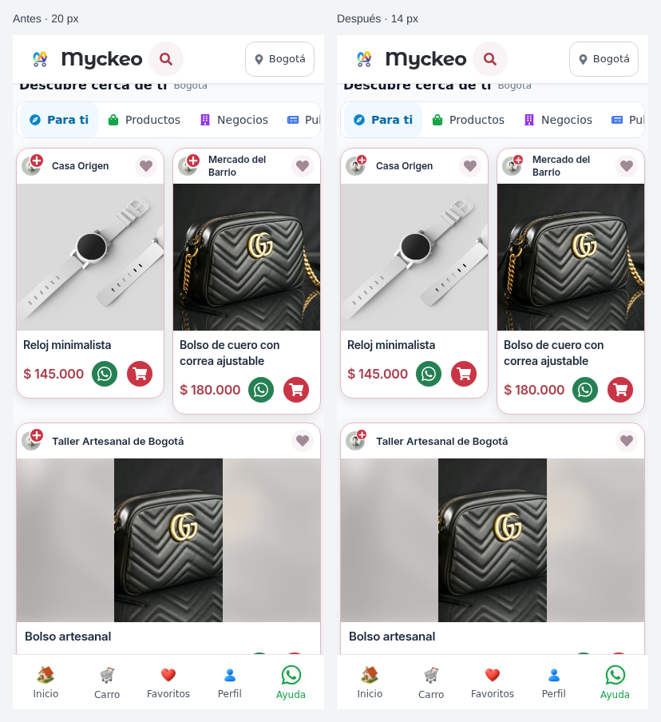

# Myckeo — Tamaño final del distintivo Seguir

**Estado: `MYCKEO_MOBILE_FEED_AVATAR_FOLLOW_BADGE_REFINED_READY`**

Fecha: 16 de noviembre de 2026, Colombia.

Ajuste exclusivamente visual en **dos CSS**. El distintivo pasa de 20 a **14 px**, su halo blanco de 2 a **1 px**, y el icono/spinner de 12 a **9 px**. El avatar permanece en **24 × 24 px** y la caja interactiva compartida en **44 × 44 px**.

## Proporciones y posición

| Propiedad | Antes | Final |
| --- | --- | --- |
| Distintivo exterior, incluido borde | 20 × 20 px | **14 × 14 px** |
| Halo blanco | 2 px | **1 px** |
| Icono + / ✓ / spinner | 12 × 12 px | **9 × 9 px** |
| Avatar | 24 × 24 px | **24 × 24 px** |
| Objetivo interactivo | 44 × 44 px | **44 × 44 px** |

El distintivo ocupa un **51 % menos de superficie**. Mantiene Ruby `#C93545` y teal `#377C85`, sin sombras ni animaciones adicionales.

Coordenadas finales respecto al botón de 44 px:

- Avatar: izquierda 6 px, arriba 10 px.
- Distintivo: izquierda **19 px**, arriba **7 px**.
- Icono centrado: izquierda 21,5 px, arriba 9,5 px.

Respecto al origen del avatar, el distintivo empieza 13 px hacia la derecha y 3 px por encima. Sobresale **3 px arriba y 3 px a la derecha**, sin separación visual. Las medidas del DOM sitúan **49,8 % del círculo dentro y 50,2 % fuera** del avatar. Su intersección geométrica cubre aproximadamente **17 % del área de la fotografía**, frente al 37 % anterior, incluyendo el halo blanco.

## Capturas ampliadas, a la misma escala

Cada captura individual se obtuvo del navegador a densidad **4×**: 176 × 176 píxeles para el mismo botón CSS de 44 × 44 px. No se redimensionaron las interfaces para aparentar proporciones distintas.





[+ final ampliado](mobile-feed-avatar-follow-badge-refined/screenshots/after-plus-enlarged.png) · [✓ final ampliado](mobile-feed-avatar-follow-badge-refined/screenshots/after-check-enlarged.png) · [Spinner antes/después](mobile-feed-avatar-follow-badge-refined/screenshots/comparison-spinner-enlarged.png).

## Comparación móvil a 390 px



Mismo componente productivo, contenido, fotografías, viewport y scroll de 100 px. Las composiciones añaden únicamente rótulos y separación exterior.

[Galería completa](mobile-feed-avatar-follow-badge-refined/comparison.html) · [Fallback y nombre largo](mobile-feed-avatar-follow-badge-refined/screenshots/fallback-long-name.png).

El header conserva 44 px de altura y el nombre mantiene todo el espacio recuperado, su tipografía, `min-width: 0`, dos líneas como máximo y elipsis:

| Viewport | Ancho del nombre antes = después |
| --- | --- |
| 320 px | **222 px** |
| 390 px | **96 px** |
| 430 px | **116 px** |
| 768 px | **281 px** |

## Archivos modificados

- [`feedProductCard.module.css`](../src/ui/components/productos/feedProductCard.module.css): diámetro, borde y posición del círculo; tamaño del SVG del control móvil.
- [`followButton.module.css`](../src/feed/componentes/followButton.module.css): posición y tamaño del icono/spinner dentro del distintivo.

Los cambios están dentro de `max-width: 768px`. Se compararon hashes de **621 archivos de `src`**: solo cambiaron estos dos CSS; **619 permanecen idénticos**, sin altas ni eliminaciones. `FollowButton.tsx`, `ProductCard.tsx`, autenticación, actualización optimista, rollback, prevención de doble envío, errores y reintento conservan exactamente su código anterior.

Favoritos, WhatsApp, carrito, producto, precio, fotos, bordes y sombras, C2/B3, buscador, ranking, paginación, APIs, backend, Prisma, Cloudinary e infraestructura no recibieron cambios.

[Diff exacto](mobile-feed-avatar-follow-badge-refined/production-change.diff) · [Integridad de fuentes](mobile-feed-avatar-follow-badge-refined/source-integrity.json) · [Mediciones](mobile-feed-avatar-follow-badge-refined/summary.json).

Validación añadida en `e2e/mobile-feed-avatar-follow-badge-refined/{playwright.config.ts,badge.spec.ts,evidence.cjs}`. Capturas, resultados y fuentes antes/después en `docs/mobile-feed-avatar-follow-badge-refined/`.

## Validación focalizada

**9 comprobaciones finales pasan: 6 de geometría y 3 de estados/interacción**, sin retries ni flaky en las ejecuciones finales guardadas. La referencia visual previa pasó 7 comprobaciones; los dos casos exclusivos del ajuste final se omitieron en esa referencia.

- **320, 390, 430 y 768 px:** distintivo de 14 px, avatar de 24 px, objetivo de 44 px, proporción de superposición, ausencia de cruces entre controles y ausencia de scroll horizontal.
- Mismas cajas de tarjeta, header, nombre, fotografía de producto, precio y demás acciones; misma fuente y ancho del nombre que antes.
- Estados +, ✓ y spinner capturados a densidad 4×; halo de 1 px e icono/SVG de 9 px medidos en los tres estados.
- Hit testing en avatar, distintivo y puntos interiores de los controles visibles. Foto y distintivo activan el mismo botón; no se anidan controles.
- Enter para seguir, botón deshabilitado y `aria-busy` durante carga, Espacio para dejar de seguir. Nombres accesibles «Seguir a [negocio]» y «Dejar de seguir a [negocio]» conservados.
- Fallback de avatar cargado, negocio largo y truncado de dos líneas comprobados en los cuatro anchos móviles. Clics reales en foto y distintivo confirman seguimiento sin navegación.
- Usuario anónimo: solicitud de login original, cancelación y ausencia de mutación.
- Lint focalizado de los dos archivos TS de validación: pasa sin avisos.
- `git diff --check`: pasa.

[Geometría: 6/6](mobile-feed-avatar-follow-badge-refined/after-layout-results.json) · [Estados e interacción: 3/3](mobile-feed-avatar-follow-badge-refined/after-states-results.json) · [Medidas de estados](mobile-feed-avatar-follow-badge-refined/after-states.json) · [Fallback, nombre largo y hit testing](mobile-feed-avatar-follow-badge-refined/fallback-long-name.json).

Se comprobó el componente real en el servidor Next.js local (`http://127.0.0.1:3000/`) con datos, sesiones y respuestas de seguimiento sintéticos. No se repitió la auditoría completa del feed ni la batería comercial anterior. No se hicieron escrituras productivas.

## Escritorio intacto

| Viewport | Píxeles diferentes antes/después |
| --- | --- |
| 769 px | **0** |
| 1024 px | **0** |

Las capturas originales de escritorio se conservan en `screenshots/before-769.png`, `after-769.png`, `before-1024.png` y `after-1024.png`; las mediciones y resultados enlazados incluyen la comparación de píxeles.

Reproducción con el servidor local activo:

```bash
pnpm exec playwright test --config=e2e/mobile-feed-avatar-follow-badge-refined/playwright.config.ts
node e2e/mobile-feed-avatar-follow-badge-refined/evidence.cjs
```

Los archivos `before-*` son referencias históricas y no deben sobrescribirse al verificar el ajuste final.

**Sin commits, pushes ni despliegues.**
