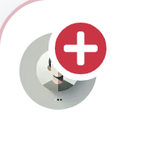
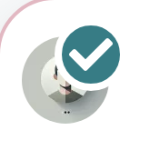
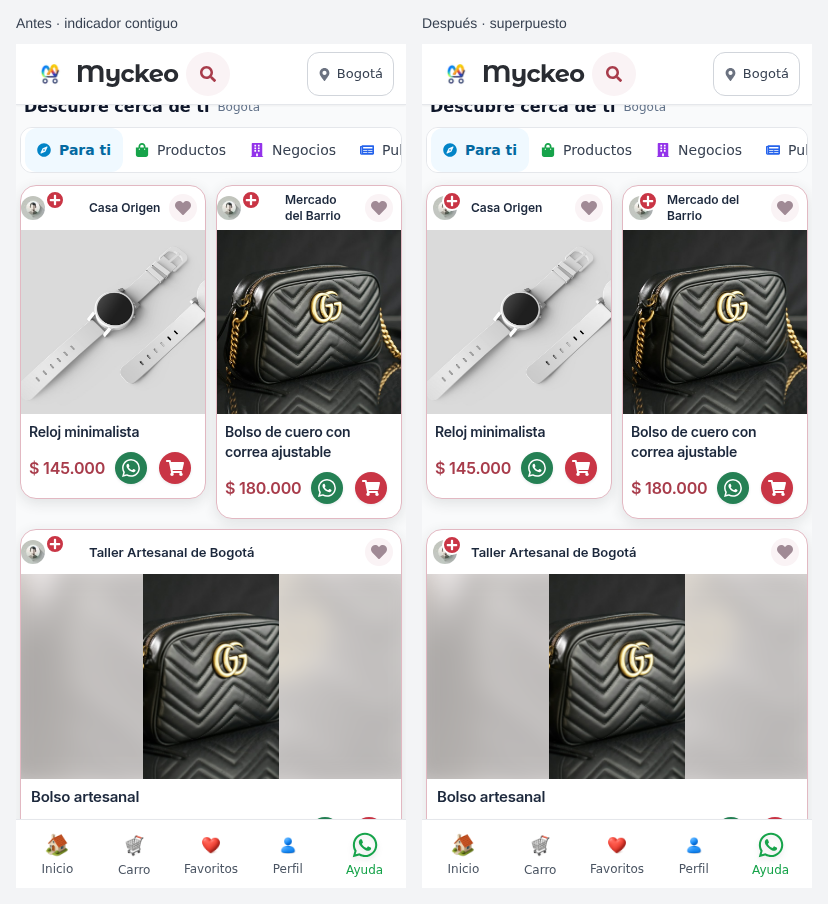
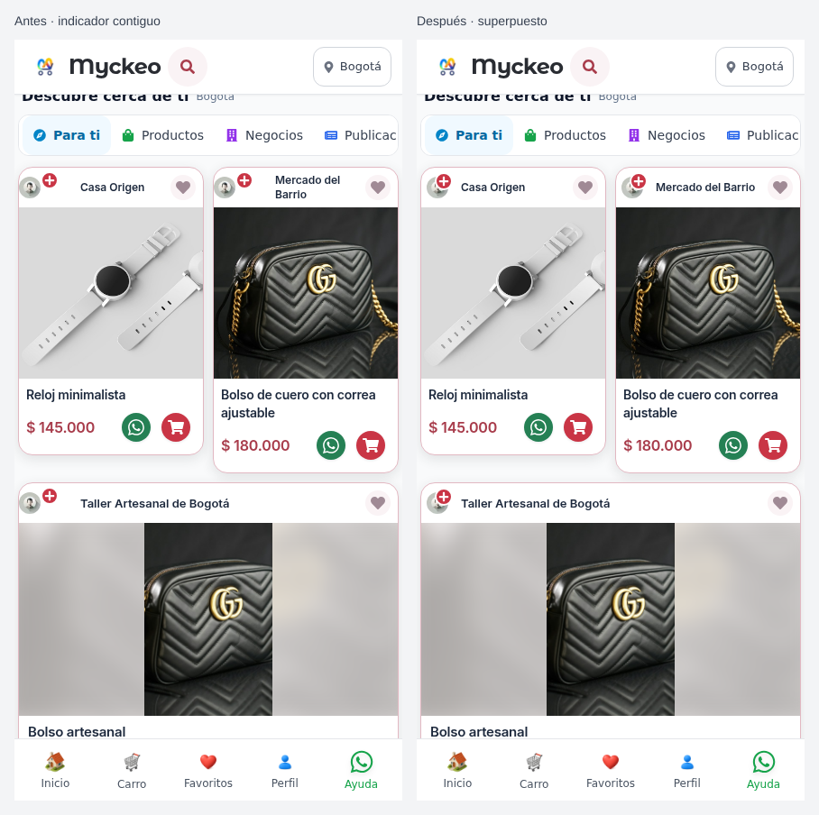

# Myckeo — Seguir superpuesto en el avatar

**Estado: `MYCKEO_MOBILE_FEED_AVATAR_FOLLOW_OVERLAY_READY`**

Fecha: 16 de noviembre de 2026, Colombia.

Se aplicó la alternativa autorizada: **avatar completo como botón Seguir de 44 × 44 px; nombre como enlace independiente al perfil**. El +/✓ está realmente superpuesto en la esquina superior derecha de la fotografía circular. Desaparece el espacio independiente de seguimiento y se recuperan los **24 px** que consumía la versión anterior.

## Posición y dimensiones reales

Todas las medidas siguientes son coordenadas CSS relativas al botón de 44 × 44 px, comprobadas en el DOM:

| Elemento | Posición | Tamaño |
| --- | --- | --- |
| Avatar circular | izquierda 6 px, arriba 10 px | 24 × 24 px |
| Distintivo, incluido borde blanco | izquierda 15 px, arriba 5 px | 20 × 20 px |
| Icono +/✓/spinner | izquierda 19 px, arriba 9 px | 12 × 12 px |
| Área interactiva compartida | izquierda 0, arriba 0 | **44 × 44 px** |

El distintivo sobresale **5 px por arriba y 5 px por la derecha del avatar**. La intersección de ambos círculos, calculada desde sus medidas renderizadas, deja **53,53 % de la superficie del distintivo dentro del avatar y 46,47 % fuera**, incluyendo su borde blanco de 2 px. No hay separación entre fotografía y distintivo.

Se conservan el + blanco sobre Ruby `#C93545`, el ✓ blanco sobre teal `#377C85` y el spinner durante la operación. La fotografía está debajo del distintivo; el icono queda por encima de ambos. Las capas decorativas no interceptan eventos: toda la foto, el distintivo y el resto de la caja de 44 px activan el mismo botón.

## Capturas ampliadas

Capturas **nativas del navegador con densidad 4×**, sin recrear la interfaz: cada PNG muestra el objetivo CSS de 44 × 44 px renderizado en **176 × 176 píxeles**.





[Comparación de estados ampliados](mobile-feed-avatar-follow-overlay/screenshots/states-enlarged.png) · [Carga](mobile-feed-avatar-follow-overlay/screenshots/avatar-pending.png) · [Avatar faltante](mobile-feed-avatar-follow-overlay/screenshots/avatar-fallback.png).

## Antes y después





[Galería completa](mobile-feed-avatar-follow-overlay/comparison.html) · [Antes 390](mobile-feed-avatar-follow-overlay/screenshots/before-390.png) · [Después 390](mobile-feed-avatar-follow-overlay/screenshots/after-390.png) · [Antes 430](mobile-feed-avatar-follow-overlay/screenshots/before-430.png) · [Después 430](mobile-feed-avatar-follow-overlay/screenshots/after-430.png).

Las comparativas de viewport conservan la escala original, las mismas fixtures y fotografías, y scroll de 100 px. Solo se añaden rótulos y separación exterior a las composiciones.

## Espacio recuperado para el negocio

| Viewport | Ancho anterior del nombre por línea | Ancho final por línea | Recuperado |
| --- | --- | --- | --- |
| 320 px | 198 px | 222 px | **24 px** |
| 360 px | 238 px | 262 px | **24 px** |
| 390 px | 72 px | 96 px | **24 px** |
| 430 px | 92 px | 116 px | **24 px** |
| 768 px | 257 px | 281 px | **24 px** |

El bloque avatar/Seguir vuelve de 68 a **44 px**, con una sola área táctil. El nombre conserva `min-width: 0`, dos líneas como máximo y elipsis. No se modifica su tipografía: continúan los tamaños de 12 px en tarjeta estrecha y 13 px en tarjeta amplia, con las reglas de anchura existentes. El header sigue midiendo **44 px**; las tarjetas no crecen ni desplazan la fotografía o el bloque de compra.

[Nombres largos a 390](mobile-feed-avatar-follow-overlay/screenshots/long-business-390.png) · [Nombres largos a 430](mobile-feed-avatar-follow-overlay/screenshots/long-business-430.png) · [Medidas completas](mobile-feed-avatar-follow-overlay/summary.json).

## Destinos de interacción

No se ofrecen dos destinos superpuestos sobre una fotografía de 24 px, porque no caben ahí dos objetivos independientes adecuados. Se utiliza expresamente la alternativa aprobada:

- **Foto del avatar y distintivo:** Seguir/dejar de seguir, dentro del botón original de 44 × 44 px. Su nombre accesible es «Seguir a [negocio]» o «Dejar de seguir a [negocio]».
- **Nombre del negocio:** abre el perfil mediante el enlace original, separado del botón.
- **Favorito y acciones comerciales:** conservan sus destinos y áreas táctiles.

Se eliminó el enlace móvil del avatar; no hay botones dentro de enlaces ni una acción de navegación asociada al toque de la fotografía. La prueba de destinos hace clic en el centro de la foto, verifica seguimiento y URL sin cambios, hace clic en el distintivo, verifica dejar de seguir y URL sin cambios, y después abre el perfil desde el nombre comprobando que no se produce otra mutación.

Se conserva exactamente la lógica de `FollowButton`: consulta, autenticación, mutación, actualización optimista, rollback, estados de carga, error y reintento. Solo se añade la imagen decorativa a su presentación móvil opcional. La carga continúa mostrando spinner y botón deshabilitado; el aviso accesible de error y el modal de login no cambian.

## Archivos modificados en esta iteración

| Archivo productivo | Cambio |
| --- | --- |
| [`ProductCard.tsx`](../src/ui/components/productos/ProductCard.tsx) | Retira el avatar móvil enlazado y pasa la misma imagen/fallback como contenido visual del botón existente |
| [`feedProductCard.module.css`](../src/ui/components/productos/feedProductCard.module.css) | Recupera el bloque inicial de 44 px y coloca el distintivo sobre el avatar, con sus capas y colores actuales |
| [`FollowButton.tsx`](../src/feed/componentes/FollowButton.tsx) | Slot opcional `mobileAvatarImage` y marcadores de presentación; no cambia callbacks ni lógica de seguimiento |
| [`followButton.module.css`](../src/feed/componentes/followButton.module.css) | Imagen circular dentro del botón y nueva posición del icono, solo en móvil |

No se añaden componentes globales ni archivos productivos. Se compararon los **621 archivos de `src` del punto de partida**: cambiaron únicamente estos cuatro; **617 permanecen idénticos**, sin altas ni eliminaciones.

El bloque de consulta, mutación y handlers de `FollowButton` coincide literalmente con el anterior. También coinciden literalmente la lógica previa al header y todo el JSX de fotografía de producto, compra y modal de `ProductCard`.

[Diff exacto](mobile-feed-avatar-follow-overlay/production-change.diff) · [Integridad de fuentes](mobile-feed-avatar-follow-overlay/source-integrity.json).

Validación añadida en `e2e/mobile-feed-avatar-follow-overlay/` (`playwright.config.ts`, `geometry.ts`, `layout.spec.ts`, `follow.spec.ts`, `interactions.spec.ts`, `touch.spec.ts`, `evidence.cjs`). Informe, referencias, capturas y mediciones en este documento y `docs/mobile-feed-avatar-follow-overlay/`.

## Pruebas ejecutadas

**Referencia: 7/7. Ajuste final: 16/16**, sin retries ni flaky en la ejecución final.

- **320, 360, 390, 430 y 768 px:** posición real de ambos círculos, intersección del 53,53 %, recuperación de 24 px, header de 44 px y objetivos de seguimiento de 44 × 44 px.
- Hit testing en cinco puntos interiores de los controles visibles, centro de la fotografía y centro del distintivo. Sin cruces con nombre o Favorito, sin controles anidados y sin controles sobre la fotografía de producto.
- Negocios largos desplazados a la zona visible y comprobados en los cinco anchos móviles; truncado de dos líneas y enlace accesible con nombre completo.
- Foto y distintivo ejecutan solo seguimiento; nombre ejecuta solo navegación. Evidencia específica a densidad 4×.
- Estado +, estado ✓, spinner, autenticado, usuario sin sesión, solicitud original de login y cancelación.
- Seguir/dejar de seguir, teclado con Enter/Espacio, error al seguir y al dejar de seguir, rollback, anuncio accesible y reintento.
- Doble pulsación con petición retenida: una sola mutación. Comprobación adicional con dos eventos reales `touchscreen.tap`; seguimiento y dejar de seguir por touch.
- Avatar faltante: se mantiene el fallback existente y la imagen carga dentro del botón.
- Favoritos: añadir/quitar y persistencia local.
- WhatsApp: URL y apertura originales; sin enviar mensajes.
- Carrito: producto base, cantidad 2, variantes, límite al stock 3 y agotados deshabilitados.
- Sin desbordamiento horizontal. Se conservan las cajas de tarjeta, header, foto, título, precio, bordes y sombras.
- Favorito, WhatsApp y carrito coinciden en geometría, color y base pintada con la referencia en los siete anchos.
- Comparación de píxeles de fotografías de producto visibles: **0 diferencias** en todos los recortes comprobados, incluidos los casos claros y oscuros.
- `pnpm typecheck`: pasa.
- `pnpm lint`: pasa con el aviso preexistente de `_body` sin usar en `src/app/activar/ActivationBootstrap.test.tsx:347`.
- Lint focalizado de los dos TSX y los TS de validación: pasa sin avisos.
- `git diff --check`: pasa.

[Resultados finales](mobile-feed-avatar-follow-overlay/after-results.json) · [Destinos de avatar/distintivo/nombre](mobile-feed-avatar-follow-overlay/avatar-destinations.json) · [Doble pulsación](mobile-feed-avatar-follow-overlay/double-tap.json) · [Touch](mobile-feed-avatar-follow-overlay/touch.json) · [Errores y reintento](mobile-feed-avatar-follow-overlay/errors.json) · [Avatar faltante](mobile-feed-avatar-follow-overlay/fallback.json) · [Negocios largos](mobile-feed-avatar-follow-overlay/long-business.json) · [Compra](mobile-feed-avatar-follow-overlay/after-commerce.json) · [Anónimo](mobile-feed-avatar-follow-overlay/after-anonymous.json) · [Navegación](mobile-feed-avatar-follow-overlay/after-navigation.json).

Se ejecutó el componente productivo en `/` del servidor Next.js local de `http://127.0.0.1:3000/`. Sesiones, datos, respuestas de Server Actions, errores y destinos externos se controlaron desde Playwright. Estas pruebas no verifican persistencia real de backend ni realizan escrituras productivas.

## Escritorio intacto

| Ancho | Píxeles distintos antes/después |
| --- | --- |
| 769 px | **0** |
| 1024 px | **0** |

[Comparación 769](mobile-feed-avatar-follow-overlay/screenshots/comparison-769.png) · [Comparación 1024](mobile-feed-avatar-follow-overlay/screenshots/comparison-1024.png).

La imagen nueva y el distintivo solo se muestran hasta 768 px. En escritorio se conserva el avatar y el icono anteriores. No se modifican Favoritos, WhatsApp, carrito, precio, fotografías de producto, bordes, sombras, C2/B3, búsqueda móvil, ranking, paginación, APIs, backend ni tarjetas de publicaciones, negocios o servicios.

Reproducción con el servidor local activo:

```bash
pnpm exec playwright test --config=e2e/mobile-feed-avatar-follow-overlay/playwright.config.ts
node e2e/mobile-feed-avatar-follow-overlay/evidence.cjs
pnpm typecheck
pnpm lint
```

Los archivos `before-*` son referencias históricas y no deben sobrescribirse sobre el ajuste final.

**Sin commits, pushes ni despliegues.**
