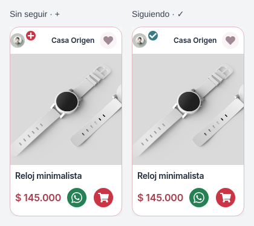
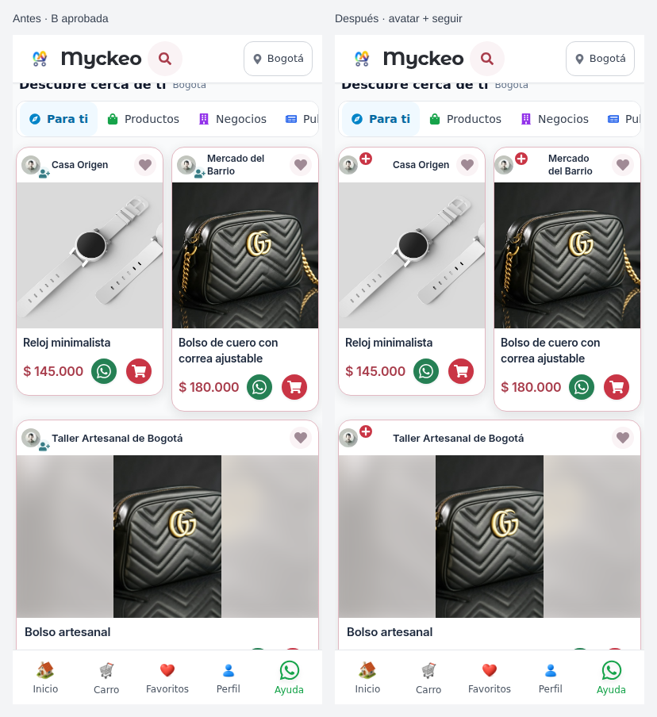
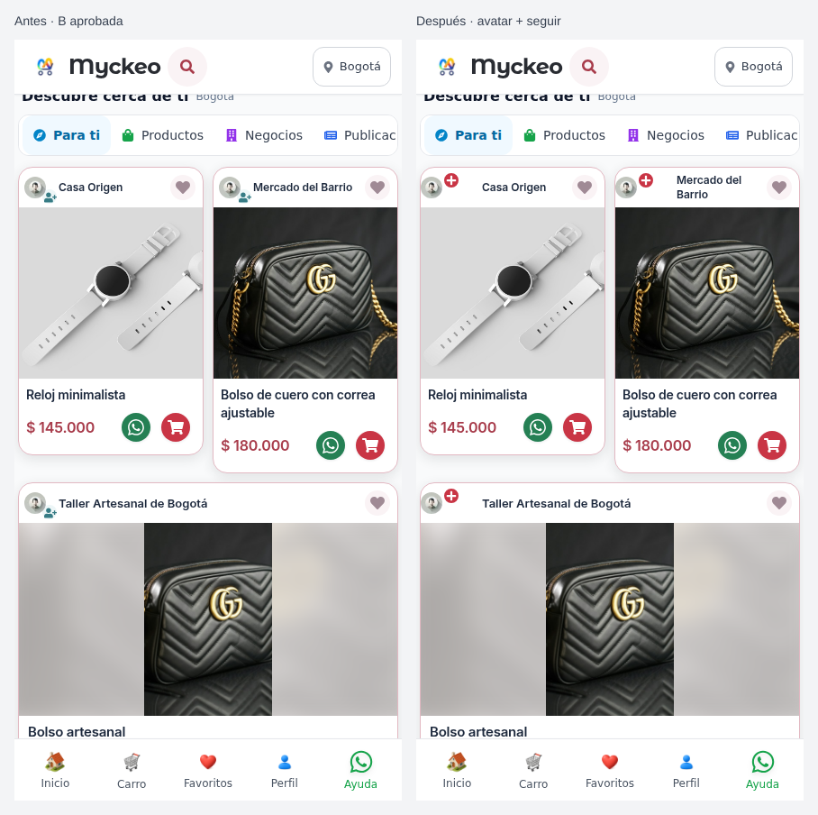

# Myckeo — Seguir integrado junto al avatar

**Estado: `MYCKEO_MOBILE_FEED_AVATAR_FOLLOW_READY_FOR_REVIEW`**

Fecha: 16 de noviembre de 2026, Colombia.

Se añadió una presentación opcional de `FollowButton` para las tarjetas de producto del feed móvil: **+ blanco sobre Ruby** cuando no se sigue y **✓ blanco sobre teal discreto** cuando se sigue. El indicador se sitúa junto a la esquina superior derecha del avatar. Durante carga muestra un spinner del estado real del componente, con el botón deshabilitado y `aria-busy`.

Se usa la **alternativa compacta accesible autorizada**: el indicador queda contiguo al avatar, sin invadir su fotografía ni compartir su destino táctil. No se fuerza una superposición que mezcle navegar y seguir.

## Composición e interacción

- Avatar: fotografía y enlace independiente de **24 × 24 px**, con nombre accesible «Abrir perfil de [negocio]».
- Seguir: caja interactiva independiente de **44 × 44 px**, contigua al avatar. Dentro se pinta el distintivo junto a su esquina superior derecha: diámetro de **20 px incluyendo halo blanco de 2 px**, círculo de color de **16 px** e icono de **12 px**.
- Nombre: enlace independiente, dos líneas con elipsis y texto accesible completo.
- Favorito: permanece en el extremo derecho, sin cambios.
- Header: conserva **44 px de altura**. No se añaden filas ni se cambian alturas de las tarjetas.

El círculo Ruby usa `#C93545`; el estado siguiendo, `#377C85`. El contraste calculado del icono blanco frente a esos fondos es **5,15:1** y **4,79:1**, respectivamente. El hover mantiene transparente toda la caja táctil: únicamente se colorea el distintivo.

Se conserva la misma instancia de `FollowButton`, consulta, mutación, autenticación y modal de inicio de sesión. No hay un segundo store, callback de seguimiento o petición paralela. La actualización optimista y su rollback originales permanecen intactos; el indicador muestra carga durante la operación y no muestra el ✓ como éxito mientras la mutación está pendiente. Si la operación falla, recupera el estado anterior y un mensaje accesible anuncia que se puede reintentar.

Los nombres accesibles del control son «Seguir a [negocio]» y «Dejar de seguir a [negocio]». El hover no convierte el ✓ en otro icono en esta presentación móvil. Los demás consumidores de `FollowButton` conservan su presentación anterior.

## Capturas y comparación



[+ original](mobile-feed-avatar-follow/screenshots/avatar-plus.png) · [✓ original](mobile-feed-avatar-follow/screenshots/avatar-check.png) · [Carga](mobile-feed-avatar-follow/screenshots/avatar-pending.png) · [Avatar faltante](mobile-feed-avatar-follow/screenshots/avatar-fallback.png).





[Galería completa](mobile-feed-avatar-follow/comparison.html) · [Negocio largo a 390](mobile-feed-avatar-follow/screenshots/long-business-390.png) · [Negocio largo a 430](mobile-feed-avatar-follow/screenshots/long-business-430.png).

Las capturas proceden del componente productivo servido por Next.js en `/`, usando las mismas fixtures y fotografías de la revisión anterior. Las composiciones añaden rótulos y separación exterior, sin redimensionar tarjetas. Las comparaciones de viewport usan el mismo scroll de 100 px.

## Espacio para el negocio: coste explícito de separar los destinos

**No se recupera ancho respecto a la B aprobada.** Esa versión utilizaba los primeros 44 px como una sola acción de seguimiento: la foto decorativa quedaba dentro de su área táctil y no navegaba al perfil. Añadir ahora un destino independiente de avatar de 24 px, manteniendo 44 px completos para Seguir, requiere **24 px adicionales**.

Un avatar tan pequeño no permite superponer dos objetivos independientes sin interferencias. Se priorizó la alternativa accesible indicada en la solicitud, manteniendo la altura, el tamaño de Seguir y el Favorito. El avatar y su indicador forman una composición de **68 px** de ancho; el nombre usa todo el espacio restante.

| Viewport | Nombre antes, por línea | Nombre después, por línea | Diferencia |
| --- | --- | --- | --- |
| 320 px | 222 px | 198 px | −24 px |
| 360 px | 262 px | 238 px | −24 px |
| 390 px | 96 px | 72 px | −24 px |
| 430 px | 116 px | 92 px | −24 px |
| 768 px | 281 px | 257 px | −24 px |

«Casa Origen» y «Mercado del Barrio» siguen mostrándose completos, usando dos líneas donde hace falta. Los nombres muy largos se truncan antes en C2; el ejemplo «Cooperativa de Productores Artesanales de Bogotá» conserva su nombre completo como nombre accesible y enlace al perfil. Esta limitación se deja visible en las capturas y medidas; no se presenta como una ganancia de espacio.

## Archivos productivos modificados

| Archivo | Cambio focalizado |
| --- | --- |
| [`ProductCard.tsx`](../src/ui/components/productos/ProductCard.tsx) | Activa la presentación opcional en `variant="feed"`; añade enlace de avatar solo visible en móvil y reutiliza el origen de imagen/fallback existentes |
| [`feedProductCard.module.css`](../src/ui/components/productos/feedProductCard.module.css) | Distribución móvil de avatar, objetivo Seguir, nombre y Favorito; posición y colores del distintivo |
| [`FollowButton.tsx`](../src/feed/componentes/FollowButton.tsx) | Prop opcional `mobileAvatarBusinessName`, +/✓/spinner, nombres accesibles y aviso de error; reutiliza toda la lógica existente |
| [`followButton.module.css`](../src/feed/componentes/followButton.module.css) — nuevo | Presentación opcional por breakpoint, icono anterior en escritorio, spinner y texto accesible |

Se compararon los **620 archivos de `src` existentes al inicio**: cambiaron los tres indicados, **617 siguen idénticos** y no hay eliminaciones. Se añadió un único CSS. Los bloques de consulta, mutación, clic y eventos táctiles de `FollowButton` son **idénticos, incluyendo su texto**, al punto de partida; también se verificó su estructura sintáctica.

No se tocaron las tarjetas de publicaciones, negocios o servicios, ranking, paginación, stores, Server Actions, Prisma, Cloudinary, CI ni infraestructura. El JSX de compra, variantes y stock conserva su implementación. Tampoco se cambian fotografías de producto, título, precio, WhatsApp, carrito, Favorito, bordes, sombras, C2/B3, header de navegación o buscador.

[Diff exacto de esta iteración](mobile-feed-avatar-follow/production-change.diff) · [Integridad de fuentes y lógica](mobile-feed-avatar-follow/source-integrity.json) · [Medidas](mobile-feed-avatar-follow/summary.json).

Validación y evidencias añadidas en `e2e/mobile-feed-avatar-follow/` y `docs/mobile-feed-avatar-follow/`. Se guardaron copias anteriores y finales de los archivos productivos en `sources/`.

## Pruebas

**Referencia: 7/7. Implementación final: 14/14. Comprobación táctil adicional: 1/1.** Las ejecuciones finales pasan sin retries.

- Geometría y capturas a **320, 360, 390, 430, 768, 769 y 1024 px**. Sin scroll horizontal ni controles anidados.
- Hit testing en centro y cuatro puntos interiores de cada control visible; además, centro del distintivo visible. Sin cruces entre avatar, Seguir, nombre o Favorito, ni controles sobre la fotografía de producto.
- Negocio largo desplazado a la zona visible y comprobado por hit testing en los cinco anchos móviles; los destinos siguen separados.
- Estado sin seguir, siguiendo, carga, seguir/dejar de seguir mediante teclado, hover y accesibilidad de los nombres.
- Doble pulsación nativa con la petición retenida: una sola mutación mientras está pendiente. Comprobación adicional con dos eventos reales de `touchscreen.tap`; seguimiento y dejar de seguir funcionan por touch.
- Error simulado al seguir **y** al dejar de seguir: rollback al estado anterior, botón habilitado, anuncio accesible y reintento correcto.
- Avatar faltante: usa el fallback existente, la imagen carga y el enlace mantiene su destino independiente.
- Avatar y nombre navegan por separado al perfil. El enlace de producto conserva su destino.
- Usuario sin sesión: modal original de inicio de sesión, cancelación, destino original de login y ausencia de mutación de seguimiento.
- Favoritos: añadir/quitar, estado accesible y persistencia local.
- WhatsApp: URL y apertura originales, sin enviar mensajes.
- Carrito: producto base, cantidad 2, selección de variante, límite al stock 3, variante agotada y productos agotados deshabilitados.
- `pnpm typecheck`: pasa.
- `pnpm lint`: pasa con el aviso preexistente de `_body` sin usar en `src/app/activar/ActivationBootstrap.test.tsx:347`.
- Lint focalizado de los componentes y archivos TS de validación: pasa sin avisos.
- `git diff --check`: pasa.
- Revisión de componentes React: presentación opcional, una sola fuente de estado, sin hooks condicionales ni lógica comercial duplicada, controles y enlaces independientes, fallback reutilizado y spinner respetando movimiento reducido.

[Suite final](mobile-feed-avatar-follow/after-results.json) · [Touch](mobile-feed-avatar-follow/touch-results.json) · [Doble pulsación](mobile-feed-avatar-follow/double-tap.json) · [Rollback y reintento](mobile-feed-avatar-follow/errors.json) · [Avatar faltante](mobile-feed-avatar-follow/fallback.json) · [Negocios largos y hit testing](mobile-feed-avatar-follow/long-business.json) · [Compra](mobile-feed-avatar-follow/after-commerce.json) · [Anónimo](mobile-feed-avatar-follow/after-anonymous.json) · [Navegación](mobile-feed-avatar-follow/after-navigation.json).

Las sesiones, Server Actions, errores y destinos externos se controlaron en el navegador. Las pruebas ejecutan componentes y callbacks reales con datos sintéticos. No verifican persistencia de backend real ni hacen escrituras productivas.

## Escritorio

| Ancho | Diferencia de píxeles antes/después |
| --- | --- |
| 769 px | **0** |
| 1024 px | **0** |

También coinciden las cajas de tarjeta, header, fotografía, precio, título, bordes y sombras en todos los anchos. La foto/avatar enlazado y el distintivo nuevo están limitados a móvil por CSS; el icono anterior se conserva en escritorio. El nombre accesible del botón del feed incorpora el negocio, sin cambiar su aspecto.

[Comparación 769](mobile-feed-avatar-follow/screenshots/comparison-769.png) · [Comparación 1024](mobile-feed-avatar-follow/screenshots/comparison-1024.png).

Reproducción con el servidor Next.js local activo en `http://127.0.0.1:3000/`:

```bash
pnpm exec playwright test --config=e2e/mobile-feed-avatar-follow/playwright.config.ts
node e2e/mobile-feed-avatar-follow/evidence.cjs
pnpm typecheck
pnpm lint
```

La referencia `before-*` es histórica y no debe sobrescribirse al comprobar la implementación final.

**Sin commits, pushes ni despliegues.**
