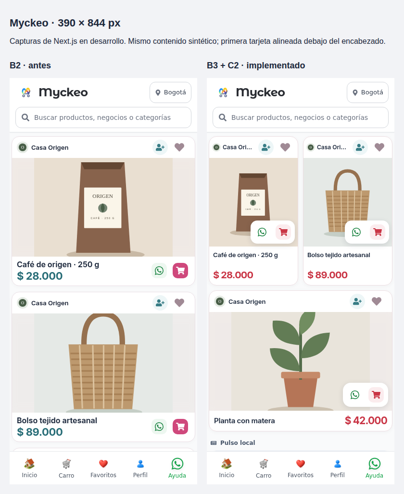

# Myckeo — Feed B3 + C2 implementado

Estado: `MYCKEO_MOBILE_FEED_B3_C2_IMPLEMENTED_READY_FOR_REVIEW`

B3 está aplicado a la variante productiva `feed` de `ProductCard`. C2 está aplicado a los bloques de productos del renderer real. Las capturas de esta entrega proceden de **Next.js en desarrollo**, con componentes productivos importados directamente, fuentes y `next/image` reales. No proceden de los prototipos de la fase anterior.

## Archivos productivos de esta iteración

| Archivo | Cambio |
| --- | --- |
| [ProductCard.tsx](../src/ui/components/productos/ProductCard.tsx) | Reutiliza el mismo JSX de acciones, con sus callbacks originales. En `feed` lo coloca en una cápsula fuera del enlace de imagen. Conserva las acciones en su ubicación original para `default` y `business_profile`. Añade identificadores DOM para verificar productos. |
| [feedProductCard.module.css](../src/ui/components/productos/feedProductCard.module.css) | Composición B3, cápsula blanca, precio rubí `#C93545`, título truncable, altura automática y adaptación por ancho de tarjeta. Los selectores pertenecen a la variante `feed`. |
| [FeedRederer.tsx](../src/publicaciones/componentes/FeedRederer.tsx) | Cambia exclusivamente la presentación de las secciones de productos existentes e incorpora identificadores de ítems y módulos. |
| [feedProductModules.module.css](../src/publicaciones/componentes/feedProductModules.module.css), nuevo | Layout C2 mediante container queries, dos columnas desde 382 px útiles, regla de impares y límites de lectura en pantallas amplias. |

Los cambios de fases anteriores en publicaciones, negocios, servicios y favoritos siguen presentes en el workspace, pero **no se modificaron en esta iteración**. El [manifiesto](mobile-feed-b3-c2/source-manifest.json) confirma tres archivos existentes modificados, uno nuevo y **616 archivos de `src/` intactos** respecto al inicio de esta tarea.

## B3 respecto a B2

- Fotografía de ancho completo y header compacto de 44 px. Conserva la estrategia de orientación de B2: vertical con `contain`, horizontal con `cover` y acercamiento controlado para la imagen cuadrada en tarjetas amplias.
- WhatsApp y carrito en una cápsula blanca inferior derecha, con sombra neutra ligera. Sus objetivos siguen siendo **44 × 44 px**; los iconos miden 18 px. La cápsula es hermana del enlace de foto, evitando controles interactivos anidados.
- Nombre y precio comparten fila en tarjetas amplias. El nombre usa elipsis cuando hace falta. El precio tiene prioridad, puede refluir y no queda oculto para sostener la fila. En tarjetas estrechas se usan hasta dos líneas de nombre y una fila propia de precio.
- Descripción oculta en el feed; ficha completa accesible desde imagen y título. «Desde», variante única, precio correspondiente, stock y agotado se conservan.
- Borde rosado suave, fondo blanco, precio y carrito rubí `#C93545`. Sin gradientes nuevos ni sombras saturadas.
- La cápsula puede pasar debajo de la foto si un embed excepcionalmente estrecho no permite alojarla; no se encogen los objetivos táctiles.

En 320–430 px, una tarjeta individual normal ahorra **18 px** respecto a B2, manteniendo la misma altura de fotografía. La mejora de densidad principal en 390/430 px viene de C2, no de reducir indiscriminadamente tipografía o controles.

## C2: composición y orden

Se redistribuyen en columnas únicamente los productos contiguos **dentro de cada sección visual que el renderer ya formaba**. No se fusionan bloques separados por publicaciones, negocios o servicios. No se modifica `cadenceSections`, su selección ni su cadencia.

El módulo mide su ancho disponible mediante `container: feed-products / inline-size`. Desde **382 px útiles** caben dos tarjetas de 186 px y una separación de 10 px. Esto coincide con un viewport de 390 px y los márgenes actuales. A 320/360 px se mantiene una columna; un contenedor estrecho sigue usando una columna aunque el viewport sea amplio. El zoom también reduce el ancho útil y activa el fallback.

Los bloques impares colocan el último producto en una fila completa, centrado y con ancho máximo de 480 px. Los módulos tienen un máximo de 960 px; las tarjetas individuales, 480 px. Así se evita extender una fotografía de altura limitada a todo el ancho de tablet/escritorio. Una sección de un solo producto no genera una fila vacía adicional. Las secciones sin productos no crean módulos.

Secuencia comprobada con el conjunto de ejemplo:

```text
P1 · P2 · P3 → Publicación → P4 · P5 → Negocio → P6 → Servicio
```

En dos columnas: P1/P2 forman el primer par, P3 ocupa la siguiente fila, y después aparece la publicación. Esta es la misma secuencia de B2. `itemsPorTab`, `filteredItems` y `cadenceSections` se contrastaron con la referencia inicial y permanecen idénticos. El bloque de hooks y handlers comerciales de `ProductCard` también es idéntico byte por byte.

## Capturas reales y comparación

| Ancho | Antes / después en Next.js |
| --- | --- |
| 320 | [Comparación](mobile-feed-b3-c2/screenshots/comparison-320.png) |
| 360 | [Comparación](mobile-feed-b3-c2/screenshots/comparison-360.png) |
| 390 | [Comparación](mobile-feed-b3-c2/screenshots/comparison-390.png) |
| 430 | [Comparación](mobile-feed-b3-c2/screenshots/comparison-430.png) |
| 768 | [Comparación](mobile-feed-b3-c2/screenshots/comparison-768.png) |
| 1024 | [Comparación](mobile-feed-b3-c2/screenshots/comparison-1024.png) |
| 1440 | [Comparación](mobile-feed-b3-c2/screenshots/comparison-1440.png) |



También se incluyen capturas `*-initial.png`, que conservan la llegada al feed, y `*-aligned.png`, con la primera tarjeta 8 px bajo el header. Las comparaciones alineadas permiten evaluar las tarjetas sin que el contexto previo cambie la lectura.

Ejemplos concretos: [B3 individual](mobile-feed-b3-c2/screenshots/b3-390-card.png), [nombre/precio largos en tarjeta estrecha](mobile-feed-b3-c2/screenshots/implemented-390-186-long.png), [variantes](mobile-feed-b3-c2/screenshots/implemented-390-186-variants.png), [imagen ausente](mobile-feed-b3-c2/screenshots/implemented-390-186-missing.png), [vertical](mobile-feed-b3-c2/screenshots/implemented-390-portrait.png), [horizontal](mobile-feed-b3-c2/screenshots/implemented-390-landscape.png), [después de paginar](mobile-feed-b3-c2/screenshots/live-pagination-after.png).

## Mediciones

Viewport de referencia: **844 px de alto**. En móvil/tablet hasta 768 px, header de 113 px y navegación inferior de 69 px: **662 px útiles**. En 1024/1440 px, header de 171 px y sin navegación inferior: **673 px útiles**. El consentimiento de cookies está aceptado; las herramientas de desarrollo de Next se ocultan, no la navegación de Myckeo.

| Viewport | B2, primera tarjeta (alto) | B3 individual (alto) | C2, primera tarjeta (ancho × alto) | Completos alineados B2 → actual | Primera publicación Y, B2 → actual |
| --- | ---: | ---: | ---: | ---: | ---: |
| 320 px | 273.6 px | 255.6 px | 312.0 × 255.6 px | 2 → 2 | 1176.7 → 1122.7 px |
| 360 px | 295.2 px | 277.2 px | 352.0 × 277.2 px | 2 → 2 | 1241.6 → 1187.6 px |
| 390 px | 311.4 px | 293.4 px | 186.0 × 310.0 px | 2 → 3 | 1290.2 → 945.4 px |
| 430 px | 320.0 px | 302.0 px | 206.0 × 316.0 px | 2 → 3 | 1316.0 → 960.0 px |
| 768 px | 304.9 px | 302.0 px | 371.0 × 287.4 px | 3 → 3 | 985.8 → 963.5 px |
| 1024 px | 436.6 px | 302.0 px | 475.0 × 302.0 px | 2 → 3 | 1202.2 → 931.0 px |
| 1440 px | 413.0 px | 302.0 px | 475.0 × 302.0 px | 3 → 3 | 730.0 → 931.0 px |

«Completos» exige que la tarjeta entera quede entre header y navegación. Un fragmento de imagen o header no cuenta como producto completo. En las cuadrículas dos tarjetas comparten altura: no se suman sus porcentajes de ocupación vertical.

| Viewport | Imagen B3 (alto) | B3 / viewport | B3 / espacio útil | Completos al llegar B2 → actual |
| --- | ---: | ---: | ---: | ---: |
| 320 px | 167.6 px | 30.3% | 38.6% | 1 → 1 |
| 360 px | 189.2 px | 32.8% | 41.9% | 1 → 1 |
| 390 px | 205.4 px | 34.8% | 44.3% | 1 → 2 |
| 430 px | 214.0 px | 35.8% | 45.6% | 1 → 2 |
| 768 px | 214.0 px | 35.8% | 45.6% | 2 → 2 |
| 1024 px | 214.0 px | 35.8% | 44.9% | 2 → 2 |
| 1440 px | 214.0 px | 35.8% | 44.9% | 3 → 2 |

A 390/430 px se pasa de **dos a tres productos completos** en la comparación alineada, y de **uno a dos al llegar**. La primera publicación aparece aproximadamente **345/356 px antes** en el documento, manteniendo su posición relativa entre los mismos productos.

En 1440 px, B2 tenía tres columnas en el primer bloque. C2 usa dos columnas y una fila para el impar: mantiene tres productos completos, pero la primera publicación queda unos **201 px más abajo**. Es un coste del layout aprobado, no un cambio de ranking o cadencia. La mejora no se presenta como uniforme en todos los anchos.

Las imágenes verticales conservan el área fuente con `contain`. Las horizontales pueden recortarse con `cover`, especialmente en el marco cuadrado estrecho. La cápsula ocupa aproximadamente el 13 % del marco de una tarjeta estrecha a 390 px, frente al 6 % en B3 individual. Área fuente retenida y área tapada por la cápsula son medidas distintas; no equivalen a reconocimiento del objeto por un usuario.

## Integridad funcional y pruebas

**13/13 pruebas Playwright aprobadas**, además de una captura de referencia B2 aprobada. [Resultados](mobile-feed-b3-c2/results.json), [mediciones actuales](mobile-feed-b3-c2/measurements.json), [referencia B2](mobile-feed-b3-c2/b2-measurements.json).

La suite comprueba:

- Los siete anchos solicitados, contenedor de 360 px dentro de viewport de 1440 px y zoom CSS al 200 % en 320/360/390/768/1024 px. Sin desplazamiento horizontal del documento, precios recortados o controles comerciales fuera de la tarjeta.
- Títulos y negocios largos, precios grandes, imagen ausente, fallback tras error real de carga diferida, orientaciones vertical y horizontal, stock agotado, todas las variantes agotadas, «Desde» y variante única.
- Cápsulas fuera del enlace de imagen; áreas comerciales, favorito y follow de al menos 44 px. Hit de puntero en los controles visibles y apertura de carrito mediante teclado.
- Carrito y cantidad con stores reales; selección de variante, stock y precio de variante, límite de cantidad; favoritos persistentes tras recargar; follow con el componente y transporte RSC reales y respuesta sintética.
- URL y apertura de WhatsApp, enlaces de ficha, publicación y modal originales; video con controles, `preload="metadata"` y sin autoplay.
- Igualdad del DOM y dimensiones de la tarjeta normal `default` y `business_profile` respecto a B2; dimensiones de publicaciones, negocios y servicios iguales en el feed comparado.
- Orden de ítems, ausencia de duplicados, módulos no vacíos e impares.

La paginación usa **FeedComponent real**, no un botón que sustituya su lógica: sus queries, observer, `fetchNextPage`, composición y deduplicación del cliente. Se entregan seis productos inicialmente y una segunda respuesta con tres nuevos y un duplicado. Quedan **nueve productos únicos**, con un solo P6 y una única solicitud del cursor siguiente.

La publicación usada como ancla mantuvo `y = 200,390625 px` antes y después de la respuesta; `scrollY = 745` en ambos momentos: **desplazamiento del ancla de 0 px**. La prueba retiene la segunda respuesta, coloca la publicación a la vista y luego la libera. Esto valida ese escenario controlado; no promete que cualquier conjunto de nuevos resultados pueda preservar toda posición bajo el algoritmo existente.

`pnpm typecheck`: aprobado. `pnpm lint`: aprobado con el warning previo de `_body` sin usar en `src/app/activar/ActivationBootstrap.test.tsx:347`. Lint focalizado de los componentes modificados y de los tests/config: sin warnings ni errores. Sintaxis Node de las herramientas locales y `git diff --check`: aprobados.

## Procedencia de la evidencia y reproducción

El [entorno de validación](../e2e/mobile-feed-implementation/README.md) instala una ruta de fixtures temporal y sirve la aplicación con Next.js 15.5.9 en desarrollo. Inyecta datos sintéticos, no implementaciones alternativas de los componentes. El proceso de prueba usa caché y tsconfig derivados aislados; no cambia `next.config.ts` ni `tsconfig.json` del repositorio ni utiliza el `.next` del servidor existente.

Las respuestas de sesión, follow y páginas de datos se interceptan en Playwright antes de alcanzar el servidor. Se conserva el transporte RSC real; el adaptador entiende `$undefined` para distinguir la primera página del cursor siguiente. Las solicitudes externas, incluida la primera navegación de la ventana de WhatsApp, se bloquean. `DATABASE_URL` apunta a un puerto local sin servicio como protección adicional. No hubo escrituras remotas.

Para comparar B2 se usan los tres archivos congelados al inicio de esta tarea, también bajo Next. El capturador los instala temporalmente y restituye automáticamente los archivos B3/C2 actuales al salir. Las capturas de la implementación final se ejecutaron después de esa restitución.

```bash
node e2e/mobile-feed-implementation/prepare.cjs
pnpm exec playwright test --config=e2e/mobile-feed-implementation/playwright.config.ts
node e2e/mobile-feed-implementation/comparisons.cjs
node e2e/mobile-feed-implementation/prepare.cjs --clean
pnpm typecheck
pnpm lint
```

La ruta, assets y tipos generados temporales ya se retiraron al finalizar. Se conservan las herramientas de reproducción en `e2e/mobile-feed-implementation/`, y evidencias y hashes en `docs/mobile-feed-b3-c2/`.

## Limitaciones pendientes

- La evidencia visual usa SVG y video sintéticos. Falta comprobar una muestra variada de fotografías reales; la cápsula y el recorte pueden ocultar detalles relevantes de ciertos productos.
- La validación fue en Chromium. El zoom es una simulación CSS; no sustituye pinch zoom ni pruebas físicas en iOS/Android. Al aumentar el zoom, header y navegación ocupan más espacio útil.
- No se valida persistencia de follow en backend, autenticación real, entrega de mensajes a WhatsApp, optimización de imágenes remotas/Cloudinary ni ranking con datos productivos. Sus implementaciones permanecen intactas.
- La estabilidad del scroll se midió en el escenario descrito. El ranking, deduplicación y paginación existentes no se modificaron para fijar artificialmente el orden al recibir datos.
- En escritorio amplio se acepta el coste visual descrito para dos columnas frente a las tres de B2; no se oculta esa diferencia en las cifras.

No se modificaron Server Actions, Prisma, Cloudinary, autenticación, ranking, políticas de visibilidad, stores compartidos, CI ni infraestructura. No se hicieron commits, pushes ni despliegues.
