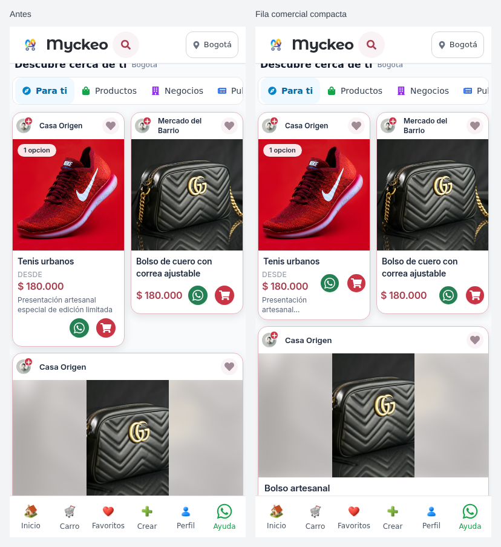
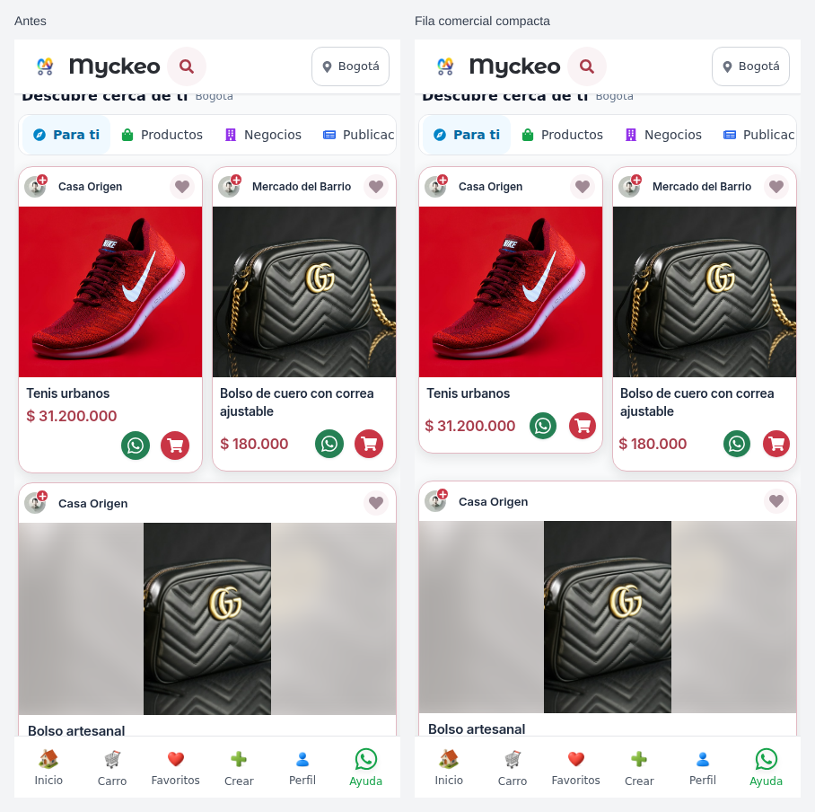

# Myckeo — Fila comercial móvil compacta

**Estado: `MYCKEO_MOBILE_FEED_COMMERCE_ROW_COMPACT_READY`**

Fecha: 16 de noviembre de 2026, Colombia.

Se ajustó únicamente el CSS del footer del producto móvil. Precio a la izquierda y WhatsApp/carrito a la derecha comparten fila cuando caben; el precio completo pasa a una fila anterior cuando el ancho resulta insuficiente. No se superponen áreas táctiles ni se reduce la tipografía del precio.

## Causa medida antes de modificar CSS

La tarjeta C2 real mide **186 px a 390 px de viewport**. Descontando los dos bordes de 1 px y 8 px de padding a cada lado, la fila tenía **168 px**. Los controles ocupan **88 px**, de modo que quedaban **80 px para el precio**.

`$180.000` mide 76,44 px a 16 px y ya cabía en la referencia. `$8.000.000` mide 94,78 px y no cabía en ese espacio. No era correcto convertir todos los saltos en un problema de tamaño del icono: reducir el círculo visible no reduce los objetivos táctiles de 44 px.

Había una segunda causa: `.priceBlock` usa `flex-basis: max-content`. Una etiqueta larga de variante determinaba el ancho intrínseco de todo el bloque, haciendo saltar las acciones incluso con un importe pequeño. El caso reproducido de `$180.000` con etiqueta larga tenía un footer de **118 px** en C2 a 390 px.

[Diagnóstico original: seis importes en C2 real](mobile-feed-commerce-row-compact/diagnosis.json).

## Solución aplicada

- Se reutiliza el padding derecho para alojar la parte transparente de los controles, manteniéndolos **dentro de la tarjeta**. Su círculo visible continúa separado del borde.
- En tarjeta estrecha, el precio usa un margen interior de **6 px**; el título conserva su padding anterior. No se modifican tipografía, peso ni color de precio o producto.
- Ambos controles mantienen **44 × 44 px**, agrupados en **88 px**, con círculos iguales de **30 × 30 px** e iconos de **18 × 18 px**. Entre los círculos quedan 14 px visibles; las cajas táctiles son contiguas y no se superponen.
- El importe conserva una sola línea. Flexbox lleva el grupo completo de acciones a otra fila cuando el importe y los 88 px no caben juntos. Esa fila queda alineada a la derecha y sin gap vertical adicional.
- La etiqueta secundaria de variante deja de determinar el ancho intrínseco del precio mediante `contain: inline-size`; su vista previa admite hasta dos líneas con elipsis. El texto completo permanece en el DOM y accesible. No se modifica selección, stock ni lógica de variantes.
- Las acciones se alinean al inicio de su fila para mantenerse junto al precio cuando hay metadatos de variante debajo.

| C2 | Tarjeta | Fila anterior | Fila final | Objetivos | Espacio anterior para precio | Espacio final |
| --- | --- | --- | --- | --- | --- | --- |
| Viewport 390 px | 186 px | 168 px | **178 px** | 88 px | 80 px | **90 px** |
| Viewport 430 px | 206 px | 188 px | **198 px** | 88 px | 100 px | **110 px** |

El precio C2 continúa en **16 px** y el B3 en **18 px**, con peso 600 y color `#A83C4B`. Los círculos conservan verde `#258054` y Ruby `#C93545`; se mantienen los grises y el estado deshabilitado para agotados.

## Precios completos y límite físico

Los seis importes se comprobaron uno por uno en la primera tarjeta C2 real a 390 y 430 px. El texto coincide con el formato monetario original de la aplicación, incluida su separación monetaria. No se recorta ni parte ningún importe.

| Importe | Ancho del texto a 16 px | C2 a 390 px | C2 a 430 px |
| --- | --- | --- | --- |
| $8.000 | 59,55 px | Una fila | Una fila |
| $45.000 | 69,55 px | Una fila | Una fila |
| $180.000 | 76,44 px | Una fila | Una fila |
| $8.000.000 | 94,78 px | Dos filas | Una fila |
| $31.200.000 | 101,53 px | Dos filas | Una fila |
| $123.456.789 | 108,45 px | Dos filas | Una fila |

A 390 px, `$31.200.000` más ambos objetivos requiere 189,53 px y `$123.456.789` requiere 196,45 px, superando incluso los **184 px interiores** de la tarjeta sin padding. `$8.000.000` requeriría 182,78 px: dejaría solo 1,22 px para todos los márgenes. Se conserva el margen legible de 6 px y se usa la segunda fila controlada. No se fuerza la fila invadiendo el precio o la otra acción.

Footer normal: **44 px**. Importe largo sin metadatos que no cabe: **66 px**, compuesto por 22 px de precio y 44 px de acciones. «Desde» y metadatos pueden necesitar más altura; se conservan completos los importes y la estructura comercial correcta.

[Seis importes a 390](mobile-feed-commerce-row-compact/prices-390.json) · [Seis importes a 430](mobile-feed-commerce-row-compact/prices-430.json).

## Capturas antes/después

**390 px: precio normal con etiqueta larga de variante**, el caso donde el ancho de la etiqueta forzaba un salto innecesario.



**430 px: precio de $31.200.000**, que pasa de dos filas a una.



Mismo contenido, sesión, fotografías, viewport y scroll de 100 px en cada par. Se capturó el componente productivo de Next.js con el CSS anterior y el final. La fuente final se restauró y se comprobó que coincide exactamente con la versión validada. No se sustituyeron componentes ni se redimensionaron tarjetas para aparentar igual altura.

[Tarjeta aislada 390](mobile-feed-commerce-row-compact/screenshots/comparison-card-390.png) · [Tarjeta aislada 430](mobile-feed-commerce-row-compact/screenshots/comparison-card-430.png) · [Galería de precios, variantes y capturas](mobile-feed-commerce-row-compact/comparison.html).

## Alturas y densidad

| Caso | Viewport | Footer anterior → final | Tarjeta anterior → final |
| --- | --- | --- | --- |
| Normal $45.000 | 390 | 44 → **44 px** | 314 → **314 px** |
| Normal $180.000, título de dos líneas | 390 | 44 → **44 px** | 334 → **334 px** |
| C2, $180.000, variante con etiqueta larga, comparación principal | 390 | 118 → **74 px** | 388 → **344 px** |
| C2, Desde $8.000.000 | 390 | 82 → **82 px** | 352 → **352 px** |
| C2, $31.200.000 | 430 | 66 → **44 px** | 342 → **320 px** |
| C2, $123.456.789 | 430 | 66 → **44 px** | 342 → **320 px** |
| B3, variante agotada con etiqueta larga | 390 | 102 → **74 px** | 393,39 → **365,39 px** |

Se midieron tarjetas completas dentro del área visible, entre las barras fijas, con viewport de 844 px de alto en móvil y 900 px en escritorio, a scroll de 100 px:

| Ancho | Productos completos antes → después |
| --- | --- |
| 320 | 2 → **2** |
| 360 | 1 → **1** |
| 390 | 2 → **2** |
| 430 | 2 → **2** |
| 768 | 2 → **2** |
| 769 | 2 → **2** |
| 1024 | 2 → **2** |

También se alineó el mismo producto `p4` a 16 px bajo el header a 390 y 430 px: el recuento permaneció en **2 → 2** en ambos casos. La reducción de los footers libera espacio y reduce alturas concretas, pero **no añade un producto completo a estas ventanas medidas**. No se modificaron las fotografías, la cuadrícula ni la composición del feed para aumentar artificialmente ese número.

[Densidad 390](mobile-feed-commerce-row-compact/screenshots/density-390.png) · [Densidad 430](mobile-feed-commerce-row-compact/screenshots/density-430.png) · [Todas las alturas y medidas](mobile-feed-commerce-row-compact/summary.json).

## Archivo productivo modificado y alcance

**Único archivo:** [`feedProductCard.module.css`](../src/ui/components/productos/feedProductCard.module.css).

Se añadió un bloque comercial al final, limitado a `max-width: 768px`. Todo el contenido anterior del CSS permanece idéntico, incluidos header, avatar/distintivo, Favorito, imagen, bordes y sombras de tarjeta.

Se compararon **677 archivos de `src` y `prisma`**: solo cambió ese CSS, sin altas ni eliminaciones. Todos los TSX y Prisma conservan sus bytes del inicio de la tarea. Se preservaron los cambios de trabajo que ya existían; no se modificaron handlers, stores, carrito, WhatsApp, variantes, ranking, paginación, APIs, Cloudinary, CI o infraestructura.

[Diff exacto](mobile-feed-commerce-row-compact/production-change.diff) · [Integridad de fuentes](mobile-feed-commerce-row-compact/source-integrity.json).

Pruebas y composición de evidencias añadidas en `e2e/mobile-feed-commerce-row-compact/`; informe, fuentes históricas y capturas en este documento y `docs/mobile-feed-commerce-row-compact/`.

## Verificación

**13 pruebas funcionales y responsive finales pasan:** siete de geometría, dos matrices de precios y cuatro de interacción/reflujo. Además pasaron cuatro capturas comparativas finales y dos comprobaciones adicionales de hit testing de escritorio. Las ejecuciones finales guardadas no tienen retries ni flaky.

- **320, 360, 390, 430 y 768 px:** precio completo, C2 16 px/B3 18 px, controles de 44 × 44 px, círculos de 30 px, misma geometría de header/fotografía y ausencia de scroll horizontal.
- Hittest en cinco puntos interiores de controles y enlaces visibles; sin controles anidados ni cruces entre objetivos de la misma tarjeta o de tarjetas diferentes. Las acciones permanecen dentro del borde de la tarjeta. El precio no invade sus objetivos.
- Seis importes comprobados individualmente en C2 real, incluidas las excepciones de dos filas a 390 px y una sola fila para los seis a 430 px.
- Variante de etiqueta corta y larga en C2 con precio normal: no fuerza una segunda fila de acciones; el texto completo permanece accesible y su vista previa tiene dos líneas como máximo.
- WhatsApp conserva URL y apertura; no se enviaron mensajes.
- Carrito mediante Enter: cantidad 2. Variantes: opción sin stock deshabilitada, selección disponible y límite de stock 3. Productos agotados deshabilitados.
- **200 %:** reflujo equivalente a ventanas físicas de 390 y 768 px, con viewport CSS de 195 y 384 px y densidad 2×. Importe completo en una línea propia cuando hace falta, objetivos de 44 px CSS, sin solapamientos ni desbordamiento horizontal. Es emulación de reflujo y densidad; no se cambió el zoom CSS de la aplicación.
- `pnpm typecheck`: pasa.
- Lint focalizado de los archivos TS de validación: pasa sin avisos ni errores.
- `git diff --check`: pasa.

[Geometría: 7/7](mobile-feed-commerce-row-compact/final-layout-results.json) · [Precios: 2/2](mobile-feed-commerce-row-compact/final-prices-results.json) · [Interacción y reflujo: 4/4](mobile-feed-commerce-row-compact/final-behavior-results.json) · [Escritorio/hit testing: 2/2](mobile-feed-commerce-row-compact/final-desktop-hit-results.json) · [Capturas finales: 4/4](mobile-feed-commerce-row-compact/after-comparison-results.json).

[Interacciones y agotados](mobile-feed-commerce-row-compact/interactions.json) · [Etiquetas de variante](mobile-feed-commerce-row-compact/variant-labels.json) · [Reflujo 200 % a 390](mobile-feed-commerce-row-compact/after-zoom-390.json) · [Reflujo 200 % a 768](mobile-feed-commerce-row-compact/after-zoom-768.json).

Se usó la ruta `/` del servidor Next.js local en `http://127.0.0.1:3000/`, con fixtures, sesiones y respuestas de acciones sintéticas en el navegador. Se ejecutaron componentes y callbacks reales; no hubo escrituras productivas ni verificación de persistencia real del backend.

## Escritorio intacto

| Viewport | Diferencia de píxeles antes/después |
| --- | --- |
| 769 px | **0** |
| 1024 px | **0** |

Las capturas originales se conservan como `screenshots/before-769.png`, `after-769.png`, `before-1024.png` y `after-1024.png`. No se cambió la presentación de escritorio.

Reproducción del ajuste con el servidor local activo:

```bash
pnpm exec playwright test --config=e2e/mobile-feed-commerce-row-compact/playwright.config.ts layout.spec.ts prices.spec.ts interactions.spec.ts zoom.spec.ts
node e2e/mobile-feed-commerce-row-compact/evidence.cjs
pnpm typecheck
```

Los archivos `before-*`, `diagnosis.json` y las capturas históricas no deben sobrescribirse al comprobar el ajuste final. Los casos de captura histórica solo se ejecutan al activar explícitamente su variable de entorno de prueba.

**Sin commits, pushes ni despliegues.**
