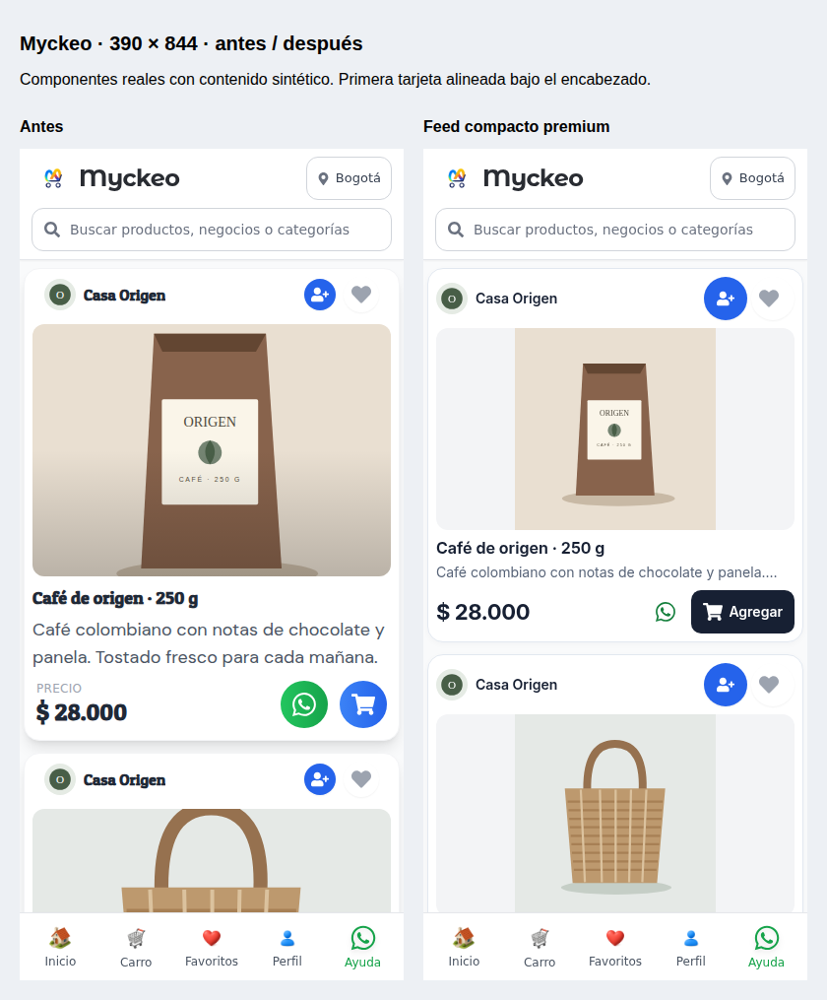
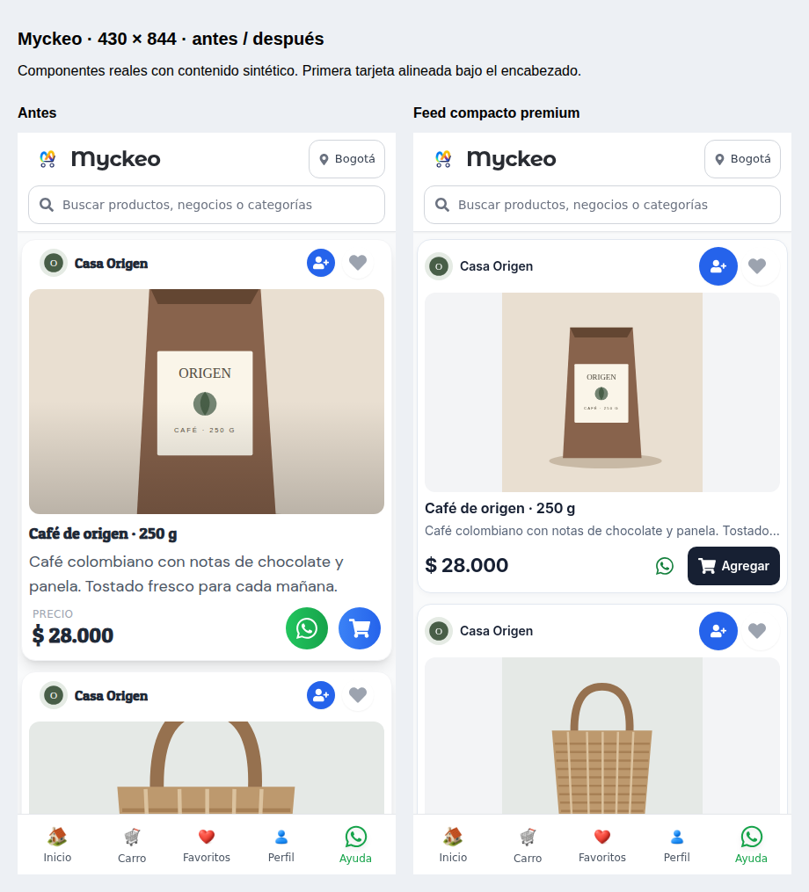

# Myckeo — Feed móvil compacto premium

Estado: `MYCKEO_MOBILE_FEED_COMPACT_READY_FOR_REVIEW`

Se implementó B como presentación principal del feed. Los productos móviles conservan una columna; no se incorporó C. El trabajo conserva la cadencia, consultas, ranking, score, deduplicación, paginación y políticas de visibilidad. No hubo escrituras productivas, commits, pushes ni despliegues.

## Cambios y alcance

| Archivo | Cambio |
|---|---|
| [`ProductCard.tsx`](../src/ui/components/productos/ProductCard.tsx) | Nueva variante explícita `feed`: altura automática, foto adaptable, título de dos líneas, descripción opcional de una, precio destacado y acciones que pueden envolver. Se conservan los handlers originales. |
| [`feedProductCard.module.css`](../src/ui/components/productos/feedProductCard.module.css) | Estilos aislados de producto y alcance visual del modal de compra del feed. Controles principales de 44 px o mayores; el precio puede desplazar los botones a otra fila. |
| [`AddFavorites.tsx`](../src/ui/components/productos/AddFavorites.tsx) | Prop de presentación opcional `accessibleLabel` y `aria-pressed` cuando se solicita. La lógica de favoritos y su persistencia no cambian. Los demás consumidores conservan sus atributos y estilos anteriores. |
| [`FeedRederer.tsx`](../src/publicaciones/componentes/FeedRederer.tsx) | Activa `variant="feed"`, sustituye párrafos editoriales por contexto breve y compacta las pestañas sin eliminar filtros ni destinos. No altera cómo se forman las cadencias. |
| [`DiscoveryPulseModule.tsx`](../src/feed/componentes/DiscoveryPulseModule.tsx) | Retira el contenedor ornamental y la explicación repetida. Conserva la identificación del tipo y sus hijos. La ciudad sigue en el contexto superior. |
| [`DiscoveryPublicationCard.tsx`](../src/feed/componentes/DiscoveryPublicationCard.tsx) | Tipografía/header/resumen compactos, título de dos líneas y botón de 44 px. Mantiene proporciones multimedia, autor, reseñas, estrellas, conteos, pósteres y modal. |
| [`DiscoveryBusinessCard.tsx`](../src/feed/componentes/DiscoveryBusinessCard.tsx) | Resumen de dos líneas, portada 16:9 y contactos secundarios de 44 px con icono, nombre accesible y destino original. Mantiene avatar, nombre, ciudad/departamento, follow y perfil. |
| [`DiscoveryServiceCard.tsx`](../src/feed/componentes/DiscoveryServiceCard.tsx) | Miniatura lateral, título/resumen breves y precio en la fila comercial. Conserva enlaces originales de perfil y WhatsApp; el video se identifica como “Video en el perfil”, sin un play ficticio. |
| [`discoveryCards.module.css`](../src/feed/componentes/discoveryCards.module.css) | Estilos comunes únicamente para las tarjetas dedicadas al feed. Ajuste de etiquetas y precios para anchos pequeños y zoom. |

También se añadieron el [entorno de pruebas](../e2e/mobile-feed/README.md), fixtures locales, manifiestos y evidencia en [mobile-feed-compact](mobile-feed-compact/). No se modificaron componentes de publicaciones del perfil ni el layout, header o navegación globales.

## Diseño implementado

El producto usa imagen 16:9 con `contain`, fondo neutro y altura máxima de 280 px para que el objeto completo siga visible. El título usa 16 px, el resumen 14 px y el precio 22 px, con Inter como fuente de interfaz de esta variante. La altura crece si lo necesitan el precio, una variante o las acciones; no se impone un techo a la tarjeta.

Follow, favoritos, WhatsApp y carrito permanecen accesibles. El carrito sigue abriendo la selección de cantidad/variantes en el feed; no se convirtió en agregado directo. Sus botones de presentación indican Agregar, Elegir, Opciones o Agotado según los estados ya existentes.

La publicación mantiene sus relaciones de aspecto verticales y su lógica de póster. El nuevo estilo solo compacta el contexto y el resumen; sin medios permite hasta cuatro líneas. Los conteos de likes/comentarios siguen siendo información y el modal conserva las acciones reales. No se añadió autoplay.

El modal de compra compartido no cambió. Un contenedor de estilos exclusivo del feed permite desplazarlo en pantallas bajas y mantiene sus botones alcanzables. La lógica de stock, variantes y cantidades permanece en los componentes y hooks originales.

## Comparación medida

Las medidas provienen del DOM de los componentes reales compilados en un entorno aislado, con el mismo contenido sintético, fuentes locales y Chromium. El “antes” se reconstruye desde la revisión `1f491ff8ce6f80e333f07548e299141fc863d993`, sin cambiar el checkout. No son medidas de una sesión de producción ni resultados de pruebas de usuarios.

Baseline con viewport de **844 px de alto**, escala 1, locale es-CO y fuentes cargadas. Se cuentan intersecciones de tarjetas en todas las columnas; una tarjeta parcial no equivale necesariamente a un producto reconocible.

| Ancho | Producto: antes → después | Imagen: antes → después | Inicio primera tarjeta: antes → después | Área útil, sin cambios | Al entrar: antes → después |
|---|---|---|---|---:|---|
| 320 | 480 → 341 | 256 → 165,4 | 622 → 292 | 662 | 0 completas + 1 parciales → 1 completas + 1 parciales |
| 360 | 480 → 363,5 | 256 → 187,9 | 602 → 292 | 662 | 0 completas + 1 parciales → 1 completas + 1 parciales |
| 390 | 480 → 380,3 | 256 → 204,8 | 578 → 292 | 662 | 0 completas + 1 parciales → 1 completas + 1 parciales |
| 430 | 480 → 402,8 | 256 → 227,3 | 578 → 292 | 662 | 0 completas + 1 parciales → 1 completas + 1 parciales |
| 767 | 480 → 455,6 | 256 → 280 | 482 → 300 | 662 | 0 completas + 1 parciales → 1 completas + 1 parciales |
| 768 | 480 → 373,6 | 256 → 198 | 506 → 324 | 662 | 0 completas + 2 parciales → 2 completas + 1 parciales |
| 769 | 480 → 373,9 | 256 → 198,3 | 459 → 277 | 673 | 0 completas + 2 parciales → 2 completas + 1 parciales |
| 1024 | 480 → 436,6 | 256 → 261 | 471 → 277 | 673 | 0 completas + 2 parciales → 2 completas + 1 parciales |
| 1440 | 480 → 413 | 256 → 237,4 | 427 → 277 | 673 | 0 completas + 3 parciales → 3 completas + 2 parciales |

A **390 px**, el producto pasa de **480 a 380,3 px** (20,8 % menos), y ocupa 57,4 % de los 662 px útiles, frente al 72,5 % anterior. La imagen pasa de 256 a 204,8 px y el encabezado de negocio crece de 36 a 44 px para mejorar las áreas táctiles. El ahorro combina foto, texto y espaciado; no se reduce todo por igual.

La primera tarjeta comienza en **292 px frente a 578 px**, 286 px antes. Ahora cabe completa al entrar a 390 × 844, con el comienzo del siguiente producto. Con la primera tarjeta alineada bajo el mismo header, se ven **261,7 px del segundo producto frente a 162 px**. Sigue siendo una tarjeta completa y una parcial; no se promete que quepan dos productos completos.

A 390 px, la publicación horizontal mide **443,5 px** frente a 473,3; negocio **382,5 px** frente a 478,3; servicio **216 px** frente a 473,5. La primera publicación empieza a 1497 px frente a 2231,5, conservando los tres productos anteriores. Esa reducción procede de alturas y del contexto editorial retirado.

El header sigue midiendo 113 px y la barra inferior 69 px en móvil sin sesión. En 769/1024/1440 el header de descubrimiento mide 171 px y no hay barra inferior fija; quedan 673 px útiles. En 320 × 568 no se garantiza una tarjeta completa al entrar: la pantalla baja conserva su necesidad de scroll, aunque ya permite llegar antes al contenido.

Las dos variantes se comparan con el mismo header y navegación global. **No se atribuyen al producto ahorros obtenidos al retirar navegación**: no se ha retirado. La simplificación de la llegada y el ahorro de altura de cada tarjeta se presentan por separado.





Capturas a 390 px: [antes al entrar](mobile-feed-compact/screenshots/before-390-initial.png), [después al entrar](mobile-feed-compact/screenshots/after-390-initial.png), [antes completo](mobile-feed-compact/screenshots/before-390-full.png) y [después completo](mobile-feed-compact/screenshots/after-390-full.png). Casos exigentes: [tarjetas a 320 px](mobile-feed-compact/screenshots/after-320-cases.png), [pantalla baja](mobile-feed-compact/screenshots/after-320-low.png) y [reflow al 200 %](mobile-feed-compact/screenshots/after-full-feed-zoom-200.png).

El orden observado sigue siendo tres productos, publicación, negocio y servicio en el fixture de portada. Mostrar una publicación antes puede evaluarse después, junto con módulos C específicos; no se ha cambiado en esta implementación.

## Funcionalidades conservadas

- Acceso a ficha por foto y título, perfil del negocio y destinos de WhatsApp/mapa.
- Precio normal/desde, variantes activas, variante única, cantidades, límites de stock, agotado y agregado al carrito mediante el modal existente.
- Favoritos con persistencia local; follow autenticado y petición de login sin sesión.
- Publicaciones, fotos, video bajo acción explícita, reseñas/calificación, likes y comentarios en su modal.
- Pestañas, filtros, categorías y ciudad. Los clusters y puntos de corte existentes permanecen: en 768 px puede haber dos columnas, como antes; no se introdujo la cuadrícula C para móviles.
- Aspecto de producto `default` y `business_profile`, comprobado contra su geometría anterior.

No se tocaron Server Actions, Prisma, Cloudinary, autenticación, stores, `FollowButton`, algoritmos ni lógica de variantes. La pequeña modificación de `AddFavorites` se limita a semántica accesible opcional; su handler no se modificó.

## Validación

- **26/26 pruebas Playwright aprobadas**, sin fallos ni flaky tests en la ejecución final. Incluyen 320, 360, 390, 430, 767, 768, 769, 1024 y 1440 px; 320 × 568; zoom/reflow al 200 %; estados comerciales; multimedia y modales reales.
- **17/17 pruebas Jest existentes** de feed global y por categoría aprobadas, con Prisma simulado. No se ejecutaron consultas reales.
- `pnpm typecheck`: correcto.
- `pnpm lint`: correcto; persiste el aviso previo de variable `_body` no usada en `src/app/activar/ActivationBootstrap.test.tsx:347`, fuera del alcance.
- `git diff --check`: correcto. Los hashes del bundle final corresponden a los componentes actuales; el diff productivo se limita a presentación.
- **32 capturas PNG y 27 registros de geometría**, incluyendo pares antes/después. No hubo overflow horizontal accidental ni controles principales fuera de su tarjeta en los escenarios del feed nuevo. Los clamps de título/resumen son intencionales.

Comandos ejecutados:

```bash
node e2e/mobile-feed/build.cjs --before
node e2e/mobile-feed/build.cjs
pnpm exec playwright test --config=e2e/mobile-feed/playwright.config.ts
pnpm exec jest src/feed/actions/getFeedData.test.ts src/feed/actions/getFeedDataByCategory.test.ts --runInBand --coverage=false
pnpm typecheck
pnpm lint
git diff --check
```

Evidencia: [resultado de Playwright](mobile-feed-compact/results.json), [mediciones](mobile-feed-compact/measurements.json), [manifiesto antes](mobile-feed-compact/before/source-manifest.json) y [manifiesto después](mobile-feed-compact/after/source-manifest.json). El procedimiento reproducible está en [e2e/mobile-feed/README.md](../e2e/mobile-feed/README.md).

La revisión con `react-best-practices` comprobó que no se introdujeron consultas, efectos, paquetes, dependencias de hover ni componentes definidos dentro de nuevos renders. Los estilos de productos compartidos se activan únicamente por variante; los estados y handlers comerciales se reutilizan. No se añadieron llamadas de red desde componentes productivos.

## Límites y riesgos pendientes

- El navegador ejecuta componentes reales y stores reales, con sesión y respuestas de acciones simuladas; no verifica una compra, login o escritura de interacción contra servicios reales. El modal real de publicación y sus carruseles sí se ejercitan. Las consultas de comentarios se interceptan localmente.
- El video WebM es sintético y silencioso: se comprueba carga, reproducción explícita, controles, `preload="metadata"` y ausencia de autoplay. No certifica todos los códecs ni URLs reales de Cloudinary.
- El adaptador de `next/image` permite medir layout y fallbacks, pero no la optimización, `srcset`, lazy loading o precarga de Next. Faltan observaciones de red, CLS y scroll en dispositivos reales; no se afirma una mejora de FPS ni de conversión.
- Zoom al 200 % se emula con CSS: feed a 640 px físicos con unos 320 px efectivos y tarjetas a 320/640 px físicos. Falta validar el zoom de navegador, teclado y áreas seguras de Safari/iOS/Android reales. La navegación global y el consentimiento permanecen fuera de este cambio; conservan las limitaciones descritas en la auditoría.
- Los títulos/resúmenes truncados intencionalmente tienen su contenido completo en ficha/modal. El nombre largo del negocio puede truncarse en el header del producto; el precio y las acciones crecen o pasan a otra fila.
- La orientación de publicaciones sigue deduciéndose tras cargar el recurso y los presets existentes de Cloudinary pueden recortarlo antes de llegar al cliente. No se alteró esa lógica ni la configuración de medios.
- Se mantuvo el comportamiento existente de conteos, caché, impresión/vistos y cadencia. Cualquier sincronización adicional de resúmenes tras interactuar en un modal debe tratarse aparte, sin incorporarla como cambio visual.

`MYCKEO_MOBILE_FEED_COMPACT_READY_FOR_REVIEW`
