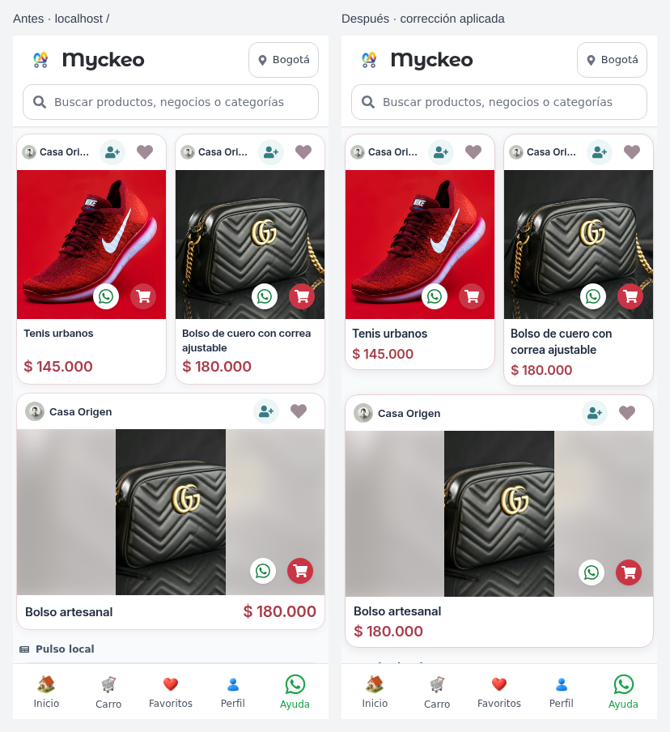
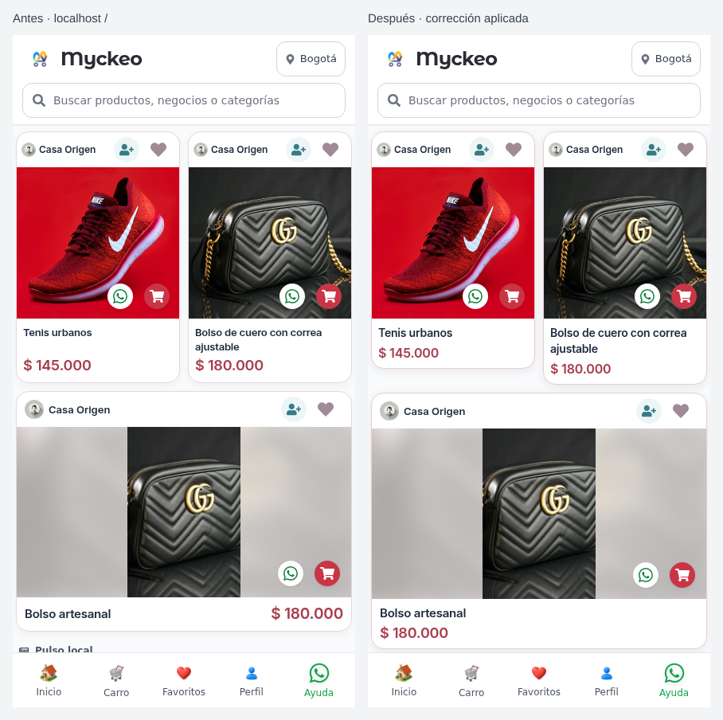

# Myckeo — Corrección visual definitiva del feed móvil

**Estado: `MYCKEO_MOBILE_FEED_FINAL_VISUAL_CORRECTION_READY`**

Fecha: 15 de noviembre de 2026, Colombia.

## Implementación aplicada

Se corrigió directamente la presentación productiva del feed móvil: precio de **16 px en C2 y 18 px en B3**, nombre y precio apilados con **4 px de separación**, altura natural y una superficie blanca con borde rosado y sombra más perceptibles. Se mantienen B3 + C2, las fotografías y los botones A.

**Único archivo productivo modificado en esta iteración:** [`src/ui/components/productos/feedProductCard.module.css`](../src/ui/components/productos/feedProductCard.module.css). No fue necesario modificar `ProductCard.tsx`.

El [diff de esta corrección](mobile-feed-final-correction/production-change.diff) parte del [CSS aprobado anterior](mobile-feed-final-correction/before.css.txt), cuyo SHA-256 coincide con el entregado en el pulido previo. El árbol conserva los cambios anteriores; `git diff HEAD` incluye esas iteraciones. La [comprobación de fuentes](mobile-feed-final-correction/source-integrity.json) confirma un único CSS modificado y otros **619 archivos de `src` idénticos**, sin altas ni bajas. Las reglas base de escritorio también son idénticas.

## Verificación del localhost que estaba activo

- Proceso existente: `next-server (v15.5.9)`, PID **566567**, lanzado por `next dev`, puerto **3000**.
- Directorio de ambos procesos: **`/home/nico/red-social`**.
- Playwright visitó **`http://127.0.0.1:3000/`**, el mismo servidor que `localhost:3000`, usando la página principal y su `FeedComponent`, `FeedRenderer`, `ProductCard`, proveedores y navegación productivos.
- No se instalaron páginas de revisión, rewrites ni componentes alternativos. No se arrancó otro servidor, se reinició ningún proceso ni se borraron cachés.
- Antes de editar, el navegador confirmó el CSS del pulido anterior: precio de 18 px en C2 estrecho y 19 px en columnas anchas a 768 px, borde `rgb(230, 215, 220)` y sombra al 5 %. **La versión anterior sí estaba cargando.**
- La hoja proviene de `/_next/static/css/app/(catalogo)/page.css?v=…`. Después de editar, se comprobaron los estilos ganadores antes de tomar las capturas finales: 16/18 px, borde `rgb(232, 205, 211)` y sombra al 9 %. Las reglas nuevas no quedan sobrescritas.

[Identidad del servidor](mobile-feed-final-correction/server.json) · [DOM y CSS antes, 390 px](mobile-feed-final-correction/before-390.json) · [DOM y CSS después, 390 px](mobile-feed-final-correction/after-390.json).

Se utilizaron ocho productos sintéticos, incluidos precios de `$ 145.000` y `$ 180.000`, y fotografías realistas de prueba [documentadas aquí](mobile-feed-final-correction/assets/SOURCES.md). Las respuestas de datos, imágenes de prueba y acciones se interceptaron solo en el contexto Playwright. No se alteraron los datos del usuario ni el contenido que ve su navegador habitual.

## Valores anteriores y nuevos

| Propiedad móvil | Antes | Ahora |
| --- | --- | --- |
| Precio C2 | 18 px; 19 px con tarjetas anchas a 768 px | **16 px**, determinado por el contenedor C2 real |
| Precio B3 / elemento impar que ocupa toda la fila | 19 px | **18 px** |
| Peso / color del precio | 600 / `#A83C4B` | Conservados |
| Altura de línea del precio | 26 px | **22 px** |
| Tracking / sombra de texto | −0,01 em / ninguna | Conservados; `text-shadow: none` explícito |
| Nombre C2 estrecho | 13 px / 18 px de línea | **14 px / 20 px de línea**, peso 600 |
| Nombre en tarjetas amplias | 15 px / 22 px de línea, una línea | **15 px / 20 px de línea**, hasta dos líneas |
| Reserva de altura del título C2 estrecho | `min-height: 36px` | **Eliminada** |
| Bloque comercial | Fila o columna según reglas superpuestas; gap 2 px | **Columna, `justify-content: flex-start`, gap 4 px** |
| Padding comercial | 8 px en tarjetas estrechas; 8 px verticales y 10 px laterales en amplias | Conservado |
| Borde | `1px solid #E6D7DC` | **`1px solid #E8CDD3`** |
| Sombra | `0 3px 10px #392E330D` | **`0 3px 12px rgba(44, 47, 51, 0.09)`** |
| Fondo / radio | Blanco / 16 px | Conservados |

Se eliminó la regla posterior que devolvía el bloque comercial a una fila. El título conserva hasta dos líneas mediante el truncado previsto, sin reservar una segunda línea cuando no se necesita. El precio aparece inmediatamente debajo, o debajo del indicador «Desde» cuando corresponde. No se añadieron alturas fijas, crecimiento flex vertical, márgenes automáticos ni distribución `space-between` al bloque comercial.

La selección de 16 px usa el mismo contenedor nombrado y umbral de **382 px útiles** que el módulo C2. Excluye el último elemento impar que ocupa toda la fila y los módulos individuales. Por ello C2 mantiene 16 px también cuando sus columnas miden 371 px a un viewport de 768 px; B3 conserva 18 px. No depende únicamente de que la tarjeta mida menos de 250 px.

## Estilos calculados reales

Valores obtenidos de `getComputedStyle`, no deducidos de las clases:

| Propiedad | C2 de 186 px, viewport 390 | B3 de 382 px, viewport 390 |
| --- | --- | --- |
| Precio | `16px`, peso `600`, línea `22px` | `18px`, peso `600`, línea `22px` |
| Familia | `inter, "inter Fallback"` | La misma |
| Color / text-shadow | `rgb(168, 60, 75)` / `none` | Los mismos |
| Tracking | `-0.16px` | `-0.18px` |
| Nombre | `14px`, peso `600`, línea `20px` | `15px`, peso `600`, línea `20px` |
| Altura mínima calculada del título | `0px` | `0px` |
| Dirección / alineación comercial | `column` / `flex-start` | Las mismas |
| Separación título–precio | **4 px** | **4 px** |
| Padding comercial | `8px` | `8px 10px` |
| Margen superior del bloque de precio | `0px` | `0px` |
| Borde | `1px solid rgb(232, 205, 211)` | El mismo |
| Sombra | `rgba(44, 47, 51, 0.09) 0px 3px 12px 0px` | La misma |
| Radio | `16px` | `16px` |

El bloque comercial mide **62 px con un título de una línea** y **82 px con dos líneas**. La tarjeta crece con ese contenido; las dos tarjetas de una fila no se fuerzan a la misma altura. El formato monetario, los indicadores «Desde» y los importes completos se conservan.

## Comparación visual y alturas

Mismo contenido, ancho, escala 1 y posición de scroll en cada pareja. Los PNG compuestos no están redimensionados; el visor puede reducir su presentación. El scroll fue de 171 px en 320/390/430 y 203 px en 768, idéntico antes y después.





| Viewport | Tarjeta medida | Altura anterior → nueva | Altura de foto anterior = nueva |
| --- | --- | --- | --- |
| 320 | B3, «Tenis urbanos» | 255,56 → **275,56 px** | 167,56 px |
| 390 | C2, título de una línea | 310 → **292 px** | 184 px |
| 390 | C2, título de dos líneas | 310 → **312 px** | 184 px |
| 390 | B3, elemento impar | 293,39 → **313,39 px** | 205,39 px |
| 430 | C2, título de una línea | 316 → **298 px** | 190 px |
| 430 | C2, título de dos líneas | 316 → **318 px** | 190 px |
| 430 | B3, elemento impar | 302 → **322 px** | 214 px |
| 768 | C2, título de una línea | 287,45 → **307,45 px** | 199,45 px |
| 768 | B3, elemento impar | 302 → **322 px** | 214 px |

El título corto de C2 elimina 18 px de altura. El título de dos líneas dispone de la altura natural necesaria. En B3 y en las columnas amplias de 768 px, colocar el precio debajo del nombre añade 20 px respecto a la fila anterior, según la disposición solicitada; se conserva íntegra el área fotográfica. La separación interna queda en 4 px en todos los casos. En el encuadre medido siguen visibles dos productos completos a 320 px y tres a 390/430/768 px.

La inspección a escala 1 muestra una jerarquía más equilibrada entre nombre y precio, borde rosado identificable y sombra suave visible sobre el fondo. Las fotografías conservan proporción, dimensiones y estrategia de recorte. El espacio exterior bajo una tarjeta corta corresponde a la fila del grid y no a un bloque blanco añadido dentro de la tarjeta.

[Comparación 320](mobile-feed-final-correction/screenshots/comparison-320.png) · [Comparación 768](mobile-feed-final-correction/screenshots/comparison-768.png) · [Galería completa](mobile-feed-final-correction/comparison.html) · [Mediciones resumidas](mobile-feed-final-correction/summary.json).

## Escritorio

Se compararon píxeles y estilos calculados del componente en el mismo servidor y con las mismas fotografías:

| Ancho | Píxeles diferentes | Altura de la primera tarjeta, antes = después | Captura |
| --- | --- | --- | --- |
| 1024 | **0** | 436,59 px | [Comparar](mobile-feed-final-correction/screenshots/comparison-1024.png) |
| 1280 | **0** | 382,95 px | [Comparar](mobile-feed-final-correction/screenshots/comparison-1280.png) |
| 1440 | **0** | 412,97 px | [Comparar](mobile-feed-final-correction/screenshots/comparison-1440.png) |
| 1920 | **0** | 455,59 px | [Comparar](mobile-feed-final-correction/screenshots/comparison-1920.png) |

Los cambios están dentro de `@media (max-width: 768px)` y del CSS específico de productos del feed. No cambian las variantes `default` y `business_profile`, publicaciones, negocios o servicios.

## Pruebas focalizadas

**Referencia: 8/8 pruebas pasaron. Implementación final: 10/10, sin retries, flaky ni errores de ejecución del navegador.**

- Responsive y estilos calculados: 320, 390, 430, 768, 1024, 1280, 1440 y 1920 px; sin desplazamiento horizontal.
- Todas las tarjetas móviles: tamaño de precio correcto según C2/B3, peso 600, texto sin sombra, separación de 4 px, sin altura mínima artificial en el título, borde y sombra esperados.
- Área fotográfica: dimensiones conservadas para todos los productos y anchos comparados; imágenes horizontales, verticales y ausentes.
- Controles: al menos 44 × 44 px, dentro de la tarjeta, alcanzables en su centro y fuera del enlace de ficha.
- Favoritos: cambio de estado y persistencia local comprobados.
- Follow: handler original, respuesta interceptada y estado «Siguiendo» comprobados.
- WhatsApp: destino original y apertura del enlace comprobados; no se enviaron mensajes.
- Carrito: producto base con cantidad 2 y precio 145.000; variante disponible con cantidad limitada a stock 3 y precio 145.000; opción agotada y producto agotado deshabilitados.
- «Desde», nombres largos y precio `$ 123.456.789`: conservados, sin desbordamiento del importe o de los controles. [Captura del precio largo](mobile-feed-final-correction/screenshots/after-edge-p7.png).
- `pnpm typecheck`: pasa.
- `pnpm lint`: pasa con el aviso previo de `_body` sin usar en `src/app/activar/ActivationBootstrap.test.tsx:347`.
- Lint focalizado de los nuevos archivos TypeScript de pruebas: pasa sin avisos.

[Resultado previo](mobile-feed-final-correction/before-results.json) · [Resultado final](mobile-feed-final-correction/after-results.json) · [Acciones comerciales](mobile-feed-final-correction/commerce.json) · [Casos especiales](mobile-feed-final-correction/edge-cases.json).

No se cambiaron ni reimplementaron ranking, filtros, deduplicación, paginación, Server Actions, lógica comercial, stores, autenticación, Prisma, Cloudinary, infraestructura o CI. Las acciones se interceptaron antes de llegar al servidor; los cambios de carrito y favoritos ocurrieron únicamente en el navegador aislado de prueba. La optimización remota de imágenes y las escrituras de backend quedan fuera de estas pruebas de presentación.

## Archivos de esta entrega

- Productivo: `src/ui/components/productos/feedProductCard.module.css`.
- Pruebas y evidencia: `e2e/mobile-feed-final-correction/{playwright.config.ts,browser.ts,correction.spec.ts,evidence.cjs}`.
- Capturas, fotos de prueba, JSON, galería y referencia anterior: `docs/mobile-feed-final-correction/`.
- Informe: este documento.

Con el mismo servidor local activo, la validación final se repite mediante:

```bash
pnpm exec playwright test --config=e2e/mobile-feed-final-correction/playwright.config.ts
node e2e/mobile-feed-final-correction/evidence.cjs
pnpm typecheck
pnpm lint
```

`FEED_CORRECTION_BEFORE=1` se utilizó exclusivamente antes de editar; no debe reemplazarse esa referencia ejecutándolo sobre el estado corregido.

**Sin commits, pushes ni despliegues.** El servidor original permanece activo con el CSS corregido.
