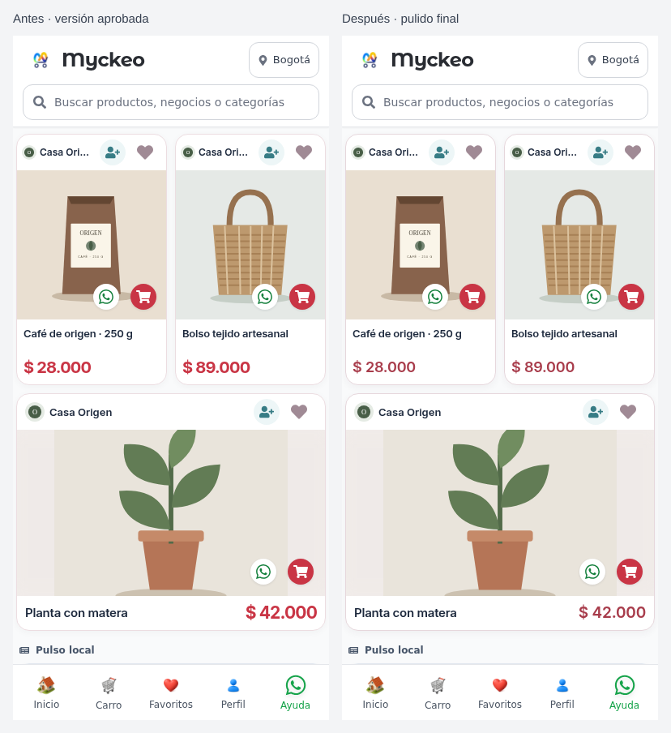

# Myckeo — Pulido visual final del feed móvil

**Estado: `MYCKEO_MOBILE_FEED_FINAL_VISUAL_POLISH_READY_FOR_REVIEW`**

Fecha: 15 de noviembre de 2026 (Colombia).

## Resultado y alcance

Se refinó el precio y el acabado del contenedor de productos del feed móvil. Se conservan la estructura B3, los módulos C2, los botones separados A, las fotografías, los espaciados y la restauración de escritorio aprobados en [la revisión anterior](MYCKEO_MOBILE_FEED_RESPONSIVE_REFINEMENT_REVIEW.md).

**Un solo archivo productivo cambió en esta iteración:** [`src/ui/components/productos/feedProductCard.module.css`](../src/ui/components/productos/feedProductCard.module.css). Son siete declaraciones, todas dentro de `@media (max-width: 768px)` y de la variante específica del feed. Las reglas base de escritorio y las variantes `default` y `business_profile` permanecen intactas.

El árbol de trabajo ya contenía las implementaciones anteriores. La comparación de esta entrega parte del estado aprobado al comenzar esta iteración, no de `HEAD`. Se guardaron [el CSS anterior](mobile-feed-final-polish/before.css.txt), [el diff exacto de esta iteración](mobile-feed-final-polish/production-change.diff) y [la comprobación de integridad de fuentes](mobile-feed-final-polish/source-integrity.json): 620 archivos en `src`, uno modificado y 619 idénticos; ninguno añadido o eliminado.

## Precio

| Propiedad móvil | Antes | Pulido final |
| --- | --- | --- |
| Tamaño en tarjetas amplias | 21 px | 19 px |
| Tamaño en tarjetas con contenedor ≤250 px | 20 px | 18 px |
| Peso | 700 | 600 |
| Tracking | −0,04 em | −0,01 em |
| Color | `#C93545` | `#A83C4B` |
| Altura de línea | 26 px | 26 px, conservada |
| Contraste sobre blanco | 5,15:1 | 6,15:1 |

El rubí más oscuro y moderado, la menor escala y el peso 600 equilibran mejor el importe con el nombre. El tracking menos cerrado facilita leer las cifras. Se mantiene la altura de línea para conservar las alturas de tarjeta y la posición de las acciones. El precio sigue completo, sin ellipsis; el tratamiento del nombre no cambió.

El carrito mantiene el rubí de marca `#C93545`. No se modificaron los colores, superficies ni dimensiones de los controles.

## Contenedor

| Propiedad móvil | Antes | Pulido final |
| --- | --- | --- |
| Borde | `1px solid #ECDDE1` | `1px solid #E6D7DC` |
| Sombra | `0 2px 8px #1C283C0A` | `0 3px 10px #392E330D` |
| Fondo / radio | Blanco / 16 px | Conservados |

El borde rosado ligeramente más definido separa la superficie blanca del fondo del feed. La sombra neutra cálida conserva una opacidad muy baja, aproximadamente 5 %. Se mantienen grosor, radio, padding y separación entre tarjetas. No se añadieron gradientes, glow, badges ni decoración.

## Comparación visual real

Capturas del componente productivo actualizado, ejecutado en Next.js con datos sintéticos locales. Se usaron los mismos productos, imágenes, fuente, viewport y encuadre en ambas versiones. No se sustituyeron componentes por prototipos ni se inyectaron estilos alternativos en el navegador.



| Ancho | Antes | Después | Comparación lado a lado |
| --- | --- | --- | --- |
| 320 px | [PNG](mobile-feed-final-polish/screenshots/before-320.png) | [PNG](mobile-feed-final-polish/screenshots/after-320.png) | [Comparar](mobile-feed-final-polish/screenshots/comparison-320.png) |
| 390 px | [PNG](mobile-feed-final-polish/screenshots/before-390.png) | [PNG](mobile-feed-final-polish/screenshots/after-390.png) | [Comparar](mobile-feed-final-polish/screenshots/comparison-390.png) |
| 430 px | [PNG](mobile-feed-final-polish/screenshots/before-430.png) | [PNG](mobile-feed-final-polish/screenshots/after-430.png) | [Comparar](mobile-feed-final-polish/screenshots/comparison-430.png) |
| 768 px | [PNG](mobile-feed-final-polish/screenshots/before-768.png) | [PNG](mobile-feed-final-polish/screenshots/after-768.png) | [Comparar](mobile-feed-final-polish/screenshots/comparison-768.png) |
| 1024 px | [PNG](mobile-feed-final-polish/screenshots/before-1024.png) | [PNG](mobile-feed-final-polish/screenshots/after-1024.png) | [Comparar](mobile-feed-final-polish/screenshots/comparison-1024.png) |
| 1440 px | [PNG](mobile-feed-final-polish/screenshots/before-1440.png) | [PNG](mobile-feed-final-polish/screenshots/after-1440.png) | [Comparar](mobile-feed-final-polish/screenshots/comparison-1440.png) |

También se capturaron una [tarjeta individual](mobile-feed-final-polish/screenshots/comparison-390-single.png), una [imagen vertical](mobile-feed-final-polish/screenshots/comparison-390-portrait.png) y una [imagen horizontal](mobile-feed-final-polish/screenshots/comparison-390-landscape.png), antes y después a 390 px.

La [galería local](mobile-feed-final-polish/comparison.html) reúne todas las comparaciones y los casos especiales finales. Las composiciones PNG conservan los píxeles originales, sin redimensionar ni retocar; el visor puede reducir su presentación.

**Conclusión visual:** el importe acompaña mejor al nombre y deja más protagonismo a la fotografía. En dos columnas se nota especialmente la reducción del peso tipográfico. El borde define mejor la silueta sin crear una superficie roja ni una sombra pesada. La composición y el ritmo del feed se conservan.

## Mediciones del DOM

Se alineó la primera tarjeta 8 px bajo el encabezado fijo para comparar el mismo tramo del feed. En móvil se usó un viewport de 844 px de alto: encabezado de 113 px, navegación inferior de 69 px y espacio útil de 662 px. En escritorio se usaron 900 px de alto, con 729 px útiles. Los conteos describen este encuadre, no la llegada inicial a la página.

Las medidas siguientes corresponden a la primera tarjeta y su bloque fotográfico. **Todas son idénticas antes y después.**

| Ancho | Columnas del primer bloque | Tarjeta: antes → después | Foto: antes → después | % viewport / útil | Productos completos + parciales |
| --- | --- | --- | --- | --- | --- |
| 320 | 1 | 255,56 → 255,56 px | 167,56 → 167,56 px | 30,28 % / 38,60 % | 2 + 1 |
| 390 | 2 | 310 → 310 px | 184 → 184 px | 36,73 % / 46,83 % | 3 + 0 |
| 430 | 2 | 316 → 316 px | 190 → 190 px | 37,44 % / 47,73 % | 3 + 0 |
| 768 | 2 | 287,45 → 287,45 px | 199,45 → 199,45 px | 34,06 % / 43,42 % | 3 + 0 |
| 1024 | 2, diseño de escritorio previo | 436,59 → 436,59 px | 261 → 261 px | 48,51 % / 59,89 % | 2 + 1 |
| 1440 | 3, diseño de escritorio previo | 412,97 → 412,97 px | 237,38 → 237,38 px | 45,89 % / 56,65 % | 3 + 0 |

Los tres productos completos en 390/430 px son la pareja C2 y la tarjeta individual que la sigue. Se preservan el orden, las posiciones de los demás contenidos y la posición de la primera publicación. La tarjeta individual a 390 px conserva 293,39 px de altura y 205,39 px de fotografía.

Los JSON `before-{ancho}.json` y `after-{ancho}.json` de [la carpeta de evidencia](mobile-feed-final-polish/) contienen geometría, controles, estilos computados y contraste. La comparación de geometría excluye las dimensiones naturales de imágenes que dependen de carga diferida y el `object-fit` de imágenes fuera de pantalla aún sin clasificar. Conserva la comparación de dimensiones del bloque, posiciones y ajuste de las fotos visibles.

## Escritorio intacto

- A 1024 px: **0 píxeles diferentes de 921.600**.
- A 1440 px: **0 píxeles diferentes de 1.296.000**.
- También coinciden las posiciones y los estilos computados de los elementos renderizados de todas las tarjetas de producto.
- Las reglas nuevas solo actúan hasta 768 px; el CSS de escritorio aprobado no recibió cambios.

## Validaciones

| Validación | Resultado |
| --- | --- |
| Referencia previa | 7/7 pruebas pasaron |
| Comparación tras el pulido | 7/7 pruebas pasaron, sin retries ni flaky |
| Capturas adicionales de información comercial | 1/1 prueba pasó; ocho casos con precio visible entre header y navegación |
| Responsive 320, 390, 430, 768, 1024, 1440 | Sin desbordamiento horizontal; alturas y densidad conservadas |
| Precio largo `$ 123.456.789` y nombre/negocio largos | Sin recortes del importe en tarjetas de 186 y 366 px reales; nombre conserva el truncado aprobado |
| Variantes, variante única, agotado y variantes agotadas | Geometría y estado visual conservados |
| Imagen ausente o fallida, vertical y horizontal | Contenedor estable, sin cambios de proporción o estrategia de imagen |
| Controles | Objetivos de al menos 44 × 44 px; centro alcanzable, dentro de la tarjeta y sin anidación en el enlace de ficha |
| `pnpm typecheck` | Pasa después de retirar las rutas temporales de revisión |
| `pnpm lint` | Pasa con el aviso previo de `_body` sin usar en `src/app/activar/ActivationBootstrap.test.tsx:347` |
| Lint focalizado del nuevo código de pruebas | Sin avisos ni errores |

Evidencia: [referencia](mobile-feed-final-polish/before-results.json), [comparación](mobile-feed-final-polish/after-results.json), [capturas adicionales](mobile-feed-final-polish/edge-results.json) y [precios visibles en casos especiales](mobile-feed-final-polish/after-edge-captures.json).

Ejemplos finales: [precio largo, tarjeta estrecha](mobile-feed-final-polish/screenshots/after-visible-case-186-long.png), [precio largo, tarjeta amplia](mobile-feed-final-polish/screenshots/after-visible-case-382-long.png), [variantes](mobile-feed-final-polish/screenshots/after-visible-case-186-variants.png), [agotado](mobile-feed-final-polish/screenshots/after-visible-case-186-sold-out.png) e [imagen ausente](mobile-feed-final-polish/screenshots/after-visible-case-186-missing.png). El ancho máximo solicitado de 382 px en el fixture de casos produce 366 px reales por su padding; se registró el ancho efectivo.

## Funcionalidad y límites

No se editaron TSX productivos, handlers, destinos de WhatsApp, carrito, cantidades, variantes, favoritos, follow, ranking, selección, filtros, deduplicación, paginación ni stores. Las comprobaciones de esta tanda se centraron en presentación y accesibilidad geométrica; las pruebas funcionales de interacción de la iteración anterior siguen documentadas en su informe.

Se reutilizó el entorno de revisión con los componentes reales, proveedores y layouts de Next.js, imágenes locales y respuestas sintéticas interceptadas en el límite de red. No se accedió a datos ni se realizaron escrituras productivas. Las rutas y los recursos temporales se retiraron al terminar. No se tocaron infraestructura, autenticación, Server Actions, Prisma, Cloudinary ni CI.

La valoración de acabado visual procede de inspección de capturas, no de pruebas con usuarios. Las imágenes son sintéticas; conviene que la revisión final de marca se haga también en un móvil físico con fotografías reales antes de publicar. No hay diferencias residuales detectadas en el escritorio comparado.

## Archivos y reproducción

- Productivo: `src/ui/components/productos/feedProductCard.module.css`.
- Pruebas nuevas: `e2e/mobile-feed-final-polish/playwright.config.ts`, `polish.spec.ts` y `evidence.cjs`.
- Informe: este documento.
- Evidencia: `docs/mobile-feed-final-polish/`, con capturas, galería, mediciones y referencia anterior.

Para repetir la validación final contra la referencia guardada:

```bash
node e2e/mobile-feed-responsive/prepare.cjs
pnpm exec playwright test --config=e2e/mobile-feed-final-polish/playwright.config.ts
node e2e/mobile-feed-responsive/prepare.cjs --clean
node e2e/mobile-feed-final-polish/evidence.cjs
pnpm typecheck
pnpm lint
```

El servidor de pruebas escucha en loopback, usa caché aislada y no comparte la caché del servidor habitual. `FEED_POLISH_BEFORE=1` sirve para capturar una referencia; no debe ejecutarse sobre el diseño final para reemplazar el estado anterior guardado.

## Recomendación

Conservar este pulido para la revisión final: precio de 19/18 px con peso 600, rubí moderado y contenedor blanco con borde fino y sombra cálida discreta. Equilibra mejor fotografía, nombre y precio manteniendo la densidad y los controles aprobados.

**Sin commits, pushes ni despliegues.**
