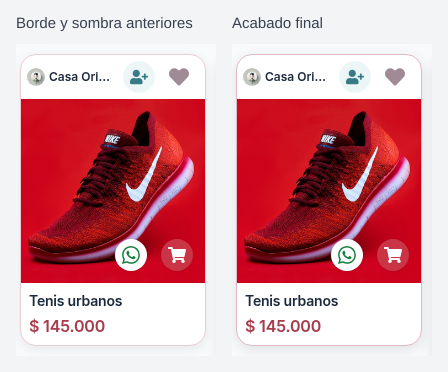
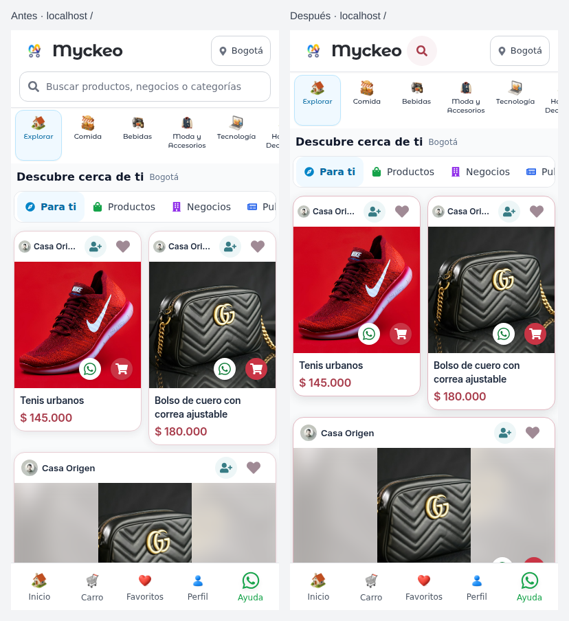

# Myckeo — Header móvil compacto y acabado final del feed

**Estado: `MYCKEO_MOBILE_FEED_HEADER_AND_CARDS_FINAL_READY`**

Fecha: 16 de noviembre de 2026, Colombia.

## Implementación

La cabecera móvil ahora muestra **marca Myckeo, lupa y ubicación en una fila**. Se retiró la fila permanente del buscador y se ajustó el desplazamiento del contenido bajo el header fijo. La lupa tiene un objetivo de **44 × 44 px**, nombre accesible «Abrir búsqueda», `aria-haspopup`, `aria-expanded` y asociación con el diálogo.

Al pulsarla se abre una capa blanca de búsqueda que ocupa el área visible del móvil. Reutiliza **la misma instancia de `SearchBar`**, su consulta, resultados, navegación y estados. La nueva prop `iconOnly` tiene valor predeterminado `false`; solo el encabezado móvil la activa. El buscador de escritorio mantiene su presentación y comportamiento.

Las tarjetas móviles reciben únicamente un borde rosado más definido y una sombra neutra más perceptible. **Precios C2 de 16 px y B3 de 18 px, fotografías, botones, alturas, proporciones, espaciados y distribución permanecen iguales.**

## Archivos productivos modificados

| Archivo | Cambio |
| --- | --- |
| [`TopMenuMobile.tsx`](../src/ui/components/topMenuMobile/TopMenuMobile.tsx) | Lupa junto a la marca; búsqueda sin fila propia; offsets del contenido actualizados |
| [`publicNavigation.module.css`](../src/ui/components/topMenu/publicNavigation.module.css) | Grid del header móvil, separación de controles y adaptación a anchos efectivos extremos |
| [`SearchBar.tsx`](../src/busqueda/componentes/SearchBar.tsx) | Lanzador opcional de icono, presentación móvil del diálogo, foco y ajuste a `visualViewport` |
| [`searchBar.module.css`](../src/busqueda/componentes/searchBar.module.css) | Lupa de 44 px, campo fijo con fondo opaco y resultados en el scroll de la capa |
| [`feedProductCard.module.css`](../src/ui/components/productos/feedProductCard.module.css) | Dos valores del contenedor móvil: borde y sombra |

[Diff exacto de esta entrega](mobile-feed-header-cards/production-change.diff) · [Integridad de fuentes](mobile-feed-header-cards/source-integrity.json).

Respecto al estado aprobado al comenzar esta tarea, se modificaron cinco archivos de `src`; los otros **615 permanecen idénticos**, sin añadir ni eliminar archivos productivos. El árbol de trabajo conserva también las modificaciones de fases anteriores.

## Búsqueda móvil

- **Foco:** el campo se enfoca al activarse el diálogo, mediante `onEntered`, con `preventScroll`. Se mantiene el autofocus existente y el campo usa `enterKeyHint="search"`.
- **Accesibilidad:** se reutiliza el control de foco de MUI Dialog, con título accesible y foco contenido dentro de la capa. La X tiene un objetivo de 44 × 44 px. Se puede cerrar con X o Escape; al cerrar vuelve el foco a la lupa.
- **Scroll:** MUI bloquea el desplazamiento del feed mientras está abierto. La lista se desplaza dentro del diálogo; el campo permanece visible con un fondo opaco que cubre los resultados al pasar por detrás. Al cerrar se recuperan el scroll y el overflow anteriores.
- **Teclado virtual:** la capa sigue la altura y el desplazamiento de `window.visualViewport`, con respaldo de `100dvh`. Los listeners solo existen mientras está abierta la capa móvil y se eliminan al cerrar o desmontar. El contenido tiene scroll propio y evita encadenarlo al feed.
- **Resultados:** se conservan el campo, las sugerencias/resultados que devuelve el buscador, la selección con flechas y Enter, y los destinos originales. No se añadió otro motor, fuente de sugerencias ni implementación de búsqueda.
- **Estados:** se muestran carga, resultados, vacío y error existentes. Antes de escribir se ofrece una instrucción breve. La consulta anterior se conserva al cerrar sin seleccionar, como en el componente existente.

La consulta a `/api/search?query=…&limit=10`, su debounce de 300 ms, `AbortController`, manejo de respuestas y funciones de navegación/teclado permanecen **idénticos en código**. La comprobación de integridad lo verifica además de las pruebas de interfaz.

En anchos normales de **320–768 px**, el header es de una fila. Por debajo de 280 px efectivos, la ubicación pasa a otra fila para conservar controles accesibles; por debajo de 200 px también se ajusta la marca. Se comprobaron 195 y 160 px efectivos sin desbordamiento, solapamientos ni corte del contenido de la marca. Esta adaptación para zoom extremo no vuelve a introducir el campo permanente.

## Alturas y llegada al primer producto

Medidas del DOM en `/`, con scroll **0** en ambas versiones y el mismo contenido. En móviles se usó un viewport de 844 px de alto.

| Ancho | Header antes → después | Espacio recuperado | Primer producto antes → después | Adelanto |
| --- | --- | --- | --- | --- |
| 320 | 113 → **61 px** | 52 px | 292 → **241 px** | **51 px** |
| 360 | 113 → **61 px** | 52 px | 292 → **241 px** | **51 px** |
| 390 | 113 → **61 px** | 52 px | 292 → **241 px** | **51 px** |
| 430 | 113 → **61 px** | 52 px | 292 → **241 px** | **51 px** |
| 768 | 113 → **61 px** | 52 px | 324 → **273 px** | **51 px** |
| 769 | 171 → 171 px | 0 px | 277 → 277 px | 0 px |
| 1024 | 171 → 171 px | 0 px | 277 → 277 px | 0 px |
| 1440 | 171 → 171 px | 0 px | 277 → 277 px | 0 px |

El espacio útil entre header y navegación inferior pasa de **662 a 714 px**. El adelanto del producto es de 51 px: el offset anterior era de 112 px y el nuevo de 61 px, incluyendo correctamente el borde del header. Se conservan categorías, contexto, pestañas y filtros.

En 320 px hay **8 px de separación** entre el objetivo de la lupa y el de ubicación. En los demás anchos móviles la separación es mayor. Logo, nombre, lupa y ubicación no se superponen.

La ciudad conserva el truncado cuando el ancho disponible no alcanza; su etiqueta accesible y tooltip mantienen el nombre completo.

## Acabado de las tarjetas

| Propiedad móvil | Antes | Después |
| --- | --- | --- |
| Borde | `1px solid #E8CDD3` | **`1px solid #E2B8C2`** |
| Sombra | `0 3px 12px rgba(44, 47, 51, 0.09)` | **`0 4px 14px rgba(44, 47, 51, 0.12)`** |
| Fondo / radio | Blanco / 16 px | Conservados |

Los estilos calculados confirman `rgb(226, 184, 194)` y `rgba(44, 47, 51, 0.12)`. El borde se identifica mejor sobre el fondo claro y la sombra aporta profundidad sin halos ni color saturado. No se cambiaron separaciones ni dimensiones para lograrlo.



| Ancho | Altura de la primera tarjeta: antes = después | Precio: antes = después |
| --- | --- | --- |
| 320 | 275,56 px | B3, 18 px |
| 360 | 297,19 px | B3, 18 px |
| 390 | 292 px | C2, 16 px |
| 430 | 298 px | C2, 16 px |
| 768 | 307,45 px | C2, 16 px |

Las pruebas compararon el ancho y la altura de **todas las tarjetas** de cada viewport, además de sus fotografías, padding, separación comercial y tipografía del precio. No se detectaron cambios. Se mantienen los controles comerciales de la alternativa A y sus handlers.

## Capturas del entorno real de desarrollo

Servidor existente: Next.js 15.5.9 en `localhost:3000`, PID **647629**, directorio `/home/nico/red-social`. Playwright accedió a la **ruta principal `/`**, sin nuevas rutas de prueba, rewrites ni componentes alternativos. No se reinició el servidor ni se borraron cachés. [Identidad del servidor](mobile-feed-header-cards/server.json).

Se usaron los mismos productos sintéticos y fotografías realistas de la corrección anterior, interceptando datos, búsqueda e imágenes únicamente en el contexto del navegador de prueba. Las capturas muestran componentes, proveedores y layouts productivos. Las composiciones conservan los píxeles originales; el visor puede reducir su presentación.



| Ancho | Feed cerrado | Búsqueda abierta | Comparación del feed |
| --- | --- | --- | --- |
| 320 | [PNG](mobile-feed-header-cards/screenshots/after-320-closed.png) | [PNG](mobile-feed-header-cards/screenshots/after-320-search.png) | [Antes/después](mobile-feed-header-cards/screenshots/comparison-320-closed.png) |
| 360 | [PNG](mobile-feed-header-cards/screenshots/after-360-closed.png) | [PNG](mobile-feed-header-cards/screenshots/after-360-search.png) | [Antes/después](mobile-feed-header-cards/screenshots/comparison-360-closed.png) |
| 390 | [PNG](mobile-feed-header-cards/screenshots/after-390-closed.png) | [PNG](mobile-feed-header-cards/screenshots/after-390-search.png) | [Antes/después](mobile-feed-header-cards/screenshots/comparison-390-closed.png) |
| 430 | [PNG](mobile-feed-header-cards/screenshots/after-430-closed.png) | [PNG](mobile-feed-header-cards/screenshots/after-430-search.png) | [Antes/después](mobile-feed-header-cards/screenshots/comparison-430-closed.png) |
| 768 | [PNG](mobile-feed-header-cards/screenshots/after-768-closed.png) | [PNG](mobile-feed-header-cards/screenshots/after-768-search.png) | [Antes/después](mobile-feed-header-cards/screenshots/comparison-768-closed.png) |

[Búsqueda antes/después a 390](mobile-feed-header-cards/screenshots/comparison-390-search.png) · [Acabado de tarjeta a 430](mobile-feed-header-cards/screenshots/comparison-card-430.png) · [Galería completa](mobile-feed-header-cards/comparison.html) · [Mediciones resumidas](mobile-feed-header-cards/summary.json).

## Escritorio intacto

| Ancho | Feed: píxeles diferentes | Búsqueda abierta: píxeles diferentes | Evidencia |
| --- | --- | --- | --- |
| 769 | **0** | **0** | [Feed](mobile-feed-header-cards/screenshots/comparison-769-closed.png) · [Búsqueda](mobile-feed-header-cards/screenshots/comparison-769-search.png) |
| 1024 | **0** | **0** | [Feed](mobile-feed-header-cards/screenshots/comparison-1024-closed.png) · [Búsqueda](mobile-feed-header-cards/screenshots/comparison-1024-search.png) |
| 1440 | **0** | **0** | [Feed](mobile-feed-header-cards/screenshots/comparison-1440-closed.png) · [Búsqueda](mobile-feed-header-cards/screenshots/comparison-1440-search.png) |

También coinciden posiciones y estilos calculados de las tarjetas de producto de escritorio. Las reglas nuevas de búsqueda son específicas de `iconOnly`, las de navegación del contenedor móvil y las de tarjetas están bajo `max-width: 768px`.

## Validaciones y límites

**Referencia: 8/8 pruebas. Implementación final: 13/13, sin retries ni flaky.**

- Responsive en los ocho anchos solicitados; header sin solapamientos, objetivos de 44 px y documento sin scroll horizontal.
- Apertura, autofocus, foco contenido, cierre con X y Escape, y restauración de foco a la lupa.
- Scroll del feed conservado en **400 px** y misma posición del producto usado como ancla; overflow del cuerpo restaurado al valor anterior.
- Carga, resultados, vacío, error y descarte de una respuesta lenta después de cambiar la consulta.
- Selección con teclado y navegación original a producto, negocio y categoría: `/producto/tenis-urbanos`, `/perfil/casa-origen` y `/category/moda-y-accesorios`.
- Simulación del teclado: viewport reducido de 844 a **430 px de alto**, diez resultados desplazables, campo y cierre visibles, feed conservado en 300 px al cerrar.
- **Zoom nativo al 200 % en Chromium:** ventana de 780 px, ancho CSS de 390 px y DPR 2; búsqueda y devolución de foco correctas. Además, anchos efectivos de 195 y 160 px sin desbordamientos.
- Sin errores de ejecución del navegador en las ocho comparaciones del feed y búsqueda.
- Revisión React: una sola implementación de búsqueda, listeners con limpieza y gestión del foco con el diálogo existente. Sin dependencias nuevas.
- `pnpm typecheck`: pasa.
- `pnpm lint`: pasa con el aviso previo de `_body` sin usar en `src/app/activar/ActivationBootstrap.test.tsx:347`.
- Lint focalizado de los TSX y pruebas modificados: pasa sin avisos.

Evidencia: [resultado previo](mobile-feed-header-cards/before-results.json), [resultado final](mobile-feed-header-cards/after-results.json), [foco y scroll](mobile-feed-header-cards/focus-scroll.json), [navegación](mobile-feed-header-cards/navigation.json), [teclado](mobile-feed-header-cards/keyboard.json), [zoom](mobile-feed-header-cards/zoom.json) y [anchos extremos](mobile-feed-header-cards/narrow.json).

Capturas adicionales: [carga](mobile-feed-header-cards/screenshots/search-loading.png), [vacío](mobile-feed-header-cards/screenshots/search-empty.png), [error](mobile-feed-header-cards/screenshots/search-error.png), [teclado simulado](mobile-feed-header-cards/screenshots/search-keyboard-430h.png) y [zoom nativo](mobile-feed-header-cards/screenshots/search-native-zoom-200.png).

El teclado se simuló con reducción del viewport; Chromium sin interfaz no muestra un teclado del sistema operativo. No se probó un móvil físico. Los datos de búsqueda y los contenidos de destino se interceptaron para validar la interfaz y los destinos, sin ejercitar la base de datos ni realizar escrituras productivas.

No se modificaron ranking, paginación, filtros, lógica comercial, carrito, favoritos, follow, WhatsApp, Server Actions, APIs, Prisma, Cloudinary, autenticación, CI o infraestructura. Las pruebas comerciales de la fase anterior siguen documentadas en [su revisión](MYCKEO_MOBILE_FEED_FINAL_VISUAL_CORRECTION_REVIEW.md).

## Reproducción

Pruebas y composición de evidencia: `e2e/mobile-feed-header-cards/{playwright.config.ts,browser.ts,header.spec.ts,evidence.cjs}`. Con el servidor local existente en el puerto 3000:

```bash
pnpm exec playwright test --config=e2e/mobile-feed-header-cards/playwright.config.ts
node e2e/mobile-feed-header-cards/evidence.cjs
pnpm typecheck
pnpm lint
```

`FEED_HEADER_BEFORE=1` se utilizó antes de implementar; no debe ejecutarse sobre el estado final para reemplazar la referencia guardada.

**Sin commits, pushes ni despliegues.**
