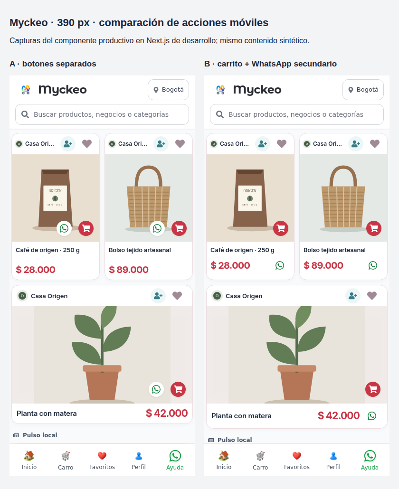

# Myckeo — Botones móviles y restauración de escritorio

Estado: `MYCKEO_MOBILE_FEED_RESPONSIVE_REFINEMENT_READY_FOR_REVIEW`

El escritorio recupera la presentación anterior a B3+C2. En móvil se mantiene C2 y se implementan dos opciones de acciones: **A, botones independientes sobre foto**, y **B, carrito en foto y WhatsApp secundario junto al precio**.

A queda como opción provisional por defecto; B se puede activar mediante `feedActionLayout="split"` en ProductCard o `productActionLayout="split"` en FeedRenderer. Estas son opciones locales de presentación, sin selector nuevo en el producto. Ambas usan el mismo escritorio restaurado. La elección visual definitiva sigue pendiente de revisión.

## Causa y corrección del escritorio

La implementación anterior convirtió los estilos B3 en la base de la variante `feed`, sin acotarlos al móvil. También sustituyó el helper de columnas por una cuadrícula de dos columnas con máximos de 960/480 px en todos los tamaños. El resultado afectó padding, imagen, header, texto, colores y ubicación de acciones, además del número de columnas.

Se restaura la base CSS anterior a B3+C2 y el helper original `getProductClusterGridClass`. Los estilos B3 y las reglas C2 quedan dentro de **`@media (max-width: 768px)`**. Desde 769 px, las acciones vuelven al bloque comercial original; los controles de foto y el WhatsApp secundario móvil no se muestran ni entran en la navegación por teclado.

Se recuperan en escritorio:

- Columnas originales según número de productos y breakpoints: dos desde `md`, tres desde `xl` y hasta cuatro desde `2xl` cuando el bloque tiene cuatro o más ítems. El bloque inicial de tres productos conserva dos columnas a 1024 y tres a 1280/1440/1920.
- Anchos originales, incluyendo `max-w-5xl` para dos productos y `max-w-2xl` para uno, sin los límites B3/C2 de 960/480 px.
- Tarjetas con padding de 8 px, borde/sombra originales, header con avatar de 32 px, separaciones anteriores y fotografía 16:9 con `contain`, radio de 12 px y máximo de 280 px.
- Tipografía, descripción breve, colores originales y botones comerciales junto al precio, con sus textos. El precio rubí y las acciones sobre foto se limitan al móvil.

La comparación utiliza los archivos congelados en `docs/mobile-feed-b3-c2/b2-sources/`, **anteriores** a B3+C2, y no el escritorio ya modificado de la fase anterior.

## Fidelidad visual de escritorio

| Ancho | Columnas del bloque inicial | Tarjeta restaurada ancho × alto | Imagen alto | Píxeles distintos A / B |
| --- | ---: | ---: | ---: | ---: |
| 1024 px | 2 | 482.0 × 436.6 px | 261.0 px | 0 / 0 |
| 1280 px | 3 | 386.7 × 382.9 px | 207.4 px | 0 / 0 |
| 1440 px | 3 | 440.0 × 413.0 px | 237.4 px | 0 / 0 |
| 1920 px | 3 | 600.0 × 455.6 px | 280.0 px | 0 / 0 |

La sección de categoría con cuatro productos también conserva cuatro columnas a 1920 px y **0 píxeles diferentes**.

Se comparan los PNG completos sin tolerancia de diferencias y la geometría/estilos calculados de los elementos visibles de todas las tarjetas de producto. Las dos alternativas móviles deben producir el mismo escritorio. También se comprueba una sección de cuatro productos a 1920 px, para ejercitar las cuatro columnas originales.

Capturas: [1024](mobile-feed-responsive/screenshots/comparison-1024.png) · [1280](mobile-feed-responsive/screenshots/comparison-1280.png) · [1440](mobile-feed-responsive/screenshots/comparison-1440.png) · [1920](mobile-feed-responsive/screenshots/comparison-1920.png). [Referencia de categoría](mobile-feed-responsive/screenshots/reference-category-1920.png) · [Categoría restaurada](mobile-feed-responsive/screenshots/restored-category-1920.png).

No se observan diferencias visuales residuales en estas capturas. Sí existen diferencias no visuales en el DOM: identificadores de verificación, la opción de presentación y representaciones de controles ocultas mediante CSS según contexto. Solo una posición de cada acción queda visible y accesible a la vez; no se duplica la lógica comercial ni el modal.

## C2 se conserva en móvil

Dentro del rango autorizado hasta 768 px, la cuadrícula continúa midiendo **el ancho útil del módulo**, no solo el viewport. Dos tarjetas de 186 px y un gap de 10 px requieren 382 px útiles. Con los márgenes actuales eso se alcanza a 390 px de viewport; a 320/360 px se mantiene una columna. Un contenedor de 360 px dentro de un viewport de 768 px también vuelve a una columna.

El producto impar conserva su fila completa, centrada y limitada a 480 px. No se fusionan módulos separados por contenido social. La selección, orden, filtros y cadencia permanecen intactos; se recupera únicamente el layout anterior de escritorio.

## Alternativas móviles implementadas

**A — Separados sobre fotografía.** WhatsApp verde sobre círculo blanco y carrito blanco sobre círculo rubí `#C93545`. Cada superficie visible mide 32 px de diámetro dentro de un objetivo táctil de 44 × 44 px; hay 2 px entre objetivos. Se elimina el fondo, borde, padding y sombra de la cápsula conjunta. Solo queda una sombra neutra pequeña en cada círculo.

**B — Carrito en foto, WhatsApp secundario.** Mantiene el mismo carrito sobre foto y mueve WhatsApp junto a la información comercial. Conserva el objetivo de 44 px. En una tarjeta individual normal añade 10 px respecto a A y reduce el ancho disponible para el nombre. En la tarjeta estrecha normal el nombre ocupa una línea y el objetivo de WhatsApp comparte fila con el precio. Los nombres o importes largos pueden exigir más altura. Si el importe cabe en el ancho de la tarjeta pero no junto al control, se desplaza el control a otra línea antes de partir el número.

En ambas opciones las acciones quedan fuera del enlace de imagen. Los badges siguen en la parte superior; las acciones de foto quedan abajo a la derecha. Las capturas con variantes y agotados permiten inspeccionar esa separación. No se añade reproducción, navegación ni acción comercial nueva.

Comparación real de Next.js con el mismo contenido sintético:

- [320 px](mobile-feed-responsive/screenshots/comparison-320.png), [360 px](mobile-feed-responsive/screenshots/comparison-360.png), [390 px](mobile-feed-responsive/screenshots/comparison-390.png), [430 px](mobile-feed-responsive/screenshots/comparison-430.png) y [768 px](mobile-feed-responsive/screenshots/comparison-768.png).
- [Tarjetas individuales A/B a 390 px](mobile-feed-responsive/screenshots/comparison-single-390.png).
- [A con variantes](mobile-feed-responsive/screenshots/separate-390-variants.png), [B con importe largo](mobile-feed-responsive/screenshots/split-390-long.png), [A vertical](mobile-feed-responsive/screenshots/separate-390-portrait.png), [B horizontal](mobile-feed-responsive/screenshots/split-390-landscape.png).



## Altura, densidad y ocupación fotográfica

| Viewport | Columnas C2 | Individual A / B, alto | Primera tarjeta del módulo A / B, alto | Productos completos A / B |
| --- | ---: | ---: | ---: | ---: |
| 320 px | 1 | 255.6 / 265.6 px | 255.6 / 265.6 px | 2 / 2 |
| 360 px | 1 | 277.2 / 287.2 px | 277.2 / 287.2 px | 2 / 2 |
| 390 px | 2 | 293.4 / 303.4 px | 310.0 / 310.0 px | 3 / 3 |
| 430 px | 2 | 302.0 / 312.0 px | 316.0 / 316.0 px | 3 / 3 |
| 768 px | 2 | 302.0 / 312.0 px | 287.4 / 297.4 px | 3 / 3 |

En la tarjeta estrecha con título largo e importe de $123.456.789, A mide **310 px** y B **358 px**. B muestra el importe entero en una línea y baja WhatsApp a otra, con un coste de 48 px; A conserva su altura. No se fuerza la compactación recortando el precio.

La altura de las tarjetas es automática. Los conteos completos exigen que la tarjeta entera quede entre header y navegación inferior, con la primera tarjeta alineada 8 px bajo el header. En 844 px de alto, el header móvil de 113 px y la navegación de 69 px dejan 662 px útiles.

| A 390 px | Marco de foto | Cápsula anterior, área pintada estimada | A, área pintada | B, área pintada | Área de objetivos táctiles A / B |
| --- | ---: | ---: | ---: | ---: | ---: |
| Individual | 380.0 × 205.4 px | 5.74% | 2.06% | 1.03% | 4.96% / 2.48% |
| Dos columnas | 184.0 × 184.0 px | 12.55% | 4.75% | 2.38% | 11.44% / 5.72% |

La caja rectangular de la cápsula anterior ocupaba 6,02 % de la foto individual y 13,04 % de la estrecha. Al descontar las esquinas se obtiene la estimación de área pintada de la tabla. A reduce esa superficie aproximadamente un 64 % en individual y un 62 % en C2; B, un 82 % y un 81 %, respectivamente. Sombras excluidas. [Estado recibido con cápsula](mobile-feed-b3-c2/screenshots/implemented-390-aligned.png).

Se distinguen tres cosas: **superficie pintada**, objetivos táctiles y extensión del grupo. Los círculos visibles son menores que sus objetivos; no se reducen los 44 px para mejorar las cifras. El área pintada se estima desde los pseudo-elementos renderizados y la fórmula del círculo, excluyendo la sombra. La cápsula anterior se estima desde su caja blanca de 92 × 48 px en tarjeta estrecha y 94 × 50 px en individual, descontando las esquinas de radio 14/16 px.

Estas medidas no equivalen al porcentaje de producto reconocido. Los badges y textos renderizados por la tarjeta no se colocan bajo los controles. Los textos incrustados en fotografías arbitrarias no se detectan automáticamente: la inspección visual usa los ejemplos controlados adjuntos.

## Funcionalidad, pruebas y alcance

**15/15 pruebas Playwright aprobadas**, sin reintentos ni casos flaky, y una prueba de captura de referencia aprobada. [Resultados](mobile-feed-responsive/results.json), [referencia](mobile-feed-responsive/reference-results.json), [mediciones](mobile-feed-responsive/measurements.json).

La publicación usada como ancla de paginación mantiene Y = 200.39 → 200.39 px: **0 px de desplazamiento**. Quedan nueve productos únicos después de la segunda página.

TypeScript aprobado. Lint global aprobado con el warning previo de `_body` sin usar en `src/app/activar/ActivationBootstrap.test.tsx:347`; lint focalizado sin warnings ni errores. Sintaxis de scripts, formato y `git diff --check` aprobados.

Se ejercitan WhatsApp y carrito en **A y B**, favoritos persistentes al recargar, follow, teclado, selección de variantes, variante sin stock y límite de cantidad. Los destinos y callbacks originales se reutilizan; el cambio de posición no crea una segunda lógica de compra o contacto. Se comprueba que haya un solo enlace accesible de WhatsApp y un único botón de carrito visible por tarjeta.

La prueba de paginación usa FeedComponent real con observer y `fetchNextPage`, respuestas sintéticas con un producto repetido y deduplicación del cliente. No se modifica el algoritmo para fijar artificialmente el orden. La opción provisional A es la utilizada por el feed general en esa prueba; B se valida en el renderer y las tarjetas con los mismos handlers.

Se comprueban 320/360/390/430/768 px, 1024/1280/1440/1920 px y la transición 768→769; zoom CSS al 200 % en móvil y escritorio; contenedor estrecho, imágenes verticales/horizontales, títulos/precios largos, imágenes ausentes/fallidas, agotados y variantes. Los objetivos visibles se miden y se prueba su hit de puntero. Las comparaciones no indican resultados de pruebas con usuarios.

## Archivos y reproducción

Solo se modifican los mismos cuatro archivos de presentación del feed:

- [ProductCard.tsx](../src/ui/components/productos/ProductCard.tsx).
- [feedProductCard.module.css](../src/ui/components/productos/feedProductCard.module.css).
- [FeedRederer.tsx](../src/publicaciones/componentes/FeedRederer.tsx).
- [feedProductModules.module.css](../src/publicaciones/componentes/feedProductModules.module.css).

Se ajustó además el cierre del launcher de QA existente `e2e/mobile-feed-implementation/dev-server.cjs` para que no deje un compilador huérfano observando la caché de pruebas. Esto no modifica el servidor ni la configuración productivos.

Las herramientas nuevas están en [e2e/mobile-feed-responsive](../e2e/mobile-feed-responsive/README.md); capturas, referencia y mediciones en `docs/mobile-feed-responsive/`. [Manifiesto de fuentes](mobile-feed-responsive/source-manifest.json).

```bash
node e2e/mobile-feed-responsive/prepare.cjs
pnpm exec playwright test --config=e2e/mobile-feed-responsive/playwright.config.ts
node e2e/mobile-feed-responsive/evidence.cjs
node e2e/mobile-feed-responsive/prepare.cjs --clean
pnpm typecheck
pnpm lint
```

La evidencia utiliza componentes productivos y Next.js reales, con datos sintéticos y las llamadas de acciones interceptadas antes del servidor. Se bloquean peticiones externas y la conexión de datos del servidor de pruebas apunta a un puerto local sin servicio. Se reutiliza el entorno aislado existente; no se modifica configuración productiva, CI ni infraestructura. La ruta y los assets de prueba se retiran al finalizar.

## Recomendación final y limitaciones

**Usaría A como opción principal.** Elimina el bloque blanco que tapaba la foto, mantiene ambas acciones reconocibles y conserva el espacio de nombre/precio y la altura B3 aprobada. B es la alternativa con menor obstrucción fotográfica, pero comprime el nombre en una columna estrecha y puede aumentar más la altura en productos con información comercial larga. Dejo ambas disponibles para la revisión, sin selector nuevo en el producto.

El escritorio se conserva idéntico en los escenarios medidos. No se ha probado una matriz de dispositivos físicos o Safari; el zoom es una simulación CSS. Las fotografías son sintéticas y no validan todos los posibles encuadres o textos impresos. Follow y paginación usan respuestas controladas: no se valida persistencia remota, autenticación real, entrega a WhatsApp ni consultas productivas. Esas implementaciones, ranking, stores y políticas de visibilidad no se han modificado.

No se hicieron commits, pushes ni despliegues.
