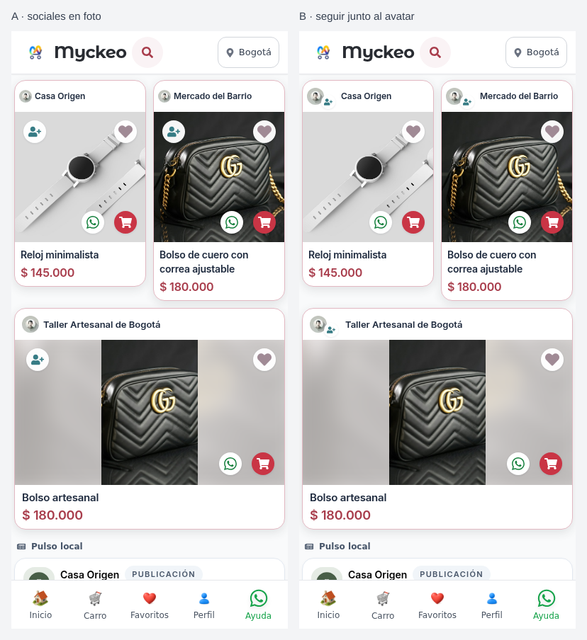
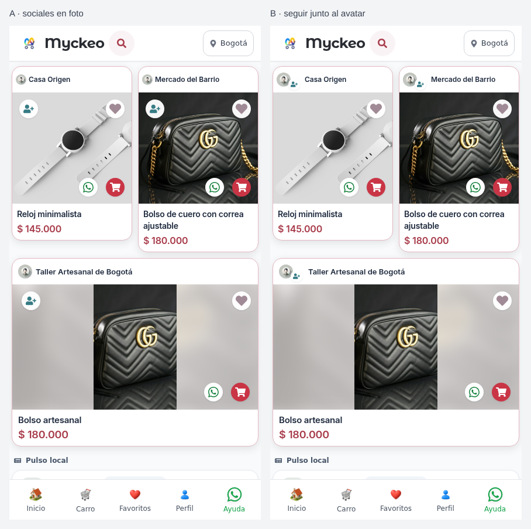
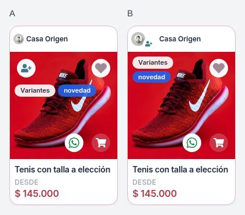

# Myckeo — Acciones sociales de las tarjetas móviles

**Estado: `MYCKEO_MOBILE_FEED_SOCIAL_ACTIONS_READY_FOR_REVIEW`**

Fecha: 16 de noviembre de 2026, Colombia.

## Resultado y opción seleccionada

**Se deja activa B: Seguir integrado junto al avatar y Favoritos sobre la fotografía.** Recupera espacio para el nombre del negocio con menos controles sobre la imagen que A. No se aumentan alturas, se reducen objetivos táctiles ni se cambia el layout B3 + C2.

Ambas propuestas se implementaron y capturaron **secuencialmente en el componente productivo de `localhost:3000/`**, con los mismos datos, fotografías y scroll. A se aplicó primero y después su bloque CSS se sustituyó por B. No se incorporó ningún selector, query param, prop de elección o flag de runtime a la aplicación.

El [CSS aplicado de A](mobile-feed-social-actions/sources/option-A.css.txt), el [CSS seleccionado B](mobile-feed-social-actions/sources/option-B.css.txt) y las capturas quedan guardados para revisión. No son prototipos ni sustitutos de `ProductCard`.

## Archivos modificados

| Archivo productivo | Cambio de esta iteración |
| --- | --- |
| [`feedProductCard.module.css`](../src/ui/components/productos/feedProductCard.module.css) | Bloque local `max-width: 768px` que recoloca los controles existentes, integra Seguir en el área del avatar y reserva espacio para los badges |
| [`ProductCard.tsx`](../src/ui/components/productos/ProductCard.tsx) | Una clase adicional en el contenedor de badges, únicamente para `variant="feed"` |

**No se modificaron `FollowButton`, `AddFavorites`, handlers ni props de los controles.** Seguir y Favoritos mantienen una única instancia DOM por tarjeta. Los mismos nodos cambian de posición mediante CSS; no hay copias ocultas de acciones sociales.

La [integridad de fuentes](mobile-feed-social-actions/source-integrity.json) confirma que otros **618 archivos de `src` permanecen idénticos**, sin añadir ni eliminar archivos productivos. El CSS anterior se conserva completo como prefijo; el nuevo bloque solo afecta al feed móvil. El cambio de TSX es exclusivamente la clase de badges. [Diff de esta entrega](mobile-feed-social-actions/production-change.diff).

Soporte de pruebas: se añadieron `e2e/mobile-feed-social-actions/{playwright.config.ts,browser.ts,social.spec.ts,evidence.cjs}` y se extendió el helper de pruebas `e2e/mobile-feed-final-correction/browser.ts` con decoradores y scores sintéticos opcionales. Los consumidores anteriores del helper conservan sus valores predeterminados. No es código del ranking o de las APIs productivas.

## A frente a B

**A — Seguir y Favoritos en la foto:** el encabezado queda solo con avatar y nombre. Los dos controles sociales usan superficies blancas suaves de 32 px dentro de objetivos de 44 px, en las esquinas superiores. Se conservan WhatsApp y carrito abajo a la derecha. Libera el máximo ancho de texto, pero introduce cuatro controles fotográficos y obliga a situar los badges debajo de la fila superior.

**B — Seguir junto al avatar:** el avatar móvil mide 24 px y comparte una zona reservada de 44 px con Seguir. Su indicador visual es de 20 px con icono de 12 px; **el botón real sigue midiendo 44 × 44 px**. Favoritos usa una superficie blanca suave de 32 px y objetivo de 44 px, arriba a la derecha de la foto. WhatsApp y carrito conservan su ubicación y presentación.

El avatar no era un enlace y no se convirtió en uno. La navegación al perfil sigue en el nombre. El objetivo de Seguir queda antes del enlace, separado de él; se comprobó **cero intersección** y la navegación real de ambos destinos.





## Espacio del nombre

Capacidad horizontal real del contenedor desde el inicio del nombre hasta su límite derecho, obtenida del DOM. Se distingue de la anchura del texto cuando el nombre corto ya cabe completo.

| Viewport / tarjeta | Antes | A | B seleccionada | Ganancia B |
| --- | --- | --- | --- | --- |
| 390 px / 186 px | 68 px | 156 px | **130 px** | **+62 px, +91 %** |
| 430 px / 206 px | 88 px | 176 px | **150 px** | **+62 px, +70 %** |

| Ejemplo a 390 px | Antes | A | B |
| --- | --- | --- | --- |
| Casa Origen | Aproximadamente 8 caracteres antes de la elipsis | Completo, 11 | **Completo, 11** |
| Mercado del Barrio | Aproximadamente 8 caracteres | Completo, 18 | **Completo, 18** |
| Cooperativa de Productores Artesanales de Bogotá | Aproximadamente 8 caracteres | Aproximadamente 23 | **Aproximadamente 19** |

En 430 px, el nombre largo pasa de aproximadamente 12 caracteres a 26 en A y 22 en B. La capacidad en píxeles es una medida real; los caracteres visibles son una estimación mediante la fuente calculada y la anchura de la elipsis, no una prueba con usuarios. Los nombres muy largos mantienen el truncado de una línea y su texto accesible completo.

## Fotografía ocupada por controles

La huella visual se calcula con los diámetros reales de los fondos circulares, sin contar dos veces los iconos que contienen. Es una aproximación geométrica conservadora: considera toda la superficie blanca semitransparente como huella. No incluye sombras ni badges. Los objetivos táctiles incluyen márgenes transparentes, por lo que **no equivalen a superficie opaca**.

| Viewport / foto | Diseño | Controles sobre foto | Huella visual circular | Objetivos táctiles |
| --- | --- | --- | --- | --- |
| 390 / 184 × 184 px | Antes | 2 | 4,75 % | 11,44 % |
| 390 / 184 × 184 px | A | 4 | 9,50 % | 22,87 % |
| 390 / 184 × 184 px | **B** | **3** | **7,13 %** | **17,16 %** |
| 430 / 204 × 190 px | Antes | 2 | 4,15 % | 9,99 % |
| 430 / 204 × 190 px | A | 4 | 8,30 % | 19,98 % |
| 430 / 204 × 190 px | **B** | **3** | **6,22 %** | **14,98 %** |

B reduce alrededor de un **25 % la huella visual de controles de A**. Frente al diseño anterior añade un control fotográfico, a cambio del espacio recuperado para la identidad comercial.

Los nuevos controles sociales no intersectan el rectángulo central del 50 % de ancho y alto de las fotos comprobadas. Es un indicador geométrico, no detección automática del producto. La inspección de fotos claras y oscuras confirma que permanecen visibles las esferas de los relojes, el centro del bolso y el elemento principal de las fotografías de prueba.

En C2 de 184 px de alto hay 84 px entre las áreas táctiles superiores e inferiores. No se detectan intersecciones entre controles, badges o el enlace del negocio.

## Badges, estados y altura

Se conservan variantes, etiqueta especial y agotado, con sus textos, tipografía y colores. En B se reservan 56 px a la derecha del grupo de badges para la acción de favorito. Se compacta su padding vertical a 2 px y su separación a 4 px para permitir varias filas sin invadir controles. En A se sitúan bajo los controles superiores.



El header de producto sigue midiendo **44 px**. Se comprobaron idénticas alturas, anchuras, proporciones y áreas fotográficas en ambas propuestas:

| Ancho | Primera tarjeta antes = A = B | Fotografía antes = A = B |
| --- | --- | --- |
| 320 | 275,56 px | 310 × 167,56 px |
| 360 | 297,19 px | 350 × 189,19 px |
| 390 | 292 px | 184 × 184 px |
| 430 | 298 px | 204 × 190 px |
| 768 | 307,45 px | 369 × 199,45 px |

Las tarjetas con título de dos líneas, «Desde» o variante única conservan su altura anterior correspondiente. Los precios C2 de **16 px**, B3 de **18 px**, padding comercial, bordes, sombras y separación de nombre/precio no cambian. Tampoco cambia el header compacto de la aplicación con lupa.

## Pruebas y accesibilidad

**Referencia: 7/7. A: 11/11. B seleccionada: 11/11. Sin retries ni flaky en las ejecuciones finales.**

- Responsive: 320, 360, 390, 430, 768, 769 y 1024 px; sin scroll horizontal y con las dimensiones comerciales anteriores.
- Una sola instancia DOM y accesible de Seguir y de Favoritos por tarjeta; objetivos de al menos 44 × 44 px, centros alcanzables y sin enlaces interactivos anidados.
- Seguir mediante Enter, estado «Siguiendo», dejar de seguir y actualización con las respuestas controladas originales.
- Favoritos mediante Espacio y clic, `aria-pressed`, persistencia local, añadido y eliminación.
- Usuario anónimo: Seguir conserva la solicitud de sesión, Cancelar funciona y «Iniciar sesión» navega a `/auth/login?callbackUrl=%2F` sin enviar una mutación de follow. Favoritos mantiene su comportamiento local previo, que no exige sesión.
- WhatsApp conserva el destino y abre su enlace. No se enviaron mensajes.
- Carrito: producto base con cantidad 2; variante disponible con cantidad limitada a stock 3; opción y productos agotados deshabilitados.
- Enlace de negocio y enlace de ficha comprobados por separado: los botones sociales no los interceptan.
- Casos con nombres largos, foto clara, foto oscura, «Desde», variantes, etiquetas y agotados; sin solapamientos.
- `pnpm typecheck`: pasa.
- `pnpm lint`: pasa con el aviso previo de `_body` sin usar en `src/app/activar/ActivationBootstrap.test.tsx:347`.
- Lint focalizado de los archivos TSX y de pruebas modificados: pasa sin avisos.

[Referencia](mobile-feed-social-actions/before-results.json) · [Pruebas A](mobile-feed-social-actions/A-results.json) · [Pruebas B](mobile-feed-social-actions/B-results.json) · [Interacciones B](mobile-feed-social-actions/B-commerce.json) · [Anónimo B](mobile-feed-social-actions/B-anonymous.json) · [Navegación B](mobile-feed-social-actions/B-navigation.json) · [Casos especiales B](mobile-feed-social-actions/B-edges.json).

## Escritorio intacto

| Ancho | A frente a antes | B frente a antes |
| --- | --- | --- |
| 769 px | **0 píxeles diferentes** | **0 píxeles diferentes** |
| 1024 px | **0 píxeles diferentes** | **0 píxeles diferentes** |

También coinciden las posiciones y estilos calculados de las tarjetas. [769, antes/A/B](mobile-feed-social-actions/screenshots/comparison-all-769.png) · [1024, antes/A/B](mobile-feed-social-actions/screenshots/comparison-all-1024.png).

Las variantes `default` y `business_profile`, y las tarjetas de publicaciones, negocios y servicios no recibieron cambios de presentación. No se tocaron Server Actions, stores, APIs, base de datos, ranking, selección, filtros o paginación.

## Evidencia y entorno

Se reutilizó el servidor existente en el puerto 3000, PID **647629**, de `/home/nico/red-social`. No se reinició ni se borraron cachés. No se instalaron rutas de prueba ni un selector visual. [Identidad del servidor](mobile-feed-social-actions/server.json).

Los datos y scores sintéticos, fotografías y respuestas de sesión/acciones fueron idénticos en antes, A y B. Las fotografías realistas están [documentadas](mobile-feed-social-actions/assets/SOURCES.md). Las solicitudes se interceptaron en el contexto aislado de Playwright: no hubo escrituras productivas. Se esperó la estabilización de las animaciones nativas para comparar DOM y capturas, sin inyectar estilos de layout.

Las comparaciones conservan el mismo scroll y los píxeles originales, sin redimensionar. La composición solo añade etiquetas y coloca las capturas juntas; el visor puede reducir su presentación.

- [Galería completa](mobile-feed-social-actions/comparison.html).
- [Antes / A / B a 390](mobile-feed-social-actions/screenshots/comparison-all-390.png) y [430](mobile-feed-social-actions/screenshots/comparison-all-430.png).
- [Foto clara](mobile-feed-social-actions/screenshots/comparison-edge-p1.png), [oscura](mobile-feed-social-actions/screenshots/comparison-edge-p2.png), [agotado](mobile-feed-social-actions/screenshots/comparison-edge-p5.png), [nombre largo](mobile-feed-social-actions/screenshots/comparison-edge-p7.png) y [variantes agotadas](mobile-feed-social-actions/screenshots/comparison-edge-p8.png).
- [Mediciones resumidas](mobile-feed-social-actions/summary.json), con las de cada tarjeta y alternativa.

## Recomendación definitiva

**B equilibra mejor la identidad comercial y el protagonismo de la foto.** Los nombres cortos del ejemplo ya caben completos, el nombre largo muestra más del doble de caracteres a 390 px y hay un control menos sobre la fotografía que en A. Seguir permanece asociado visualmente al negocio; Favoritos se asocia al producto.

A conserva la ventaja de 26 px adicionales para el nombre respecto a B, pero sus cuatro controles y la recolocación de badges cargan más la fotografía. B queda aplicada en desarrollo para revisión, manteniendo accesibilidad y altura.

Para repetir las pruebas de la opción activa:

```bash
pnpm exec playwright test --config=e2e/mobile-feed-social-actions/playwright.config.ts
node e2e/mobile-feed-social-actions/evidence.cjs
pnpm typecheck
pnpm lint
```

`FEED_SOCIAL_PHASE` solo etiqueta y valida las capturas de pruebas; **no cambia la UI**. Las pruebas A se ejecutaron mientras su CSS estaba aplicado. Las instantáneas A y anterior se conservan como referencia y no deben sobrescribirse ejecutando esas fases sobre B.

**Sin commits, pushes ni despliegues.**
