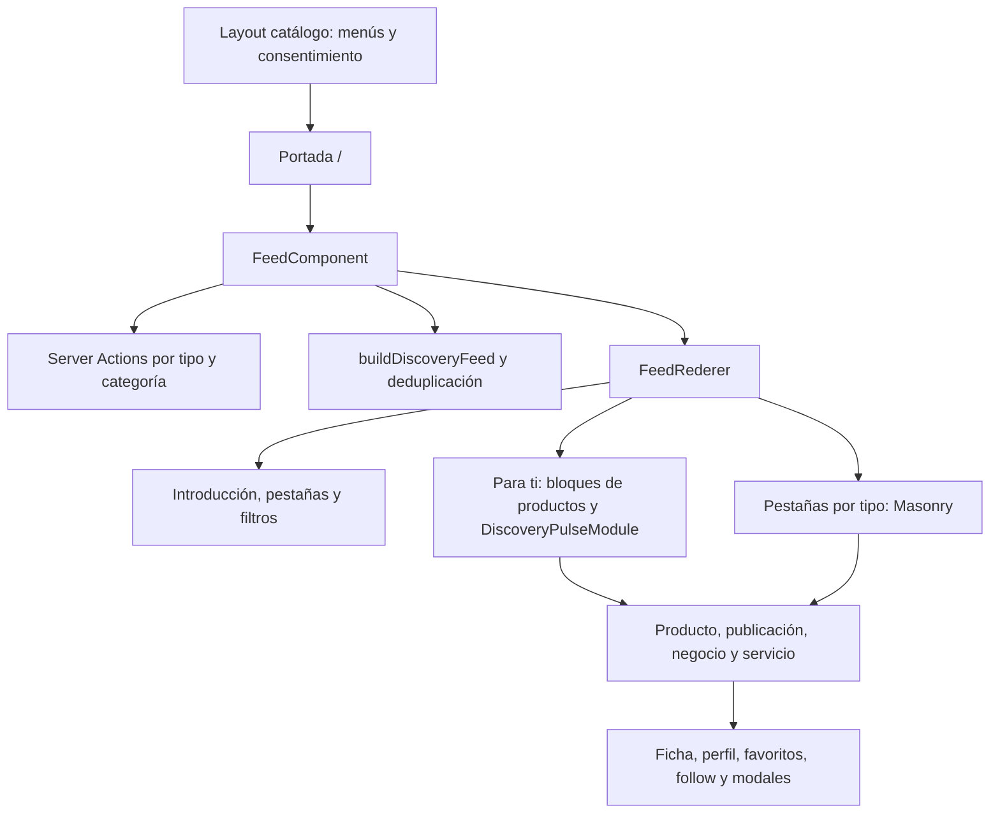
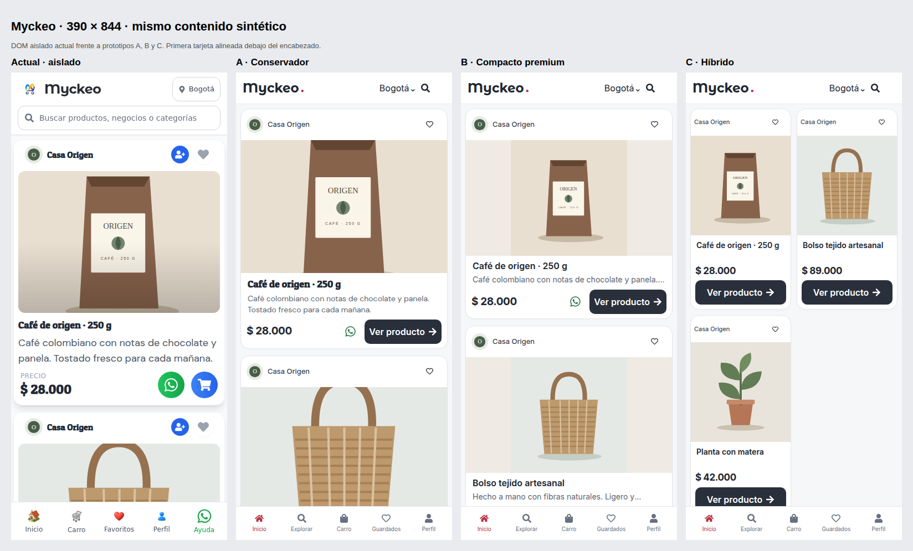
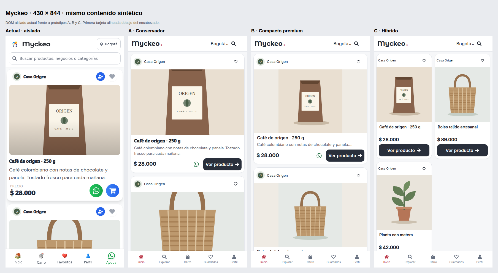

# MYCKEO — Auditoría UX/UI del feed móvil y tarjetas

**Estado: `MYCKEO_MOBILE_FEED_UX_AUDIT_READY`**

Fecha: 15 de noviembre de 2026. Revisión inspeccionada: `1f491ff8ce6f80e333f07548e299141fc863d993`.

La recomendación es **B como base del feed móvil**, con módulos de dos columnas de C únicamente cuando el ancho y el contenido lo permitan. El problema principal combina una tarjeta de producto rígida de 480 px, introducciones extensas y varias capas de navegación. Reducir únicamente las fotos dejaría sin resolver la llegada al contenido y los recortes con títulos largos.

Este trabajo entrega análisis, prototipos separados, mediciones y capturas. No modifica componentes productivos, Prisma, Cloudinary, autenticación, APIs, CI ni infraestructura. No se ejecutaron commits, pushes, merges ni despliegues.

## 1. Alcance y calidad de la evidencia

Se inspeccionó el código y se renderizaron los componentes actuales con Playwright en un entorno local aislado. **Las mediciones son reales del DOM del entorno aislado; no son mediciones de una sesión de producción.** Las alternativas son prototipos independientes, también medidos en el navegador. No se realizaron pruebas de usuarios ni se midió conversión.

No hay una captura adjunta accesible en esta conversación. La referencia visual usada es el repositorio y las capturas generadas durante la auditoría. No se accedió a una sesión real, datos de clientes, base de datos ni servicios de multimedia. Los seis contenidos de ejemplo —tres productos, una publicación, un negocio y un servicio— son sintéticos, con dibujos SVG locales y las fuentes existentes de Myckeo. Se mantiene el mismo contenido y orden de presentación en las cuatro variantes.

El entorno conserva el JSX de las tarjetas actuales, `FeedRederer`, menús, categorías, buscador y helpers de presentación. Sustituye las fronteras con Next y datos: imágenes por `` con `fill` equivalente, links por enlaces HTML, sesión/stores por estado sintético, acciones por funciones inertes y modales de publicación/menú/creación por componentes cerrados. Reproduce la composición visual del layout sin geolocalización, consultas ni footer legal. Por ello no valida `next/image`, latencias, carga real, autenticación, compras, paginación ni reproducción de video. Detalle y reproducción: [README del entorno](mobile-feed-audit/README.md).

Evidencia:

- [Mediciones originales](mobile-feed-audit/measurements.json): 39 escenarios, coordenadas y alturas por componente, overlays, conteos y controles pequeños.
- [Manifiesto de fuentes](mobile-feed-audit/source-manifest.json): revisión y hashes de los archivos incorporados al renderizado.
- [Comparación a 390 px](mobile-feed-audit/preview/screenshots/comparison-390.png) y [a 430 px](mobile-feed-audit/preview/screenshots/comparison-430.png).
- [Prototipo navegable local](mobile-feed-audit/preview/index.html), que necesita el servidor descrito en el README.

Las observaciones se distinguen como **DOM**, **código** o **hipótesis de diseño**. Las alturas de los prototipos no predicen resultados de uso.

## 2. Arquitectura del feed y componentes compartidos

### Rutas y composición

La portada real es **`/`**, implementada en [`src/app/(catalogo)/page.tsx`](../src/app/(catalogo)/page.tsx). **`/inicio` es un placeholder** con dos títulos; no es el feed observado.

| Pieza | Archivo | Responsabilidad y reutilización |
|---|---|---|
| Datos y estado del feed | [`FeedComponent.tsx`](../src/feed/componentes/FeedComponent.tsx) | Cuatro consultas infinitas, pestañas, ubicación, vistos y mezcla. Usado en portada, `/category/[slug]` y `/[categoria]`. Categoría abre Productos; portada abre Para ti. |
| Composición visual | [`FeedRederer.tsx`](../src/publicaciones/componentes/FeedRederer.tsx) | Nombre de archivo con esa ortografía. Introducciones, tabs, filtros, agrupación y tarjetas. Para ti abre con tres productos en home, cuatro en categoría, si existen. |
| Producto | [`ProductCard.tsx`](../src/ui/components/productos/ProductCard.tsx) | El feed usa `variant="default"`. `ProductGridProduct` también lo usa en relacionados de ficha y listados de sección. El perfil comercial, vía `SectionFilterBar`, usa `business_profile`, con altura automática y otra composición. |
| Publicación del feed | [`DiscoveryPublicationCard.tsx`](../src/feed/componentes/DiscoveryPublicationCard.tsx) | Vista previa, conteos y apertura de `PublicationModal`; no es el carrusel del perfil. |
| Negocio del feed | [`DiscoveryBusinessCard.tsx`](../src/feed/componentes/DiscoveryBusinessCard.tsx) | Portada, ubicación, follow, perfil, WhatsApp y mapa. |
| Servicio del feed | [`DiscoveryServiceCard.tsx`](../src/feed/componentes/DiscoveryServiceCard.tsx) | Título/precio, foto o vista previa de video, resumen y contacto mediante perfil/WhatsApp. |
| Contenedor de descubrimiento | [`DiscoveryPulseModule.tsx`](../src/feed/componentes/DiscoveryPulseModule.tsx) | Rodea publicaciones, negocios y servicios con otro título, badge, ciudad, descripción y padding. Agrega altura exterior a la tarjeta. |
| Compra y precio | `ProductQuickAddModal`, `useQuickAddSelection`, `variantDisplay`, `Precio` | Precio desde, variantes, stock, cantidades y confirmación. Compartidos con superficies de producto; no duplicar reglas al cambiar el feed. |
| Acciones compartidas | `FollowButton`, `AddFavorites` | Follow con sesión/query/actualización optimista; favoritos con Zustand. `AddFavorites` se importa también desde otras superficies de producto. |
| Publicaciones en perfil/detalle | `FeedPublicaciones`, `SocialMediaPublicacion`, `ShowTestimonioPublicacion`, `PublicationModal`, `Interactions` | Carrusel, reseñas, estrellas, reacciones y comentarios. El perfil usa `FeedPublicaciones`; `/carrusel` usa `SocialMediaCarousel`. Cambiar estos archivos afectaría más que el feed de portada. |
| Servicios en perfil | `ServicioViewer` | Carrusel y modal propios. No es la tarjeta activa del feed. |
| Navegación | `TopMenuMobile`, `TopMenu`, `publicNavigation.module.css`, `MenuSectionBar`, `SearchBar` | Compartidos por el layout catálogo: perfiles, productos, carro, reservas y otras páginas públicas. Tienen modo compacto para descubrimiento. |
| Layout | [`(catalogo)/layout.tsx`](../src/app/(catalogo)/layout.tsx) | Escoge móvil con `innerWidth <= 768`, monta consentimiento y footer. Render inicial usa estado no móvil hasta el efecto: posible cambio visual de hidratación, no medido aquí. |

`BusinessCard.tsx` es una implementación anterior de 480 px, pero **no se importa desde el renderer activo**. `FeedCategoryComponente.tsx` y `MediaSlide.tsx` están vacíos. El `MediaSlide` que sí funciona está definido dentro de los componentes multimedia. No atribuir al feed actual las dimensiones de esos archivos antiguos o vacíos.

### Carga, scroll y orden

**Código:** `FeedComponent` usa TanStack `useInfiniteQuery` por tipo; límite 10 por consulta en Para ti y 20 en pestañas individuales. El cursor viene de las Server Actions `getFeedDataByType`/`getFeedDataByCategory`. `useInView` observa un sentinel con `rootMargin: 200px`; en Para ti solicita la siguiente página del tipo con menos elementos entre los candidatos disponibles. Hay deduplicación, reintentos, caché, notificación de errores, estados vacíos y reciclado de vistos al agotarse un ámbito.

La carga inicial muestra un spinner centrado en `min-h-screen`; la siguiente página usa ocho skeletons con medio `h-40`. No se observó virtualización de tarjetas en este recorrido. Los skeletons son bastante más bajos que algunas tarjetas finales: riesgo de desplazamiento visual, no cuantificado como CLS.

`buildDiscoveryFeed` mezcla tipos, pero `FeedRederer` vuelve a agruparlos en cadencias. En móvil aparecen primero tres productos completos antes de la primera publicación, con independencia de que hubiera una publicación temprana en la mezcla anterior. Con los fixtures, esa publicación empieza a 2231,5 px del documento a 390 px. Es una causa de poca variedad inicial además de la altura de cada tarjeta.

`markAsSeen` marca los elementos cargados, sin comprobar exposición individual en pantalla. No equivale a una impresión visible. Mantener esta lógica fuera del rediseño visual y no usarla como métrica de descubrimiento sin una revisión independiente.

## 3. Inventario visual actual

### Producto — variante del feed

**Estructura:** encabezado de negocio con avatar, nombre, follow y favorito → foto enlazada y badges → título enlazado y descripción corta → precio, WhatsApp opcional y carrito. Contenedor flex de **480 px fijos**, `overflow-hidden`, padding 8 px, borde de 1 px, radio 16 px y `shadow-lg`, que aumenta al hover. Ancho móvil completo con 4 px de margen del feed a cada lado.

**Imagen:** caja de 256 px, ancho disponible, `object-cover`, radio 12 px. Segunda imagen cambia al hover; en móvil no debe considerarse contenido accesible. Imagen y título llevan a `/producto/[slug]`. Hay fallback si la imagen no es válida o falla.

**Texto:** nombre del negocio truncado; avatar de 32 px. Producto en Patua One, 18/28 px, peso solicitado extrabold; **sin límite de líneas en el título**. Descripción corta en DM Sans, 18/28 px, máximo dos líneas; si falta se muestra “Sin descripción disponible”. Precio en Patua One, 24/32 px, con etiqueta “Precio” o “Desde” de 12 px. Esta mezcla de fuentes y pesos crea una jerarquía distinta de las otras tarjetas.

**Acciones:** follow 32 × 32 px; favorito 36 × 36 px sin nombre accesible explícito; WhatsApp y carrito de aproximadamente 48 × 48 px en móvil. El carrito del feed abre el modal de cantidad/variantes; el agregado directo de la variante del perfil no debe trasladarse automáticamente a esta tarjeta.

**Datos ocultos/expandibles:** descripción completa, imágenes adicionales en móvil, variantes, cantidades y stock detallado están en ficha/modal. Se muestran badges de variantes, etiqueta especial y agotado cuando corresponden. Agotado deshabilita compra; éxito muestra overlay temporal mediante portal. No hay un “ver más” para la descripción dentro de la tarjeta.

**Responsive:** altura y foto permanecen 480/256 px aunque cambie el ancho o se alargue el título. Cambia la cantidad de columnas del contenedor. La variante `business_profile` ya tiene altura automática, foto 192/208 px y textos menores, pero también controles de 36 px: es una referencia interna de composición, no una solución para copiar sin revisar.

### Publicación, testimonio y video — vista de descubrimiento

**Estructura:** avatar de 44 px, autor, badge de tipo, tiempo, producto enlazado en reseñas y cantidad de medios cuando hay varios → primer medio como botón de apertura → título, resumen, estrellas opcionales y fila de conteos/“Ver publicación”. Borde de 1 px, radio 16 px, sombra suave y elevación al hover. Header y cuerpo con padding 12 px; altura automática.

**Medios:** vertical 4:5 en móvil; horizontal 16:10; cuadrado 1:1; estado desconocido 4:5. En `sm` cambia otra vez la proporción. La orientación se deduce con `new Image()` después de cargar el recurso, lo que puede alterar la altura. `object-cover` recorta. El video usa póster con varios intentos o superficie oscura con “Ver video”; **no hay un reproductor activo en la tarjeta de descubrimiento**.

**Texto y acciones:** autor 14 px; tiempo 12 px; título Montserrat Alternates 16/24 px, sin clamp; resumen DM Sans 14/24 px, tres líneas con multimedia y cuatro sin ella. Título, descripción o nombre de producto pueden repetir contexto. Los corazones y comentarios de 32 px son **conteos en `span`**, no botones para reaccionar. “Ver publicación” mide 36 px de alto. La foto es otra entrada al mismo modal, una repetición útil para descubrir el detalle, aunque no requiere dos controles visualmente dominantes.

**Oculto/expandible:** resto de multimedia, descripción completa, comentarios y reacciones se consultan en el modal. Las reseñas agregan estrellas y enlace al producto; no deben perderse por unificar la altura. Estado sin medios conserva contexto textual. Fecha, datos y orientación cambian la altura; una foto vertical puede justificar una tarjeta más alta.

### Negocio — tarjeta activa de descubrimiento

**Estructura:** avatar 48 px, nombre, categoría, ciudad/departamento y follow → portada enlazada 16:10 → resumen de tres líneas → perfil, WhatsApp opcional y mapa opcional. Radio 16 px, padding 12 px, borde slate y sombra suave, con elevación al hover. Portada con radio 16 px y zoom al hover.

**Texto:** nombre Montserrat Alternates 16/24 px; categoría 11 px en mayúsculas; ubicación 12 px; descripción DM Sans 14/24 px. No tiene precio. Las acciones hacen wrap: en los fixtures de 390 px, Mapa pasa a una segunda línea y la fila ocupa 84 px. Botones principales 36 px y secundarios alrededor de 38 px; follow 32 px.

**Oculto/expandible:** ficha del negocio, catálogo, ubicación detallada y resto de la descripción se abren mediante perfil/mapa; no hay expansión inline. Hay fallback de imagen y descripción. Su ancho se reduce dentro de `DiscoveryPulseModule`, aumentando el wrap.

### Servicio — tarjeta activa de descubrimiento

**Estructura:** badge naranja “Servicio”, título, autor y precio opcional al lado → multimedia opcional 16:10 → descripción de tres líneas → “Ver negocio” y WhatsApp. Altura automática, padding 12 px, radio 16 px, borde naranja y gradiente blanco/naranja. Header más alto por badge, margen superior del título de 12 px y margen del autor de 8 px.

**Texto:** título Montserrat Alternates 18/24 px, sin clamp; precio 14 px en cápsula; resumen DM Sans 14/24 px. El precio y el título compiten por ancho. Acciones con margen superior de 16 px y wrap; alto aproximado 36–38 px. No hay acciones sociales.

**Medios e interacción:** primera imagen ordenada, `object-cover`; para video muestra una superficie “Vista previa”. Esa superficie no es un reproductor ni un botón de reproducción. Se accede al negocio mediante CTA, no a una ficha dedicada al servicio. La interfaz puede crear una expectativa de play que no cumple la tarjeta.

**Oculto/expandible:** multimedia restante y descripción completa no se expanden en el feed; dependen del perfil. Sin medios desaparece el bloque y disminuye mucho la altura. Precio ausente y teléfono ausente eliminan sus controles respectivos.

### Contenedores, navegación y estados

Los productos de home usan gap de 12 px. Entre un producto y una tarjeta social puede haber aproximadamente **190–199 px de introducción, padding y separación** a 390 px: no es solo un margen CSS de tarjeta. Cada Pulse añade borde, radio 24 px, padding 12/16 px, badge, ciudad repetida, título, explicación, margen al contenido y margen inferior.

La portada añade “Descubre primero”, un párrafo explicativo, cinco pestañas y “Productos para empezar” con otra explicación y etiqueta “Discovery principal”. Es texto sobre cómo está construido el feed, poco útil para elegir contenido. Las pestañas pueden hacer wrap dentro de un carril horizontal; “Para ti” ocupa dos líneas en la captura de 390 px.

En móvil, header fijo con marca/ciudad y buscador en otra fila; debajo, categorías en flujo normal. Navegación inferior fija con Inicio, Carro, Favoritos, Perfil y Ayuda; añade Crear o Mi negocio según sesión. No se encontró otro botón flotante independiente en este recorrido. El consentimiento, con z-index 9999, sí puede cubrir navegación y contenido.

En desktop, el header de descubrimiento es sticky e incluye categorías; no hay barra inferior fija. Existe divergencia de breakpoints: el layout usa móvil hasta 768 inclusive; los clusters de Para ti pasan a dos columnas desde `md=768`, mientras Masonry de pestañas sigue a una columna hasta 768. Debe revisarse también 767/769 antes de implementar.

`FeedRenderer.css` **no está importado en el código inspeccionado**: sus gaps, colores y regla global de foco no describen el DOM medido. `FeedPublicaciones.css` sí se importa en perfiles y usa nombres globales `masonry-*`: posible interferencia tras navegación entre superficies, no reproducida en el entorno aislado.

## 4. Mediciones reales del DOM

### Método y denominadores

Baseline: Chromium headless, escala 1, idioma es-CO, tema claro, fuentes locales cargadas y preferencia de movimiento reducido. Anchos 320, 360, 390, 430, 768, 1024 y 1440 px, **todos con 844 px de alto** para aislar el efecto del ancho. Esto no representa siete modelos físicos de teléfono. Se añadió 320 × 568 para texto extenso y roles.

Se midieron `getBoundingClientRect()`, posición de header, navegación, medios, títulos, descripciones y acciones. Se esperó la estabilización de efectos y fuentes. Un estado es la llegada (`initial`) y otro coloca la primera tarjeta 8 px bajo el header (`aligned`).

Área útil = viewport menos header visible y obstrucción inferior. Sin cookies, móvil: **844 − 113 − 69 = 662 px**. Porcentaje de tarjeta = altura / 844; porcentaje de área útil = altura / área útil. Una tarjeta completa exige estar dentro de esa zona. Una parcial solo significa que una parte intersecta: no prueba que se reconozca el producto. Los conteos incluyen todas las columnas; las equivalencias fraccionarias del JSON son superficie visible, no personas ni impresiones.

### Feed actual: tamaños y visibilidad por ancho

Alturas en px, con el mismo contenido sintético y publicación horizontal. Negocio y servicio están dentro del Pulse de Para ti.

| Ancho × 844 | Header | Barra inferior fija | Área útil | Inicio primera tarjeta | Producto / imagen | Publicación | Negocio | Servicio | Al entrar: completas + parciales | Alineado: completas + parciales |
|---|---:|---:|---:|---:|---:|---:|---:|---:|---|---|
| 320 | 113 | 69 | 662 | 622 | 480 / 256 | 516 | 461 | 497,8 | 0 + 1 | 1 + 1 |
| 360 | 113 | 69 | 662 | 602 | 480 / 256 | 454,5 | 459,5 | 478,8 | 0 + 1 | 1 + 1 |
| 390 | 113 | 69 | 662 | 578 | 480 / 256 | 473,3 | 478,3 | 473,5 | 0 + 1 | 1 + 1 |
| 430 | 113 | 69 | 662 | 578 | 480 / 256 | 498,3 | 457,3 | 498,5 | 0 + 1 | 1 + 1 |
| 768 | 113 | 69 | 662 | 506 | 480 / 256 | 630,8 | 634,5 | 675,8 | 0 + 2 | 2 + 1 |
| 1024 | 171 | 0 | 673 | 471 | 480 / 256 | 658,9 | 665,8 | 683 | 0 + 2 | 2 + 1 |
| 1440 | 171 | 0 | 673 | 427 | 480 / 256 | 527,3 | 519,5 | 560,8 | 0 + 3 | 3 + 2 |

En 1024/1440 el JSON también registra el rectángulo del nav superior (48 px): forma parte del header, **no se resta de nuevo como barra inferior**. La altura 171 incluye las categorías del header desktop.

A 390 px, la tarjeta de producto ocupa **56,9% del viewport y 72,5% del área útil**. Al entrar solo se ven 197 px de la primera tarjeta y su título queda bajo la navegación. Alineada, cabe un producto completo y 162 px del siguiente, principalmente encabezado/foto: dos tarjetas intersectadas no equivalen a dos productos identificables. A 320 × 568 la misma tarjeta ocupa aproximadamente 124% del área útil sin sesión y no cabe completa.

### Anatomía a 390 px

| Tipo | Ancho | Total | Encabezado | Medio | Título | Descripción | Acciones | % viewport / % útil |
|---|---:|---:|---:|---:|---:|---:|---:|---|
| Producto | 382 | 480 | 36 | 256 | 28 | 56 | 48 | 56,9 / 72,5 |
| Publicación horizontal | 356 | 473,3 | 70 | 221,3 | 24 | 72 | 36 | 56,1 / 71,5 |
| Negocio | 356 | 478,3 | 50 | 206,3 | Dentro del header | 72 | 84 | 56,7 / 72,2 |
| Servicio | 356 | 473,5 | 90,5 | 205 | 24 dentro del header | 72 | 38 | 56,1 / 71,5 |

No sumar todas las columnas como si fueran cajas independientes: título de servicio está dentro del header, y padding/márgenes completan el resto. La imagen ocupa 53,3% del producto; el resto también exige rediseño. La publicación y el negocio pierden 26 px de ancho frente al producto por su contenedor exterior, lo que aumenta líneas y wrap.

### Variantes y casos exigentes

| Caso | Resultado DOM | Interpretación |
|---|---|---|
| Producto con título largo, precio de siete dígitos y negocio largo; 320 × 568 | Sigue en 480 px; el fondo de la fila de acciones queda **37 px fuera de la tarjeta** | Recorte real por `overflow-hidden`; no basta con reducir padding. |
| Publicación vertical a 390 px | 694,5 px total; medio 442,5 px | Supera los 662 px útiles, pero conserva una foto vertical protagonista. Necesita contención del contexto, no achatamiento indiscriminado. |
| Publicación cuadrada a 390 px | 606 px; medio 354 px | Ocupa 91,5% del área útil. |
| Video sin póster disponible a 390 px | 694,5 px; superficie 442,5 px | Estado fallback medido. No prueba reproducción, calidad del póster ni rendimiento de video real. |
| Publicación sin medios | 252 px | El tipo de contenido cambia la densidad de manera legítima. |
| Servicio sin medios | 254,5 px | No reservar hueco fotográfico cuando no existe medio. |
| Usuario simulado a 320 × 568 | Barra inferior 73 px | El sexto acceso aumenta la altura; no es una sesión autenticada real. |
| Negocio simulado a 320 × 568 | Barra inferior 79 px | “Mi negocio” y su icono incrementan la altura. |
| Aviso de cookies a 390 px | Overlay de 192 px, desde y=652, cubriendo la barra de 69 px | Descuenta la unión de obstáculos, no 192+69. Quedan 539 px entre header y aviso. |

Las publicaciones vertical/cuadrada usan SVG locales sin transformación. En Cloudinary, el preset `publication-preview` solicita 720 × 540 con crop fill; la orientación deducida puede corresponder a esa imagen ya recortada y no al original. **No extrapolar estos tamaños de fixture a todas las publicaciones reales.** El preset `business-cover` también solicita un recorte distinto de la caja 16:10. Se inspeccionó esta relación; no se cambió Cloudinary.

No se encontró overflow horizontal del documento en los escenarios medidos. Eso no descarta recortes internos: el producto de texto extenso demuestra la diferencia. Los carriles horizontales de categorías y pestañas son scroll intencional.

## 5. Evaluación UX y prioridades

| Prioridad | Hallazgo | Evidencia y efecto |
|---|---|---|
| Alta | Se descubre tarde el primer producto | DOM: inicio a 578–622 px en móviles estrechos; en 320 × 568 no aparece ninguna tarjeta al entrar. |
| Alta | Altura rígida recorta el comercio | DOM: acciones fuera por 37 px con título largo. Código: título sin clamp y contenedor fijo/oculto. |
| Alta | Poca diversidad temprana | Código y DOM: tres productos iniciales, luego primera publicación, rodeada de otra introducción. Aumenta el desplazamiento para llegar al componente social. |
| Alta | Algunos controles pequeños o ambiguos | DOM/código: follow 32 px, favorito 36 px sin label; “Ver publicación” 36 px; conteos con apariencia de botón sin interacción. |
| Media | Descripción de producto compite con el nombre y precio | Dos líneas de 18/28 px: 56 px para información que ya amplía la ficha. Reducir a un resumen sin reducir la legibilidad del nombre. |
| Media | Anidación y redundancia editorial | DOM: alrededor de 190–199 px entre tarjetas de bloques distintos. Ciudad, badges y explicaciones repetidos. |
| Media | Jerarquía comercial inconsistente | Producto: precio grande abajo; servicio: precio pequeño arriba; negocio: tres CTA. Colores, fuentes, sombras y radios varían entre tipos. |
| Media | Barra inferior y consentimiento se superponen | DOM: barra 69–79 px; aviso por encima de la navegación. No hay tratamiento de `safe-area-inset-bottom` en la barra actual. Padding final fijo de 80 px deja escaso margen para roles con barra de 79 px y áreas seguras reales. |
| Media | Estabilidad multimedia | Código: relación de aspecto se actualiza tras carga; los pósteres y transformaciones pueden cambiar el encuadre. No se midió CLS ni ancho de banda real. |
| Media | Expectativa de reproducción incorrecta en servicio | Código: icono de play sobre una superficie sin acción de reproducción. Debe comunicar vista previa o llevar explícitamente al perfil. |
| Media | Descubrimiento y compra comparten demasiados elementos simultáneos | Hipótesis: follow, favorito, dos entradas a detalle y dos acciones comerciales compiten. Priorizar la identificación y una acción principal, conservando los caminos secundarios. |

No toda altura es desperdicio: fotos verticales, reseñas con calificación, contexto del autor, disponibilidad y productos con variantes necesitan espacio. La jerarquía debe adaptarse al tipo y no imponer 360 px a todas las tarjetas.

La barra inferior por sí sola usa 8,2% de un viewport de 844 px; no es la única causa. Header más barra consumen 182 px, y las introducciones empeoran mucho la llegada. Reducir la barra quitando targets táctiles sería una mala compensación; conviene priorizar destinos y asegurar espacio final y áreas seguras.

## 6. Alternativas de diseño y comparación objetiva

Los prototipos A/B/C comparten una **carcasa compacta experimental**: header 57 px con búsqueda como acción, filtros de 56 px en flujo normal, barra inferior 61 px, título breve y primer contenido a 155,5 px. Al desplazarse quedan 726 px útiles. Se cambia el acceso visual a búsqueda/categorías y Ayuda; esas funciones deben conservarse en la implementación, aunque la maqueta no las conecta.

Esto permite comparar las tarjetas sobre una misma base. **La diferencia frente al actual incluye también la carcasa y la retirada de introducciones.** La captura A completa no representa un ajuste exclusivamente de padding: si se conserva la navegación actual, solo se obtiene su ahorro de tarjeta, manteniendo el retraso inicial. Los conteos alineados todavía tienen headers diferentes; para aislar el ahorro usar las alturas y distancias por tarjeta.

### A. Refinamiento conservador

Producto de ancho completo, foto de 240 px, título 18/24 px a dos líneas, resumen hasta dos líneas de 14/20 px, precio y fila táctil. Mantiene el carácter fotográfico y Patua en el nombre del producto. Altura automática: **434 px** en fixtures móviles; **462 px** en el caso largo de 320 px.

Ventajas: cambio limitado de tarjeta, lectura familiar y menor riesgo de alterar selección. Desventajas: ahorro de solo 46 px por producto normal (9,6%); sigue mostrando sobre todo producto en la primera pantalla. Si se retiene el shell actual, las introducciones seguirán dominando. Los controles deben ganar área táctil aunque el icono no cambie.

### B. Feed compacto premium

Producto de ancho completo, header compacto, imagen adaptable 16:9 para estos objetos, nombre 16/21 px de hasta dos líneas, descripción 14/20 px de una línea, precio 19 px y CTA explícito. Imágenes sintéticas de producto se muestran con `contain` para no cortar el objeto; el fondo evita una superficie vacía blanca. No se fuerza 16:9 sobre imágenes de contexto que necesiten 4:3 o cuadrado.

Altura normal de **341–403 px** entre 320 y 430 px; **380,3 px a 390 px**. Reduce 99,7 px (20,8%) frente a 480 px a ese ancho. La foto de 209,3 px solo explica 46,7 px del ahorro; el resto viene de jerarquía y texto. La ficha mantiene la información completa y la compra.

Ventajas: más del segundo producto visible, buena lectura, acción comercial inequívoca y menor competencia visual. Desventajas: un resumen de una línea puede esconder diferenciadores; `contain` hace el objeto menos grande en pantalla; la relación debe elegirse con cuidado. Requiere variante explícita del feed y revisar accesos secundarios, no solo cambiar clases globales.

### C. Diseño híbrido

Productos B en una columna a 320/360 px; módulo de **dos columnas únicamente desde 390 px**, con título de hasta dos líneas, precio, favorito de 44 px y CTA de 44 px. La descripción pasa a la ficha; WhatsApp no ocupa cada mini tarjeta y debe seguir accesible en ficha. Publicaciones permanecen a ancho completo; servicios usan miniatura de 88 px y texto lateral, sin competir como póster social. Negocios conservan identidad y entrada al perfil.

En los fixtures, cada producto del módulo mide **363,5 px a 390 px y 383,5 px a 430 px**. La ganancia proviene de mostrar dos productos por fila, no de una altura extrema. La publicación horizontal mide 423,5/448,5 px; negocio 330 px; servicio 202 px.

Ventajas: dos opciones comprables completas en la llegada y conservación de multimedia social grande. Desventajas: menos contexto por producto, más decisiones visuales y riesgo de títulos truncados. Tres fixtures producen una fila con un solo producto: el prototipo deja ese caso visible deliberadamente. La implementación debería formar módulos de dos o cuatro y devolver el sobrante al flujo, sin duplicar ni ocultar productos. No usar Masonry de alturas arbitrarias en esos módulos móviles.

### Comparación a 390 × 844 y 430 × 844

`C + P` = tarjetas completas + parciales dentro de la zona no tapada. Los tamaños son DOM de los prototipos, no estimaciones de una implementación futura.

| Variante | Producto a 390 / 430 | Imagen a 390 / 430 | Al entrar a 390 / 430 | Alineado a 390 / 430 | Parte visible del siguiente producto a 390 | Complejidad |
|---|---|---|---|---|---:|---|
| Actual aislado | 480 / 480 | 256 / 256 | 0C+1P / 0C+1P | 1C+1P / 1C+1P | 162 px | Referencia |
| A | 434 / 434 | 240 / 240 | 1C+1P / 1C+1P | 1C+1P / 1C+1P | 272,5 px | Baja para tarjeta; media si incluye carcasa |
| B | 380,3 / 402,8 | 209,3 / 231,8 | 1C+1P / 1C+1P | 1C+1P / 1C+1P | 326,3 px | Media |
| C | 363,5 / 383,5, dos por fila | 180 / 200, cuadradas | 2C+1P / 2C+1P | 2C+1P / 2C+1P | 345 px del tercer producto | Media-alta |

B no logra mágicamente dos productos completos a 390 px: muestra uno completo y gran parte del siguiente, con más posibilidades de identificarlo. C tiene el mayor número visible pero traslada información al detalle. No se infiere mayor conversión de ninguno de estos conteos.

Para comparar solo desplazamiento entre productos homogéneos a 390 px: paso actual **492 px** (480+12), A **446 px**, B **392,3 px**. Es aproximadamente 9,3% y 20,3% menos recorrido respectivamente, antes de considerar el shell. No es una medición de esfuerzo subjetivo ni de tiempo de usuario.

### Efectos e interacción

| Aspecto | A | B | C |
|---|---|---|---|
| Legibilidad | Nombre familiar 18 px, menos texto | Nombre 16 px, resumen 14 px y precio claro | Nombre 14 px en mini tarjeta; exige comprobar longitud y zoom |
| Tacto | Controles de al menos 44 px | Una acción principal de al menos 44 px; secundarias discretas | CTA en cada celda; nunca dos botones pequeños compartiendo el precio |
| Fotos | Ajuste de altura pequeño; puede recortar | Proporción y ajuste según tipo de foto; objeto completo cuando sea apropiado | Cuadradas en módulo, imagen mayor en publicación |
| Videos | Póster y reproducción al abrir detalle | Igual patrón; reservar espacio antes de cargar | Video siempre fuera de las dos columnas; protagonismo social |
| Servicios | Puede conservar su diseño con menos texto | Miniatura y resumen específicos | Miniatura y agrupación controlada, separada del módulo de productos |
| Información oculta | Menor resumen; resto en ficha | Resumen de una línea; resto en ficha | Descripción fuera del módulo; variantes y contacto en ficha |
| Riesgo principal | Ahorro insuficiente si no cambia el preámbulo | Encuadre o resumen demasiado restrictivos | Caos visual, omisión de contexto y filas huérfanas |

Matriz adicional: altura del primer producto y conteo al entrar (`C + P`). Se mantiene el viewport de 844 px de alto; las alturas de publicación, negocio y servicio y la geometría de cada elemento quedan en el JSON.

| Ancho | A: altura; visibles | B: altura; visibles | C: altura; visibles |
|---|---|---|---|
| 320 | 434; 1C+1P | 340,9; 1C+1P | 332,9; 1C+1P |
| 360 | 434; 1C+1P | 363,4; 1C+1P | 355,4; 1C+1P |
| 390 | 434; 1C+1P | 380,3; 1C+1P | 363,5; 2C+1P |
| 430 | 434; 1C+1P | 402,8; 1C+1P | 383,5; 2C+1P |
| 768 | 434; 2C+1P | 378; 2C+1P | 370; 2C+1P |
| 1024 | 434; 2C+1P | 441; 2C+1P | 433; 2C+1P |
| 1440 | 434; 3C+1P | 366,4; 3C+1P | 358,4; 3C+1P |

En 768 px los prototipos usan dos columnas para productos; 1024 usa dos y 1440 tres. Son decisiones de maqueta: no se propone sustituir automáticamente los breakpoints de todas las páginas.

## 7. Propuesta premium recomendada

**Adoptar B como lenguaje principal y habilitar C por módulo, no como modo general del feed.** A puede ser una intervención inicial de menor alcance, pero no resuelve por sí sola el descubrimiento.

1. **Llegada al contenido.** Sustituir explicaciones internas por un título breve contextual, como “Descubre cerca de ti”. Conservar ciudad y búsqueda, con categorías accesibles sin mantener dos introducciones simultáneas. Meta de diseño: primer contenido en torno a 150–190 px en 390 × 844 sin avisos. Es un criterio para validar, no un resultado productivo.
2. **Producto identificable.** Negocio breve, imagen, nombre de hasta dos líneas, precio y acción principal. Altura automática; jamás cortar el precio para imponer un objetivo de altura. Descripción corta opcional de una línea; evitar “Sin descripción disponible” si no ayuda a decidir. La foto debe mostrar el producto completo o un recorte editorial intencional, según categoría.
3. **Conversión.** Foto y nombre abren la ficha actual. Para productos simples, evaluar conservar agregado rápido explícito; para variantes, “Elegir opciones”. El prototipo usa “Ver producto” para representar la entrada a ficha y no simula una compra. Conservar WhatsApp con buen acceso en tarjeta/ficha según espacio; no retirarlo del producto real sin comprobar el recorrido.
4. **Publicación con contexto.** Autor, tiempo y medio como protagonistas. Texto hasta dos o tres líneas y expansión al abrir. Mantener calificación y producto de reseñas. Vertical hasta 4:5 cuando aporta valor; no convertir video en una miniatura ilegible ni imponerle la misma altura que a un producto.
5. **Servicios específicos.** Miniatura y título/precio/resumen con CTA “Consultar”. Si la tarjeta solo dirige al perfil, comunicar ese destino con claridad. El detalle y la reserva siguen donde ya existen; no inventar un flujo nuevo desde el feed.
6. **Cadencia predecible.** Mostrar una señal social tras uno o dos productos o un módulo acotado. Evitar introducir un título explicativo para cada cambio de tipo. La disponibilidad manda: no forzar bloques vacíos ni duplicar contenido para completar una cuadrícula.
7. **Sistema visual común.** Espaciado de 4/8/12/16 px, radios 12–16 px, borde neutro y sombra discreta; eliminar sombras de texto y acumulación de gradientes en superficies pequeñas. Usar una fuente de interfaz consistente para precios y acciones; mantener Montserrat Alternates en marca/identidad. La presencia de Patua en títulos es una decisión de marca a revisar, no una obligación de reducirla a tamaños mínimos. Reutilizar los colores existentes (`#428f99`, `#d44b7c` y el acento `#c93545` de navegación) con funciones claras y moderación.
8. **Navegación.** Mantener targets cercanos a 44 × 44 px o mayores, labels legibles, estado activo, foco y nombres accesibles. Revisar si Ayuda puede pasar al menú para conservar cuatro o cinco destinos principales; preservar Crear/Mi negocio según rol. No eliminar accesos sin diseñar su nueva ubicación. Respetar área segura inferior y reservar padding/scroll-padding según altura real de la barra.
9. **Accesibilidad y movimiento.** No depender del hover para cambiar imagen o revelar acciones. Respetar movimiento reducido en las animaciones reales y probar teclado, lector de pantalla y tamaño de texto aumentado. El browser del entorno usa preferencia reducida, pero eso no certifica que Framer Motion la aplique: el código no configura todos sus efectos con esa preferencia.

## 8. Componentes candidatos a cambios futuros

| Componente | Cambio propuesto | Límite de alcance |
|---|---|---|
| `FeedRederer` | Preámbulo, jerarquía de pestañas, cadencia y módulos acotados | No reinterpretar score, cursores ni visibilidad del negocio. |
| `DiscoveryPulseModule` | Eliminar introducciones repetidas; contenedor ligero o título único cuando aporte contexto | No envolver cada tarjeta en otra tarjeta de forma sistemática. |
| `ProductCard` | Añadir variante explícita `feed`; altura automática, clamp y acción clara | Mantener `default` de otras páginas y `business_profile`; no cambiar todas las instancias mediante CSS global. |
| `DiscoveryPublicationCard` | Header compacto, estabilidad de proporción, resumen y affordances | Conservar reseñas, estrellas, autor, contador de medios y acceso a modal. |
| `DiscoveryBusinessCard` | Jerarquía y acciones que no formen filas innecesarias | Conservar perfil, follow, ubicación y acceso a mapa/contacto. |
| `DiscoveryServiceCard` | Composición propia con miniatura y CTA consistente con destino | No confundirlo con `ServicioViewer` ni inventar reproducción inline. |
| `TopMenuMobile`, `TopMenu`, `publicNavigation.module.css`, `MenuSectionBar`, `SearchBar` | Variante de descubrimiento con menos ocupación; categorías y ayuda localizables | Son compartidos con todo el catálogo; proteger perfiles, producto y búsqueda. |
| `FollowButton`, `AddFavorites` | Área táctil y etiquetas accesibles | Mantener estado, sesión y persistencia; evitar una reducción global de iconos. |
| Layout catálogo | Espacio final, área segura y coexistencia con consentimiento | Evaluar visualmente sin cambiar el mecanismo de consentimiento o autenticación en esta fase. |
| Skeletons del renderer | Reservar dimensiones próximas al contenido esperado | No añadir carga pesada ni más solicitudes de datos. |

No se necesita modificar Prisma, Cloudinary, autenticación, APIs, CI ni infraestructura para decidir y prototipar esta dirección. Cualquier futura necesidad de metadatos de medios debe evaluarse por separado; no forma parte de esta auditoría.

## 9. Funcionalidades que deben preservarse y riesgos

| Flujo o estado | Debe mantenerse | Riesgo al compactar |
|---|---|---|
| Identificación | Nombre del producto, negocio y precio legibles; acceso por imagen/título | Mostrar fotos sin identificar el artículo o ocultar el precio. |
| Compra | Carrito, cantidad, variantes activas, precio desde, stock y agotado | Hacer agregado directo cuando se necesita seleccionar variante; precio distinto entre tarjeta y modal. |
| Contacto | WhatsApp y destino de perfil/mapa correctos | Quitar el camino comercial secundario o dejarlo inaccesible en móvil. |
| Favoritos/follow | Persistencia y actualización de estado; login cuando corresponde | Reducir targets, quitar labels o hacer que la tarjeta completa intercepte el toque. |
| Social | Reacciones, comentarios y conteos sincronizados al volver del modal | Convertir conteos en falsos botones o perder interacción por truncado. |
| Multimedia | Orden, cantidad, póster, fallback y reproducción explícita en detalle | Cargar todos los videos, recortar objetos importantes o mover el scroll al cargar imágenes. |
| Reseñas | Estrellas, calificación y enlace al producto | Tratar un testimonio como publicación genérica y perder su valor comercial. |
| Feed | Pestañas, filtros, contexto de categoría, dedupe, paginación y recuperación de errores | Duplicar al formar módulos, alterar orden al añadir páginas o perder posición al volver de ficha. |
| Visibilidad de datos | Políticas actuales de negocio y publicación | Mostrar contenido oculto/archivado por cambiar cómo se agrupan los elementos. |
| Analítica | Eventos existentes de ficha, WhatsApp, modal y carrito | Perder atribución o contar contenidos cargados como vistos. |
| Páginas compartidas | Perfiles tradicionales/restaurante, relacionados y listados | Aplicar reglas del feed a catálogos o afectar CSS global de Masonry. |
| Navegación y capas | Sesiones/roles, modales, buscador, cookies, foco y scroll del body | Barra encima del modal, campos bajo el teclado, pérdida de ayuda o contenido final tapado. |

El feed no monta reproductores de video por cada vista previa: es una decisión favorable para evitar reproducción simultánea. En los carruseles de detalle inspeccionados se usa `<video controls preload="metadata" playsInline muted={false}>`; mantener la reproducción explícita. `new Image()` para orientar el medio puede anticipar la descarga aunque el `<Image>` visual sea lazy. El entorno no reproduce esa red ni el coste de decodificación, así que no permite afirmar ahorro de MB o mejora de FPS.

### Validación necesaria antes de implementar o aceptar un cambio

- Revisar una sesión real y muestras variadas: nombres largos, precios grandes, productos con/sin variantes, stock cero, imágenes ausentes/fallidas, diferentes orientaciones, testimonios y servicios sin precio.
- Repetir 320, 360, 390, 430, 768, 1024 y 1440 px, además de 767/769, alturas cortas, zoom/texto aumentado, teclado abierto y áreas seguras en iOS/Android reales.
- Verificar ficha → volver al mismo scroll; carrito y selección de variantes; favoritos/follow; publicación → comentar/reaccionar → cerrar; WhatsApp/mapa y búsqueda/categorías. No modificar estos flujos para acomodarlos a la maqueta.
- Verificar nuevas páginas del feed y cambio de pestaña sin remounts visibles ni alteración inesperada del orden. Medir imágenes/pósteres lentos, layout shifts, solicitudes y scroll con muchos elementos.
- Comparar exposición reconocible: nombre y precio visibles por pantalla; desplazamiento hasta el siguiente tipo de contenido y hasta el siguiente producto. Añadir pruebas de tareas para decidir entre A/B/C, sin presumir resultados a partir de densidad.

## 10. Capturas, prototipos y cierre

Las imágenes de comparación alinean la primera tarjeta bajo el encabezado para inspeccionar densidad. Las capturas `initial` conservan el estado de llegada y las `full` muestran los seis contenidos. Las diferencias entre ambas son esenciales: el actual pierde mucho espacio antes de la primera tarjeta.

| Vista | 390 px: llegada / página completa | 430 px: llegada / página completa |
|---|---|---|
| Actual aislado | [Llegada](mobile-feed-audit/preview/screenshots/current-390-initial.png) · [Completa](mobile-feed-audit/preview/screenshots/current-390-full.png) | [Llegada](mobile-feed-audit/preview/screenshots/current-430-initial.png) · [Completa](mobile-feed-audit/preview/screenshots/current-430-full.png) |
| A | [Llegada](mobile-feed-audit/preview/screenshots/A-390-initial.png) · [Completa](mobile-feed-audit/preview/screenshots/A-390-full.png) | [Llegada](mobile-feed-audit/preview/screenshots/A-430-initial.png) · [Completa](mobile-feed-audit/preview/screenshots/A-430-full.png) |
| B | [Llegada](mobile-feed-audit/preview/screenshots/B-390-initial.png) · [Completa](mobile-feed-audit/preview/screenshots/B-390-full.png) | [Llegada](mobile-feed-audit/preview/screenshots/B-430-initial.png) · [Completa](mobile-feed-audit/preview/screenshots/B-430-full.png) |
| C | [Llegada](mobile-feed-audit/preview/screenshots/C-390-initial.png) · [Completa](mobile-feed-audit/preview/screenshots/C-390-full.png) | [Llegada](mobile-feed-audit/preview/screenshots/C-430-initial.png) · [Completa](mobile-feed-audit/preview/screenshots/C-430-full.png) |

[Ejemplo con aviso de cookies](mobile-feed-audit/preview/screenshots/current-390-cookies-1-initial.png). Los textos de las maquetas son ejemplos, no una propuesta de contenido comercial definitivo. Los controles sin conexión a datos no demuestran funcionamiento de producción.

La validación local incluye compilación de los prototipos, **39 escenarios de geometría completados con Chromium 140.0.7339.186**, y comprobación de guardar y abrir/cerrar ficha ilustrativa. No hubo errores de JavaScript, imágenes rotas ni overflow horizontal del documento en esos escenarios; el recorte vertical interno descrito sí está presente en la tarjeta actual de texto largo. No se solicitaron recursos de orígenes externos. Los enlaces documentales y los hashes de las fuentes incorporadas también se verificaron. Los resultados se registran en `measurements.json`. No se requieren pruebas de base de datos ni un build/despliegue de la aplicación para este entregable documental. El código productivo permanece intacto.

**Decisión propuesta para la siguiente fase:** variante B del producto y simplificación del preámbulo; después evaluar módulos C con tareas reales. La aprobación de esa fase no se presupone y aquí no se implementa.

`MYCKEO_MOBILE_FEED_UX_AUDIT_READY`
