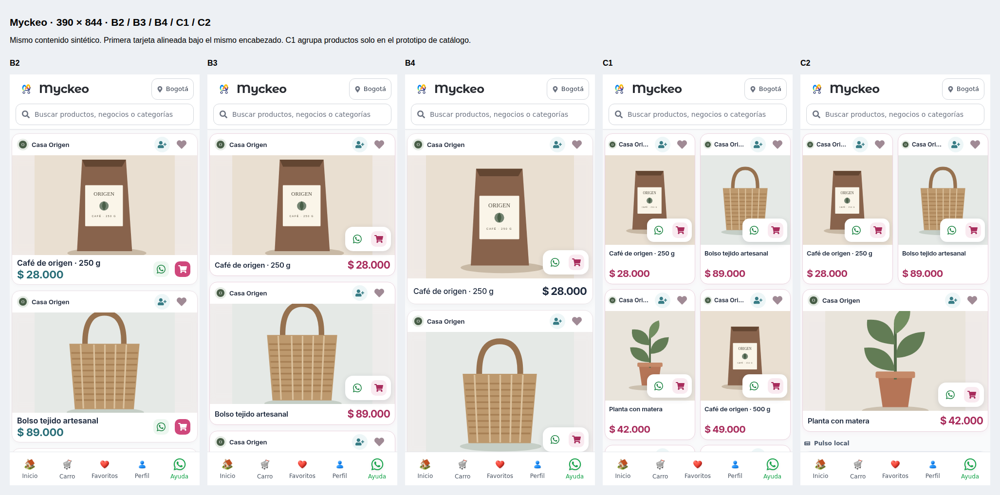

# Myckeo — Comparación final de tarjetas de producto móviles

Estado: `MYCKEO_MOBILE_FEED_VARIANTS_COMPARISON_READY_FOR_REVIEW`

## Decisión propuesta

Usaría **B3 para los productos del feed general** y **C2 para módulos acotados de discovery desde 390 px**. Descartaría **C1 como layout general del feed mixto**. B4 funciona como opción editorial para una selección especial, pero no responde bien al objetivo principal de reducir desplazamiento.

La elección sigue pendiente de revisión visual. Esta entrega **no adopta ninguna variante**: B2 continúa siendo la implementación productiva del workspace. Los archivos de `src/` conservan sus hashes del inicio de esta exploración, incluidos los cambios de fases anteriores que ya estaban sin commit.

## Comparación visual

Abrir la [galería local](mobile-feed-variants/index.html), que permite cambiar ancho, llegada al feed, tarjeta alineada, orientaciones y casos largos. Para interactuar con los prototipos, seguir el [README](../e2e/mobile-feed-variants/README.md).

| Evidencia | Comparación |
| --- | --- |
| 320 px | [Captura comparativa](mobile-feed-variants/screenshots/comparison-320.png) |
| 390 px | [Captura comparativa](mobile-feed-variants/screenshots/comparison-390.png) |
| 430 px | [Captura comparativa](mobile-feed-variants/screenshots/comparison-430.png) |
| 768 px | [Captura comparativa](mobile-feed-variants/screenshots/comparison-768.png) |
| Ritmo completo a 390 px | [B2](mobile-feed-variants/screenshots/b2-390-full.png) · [B3](mobile-feed-variants/screenshots/b3-390-full.png) · [B4](mobile-feed-variants/screenshots/b4-390-full.png) · [C1](mobile-feed-variants/screenshots/c1-390-full.png) · [C2](mobile-feed-variants/screenshots/c2-390-full.png) |



En las capturas alineadas se coloca la primera tarjeta 8 px debajo del header. Esto permite comparar las tarjetas sin que el texto previo cambie la lectura. Las capturas `*-initial.png` conservan la llegada real del renderer, con ciudad, pestañas y contexto existentes. Las capturas completas sirven para comparar secuencia; el header y la navegación fija aparecen una vez en el documento largo, por lo que no deben usarse para contar contenido por viewport.

## Referencias y criterio visual

Se consultaron fuentes oficiales y ejemplos públicos, sin iniciar sesión en aplicaciones. La inspección visual se apoyó en las imágenes públicas de Pinterest y Dawn; las referencias de Meta y TikTok aportan ejemplos documentados de descubrimiento y acceso a producto. No se presenta esta revisión como una auditoría de sus interfaces autenticadas actuales.

| Referencia | Patrón útil y adaptación | Qué evitar |
| --- | --- | --- |
| [Instagram Shopping / Shops, Meta, 2020](https://about.fb.com/news/2020/05/introducing-facebook-shops/) | Descubrimiento por imágenes y colecciones, acceso a ficha y contacto comercial. Myckeo conserva negocio identificable y enlace de ficha desde imagen y título. La fuente es histórica. | Copiar una antigua pestaña Shop como si fuera navegación vigente, ni trasladar checkout o acciones ajenas al producto. |
| [Pinterest Shopping](https://business.pinterest.com/shopping/) | Imagen fuerte con poca información comercial. El ejemplo visual de H&M muestra nombre/precio sobre una composición visual; Myckeo lleva el precio a una superficie sólida legible. | Masonry indiscriminado y texto sobre fondos variables: perjudicarían la lectura del feed mixto. No se trasladan sus estadísticas comerciales. |
| [TikTok Product Shopping Ads](https://ads.tiktok.com/resources/help/article/advertise-using-product-images-from-tiktok-shop?lang=en) y [ejemplos oficiales, pp. 27–29](https://ads.tiktok.com/business/library/Be_Home_And_Living_Next_Big_Thing_SMB_NA.pdf) | Imagen + acceso a ficha y producto cercano al contenido. Inspira la proximidad de la acción a la foto. La pill blanca de B3/B4 es una propuesta propia para los handlers de Myckeo. | Video a pantalla completa, autoplay, contadores de urgencia y densidad publicitaria. |
| [Dawn, Shopify](https://themes.shopify.com/themes/dawn/presets/dawn) | Fotos grandes, líneas limpias y nombre/precio breves. La cuadrícula es útil cuando la intención es comparar productos. | Convertir todo el feed social en catálogo, o trasladar el gran hero y el espacio editorial a cada tarjeta. |

Acentos: rubí `#a82c5c` en precio/carrito, fondo rosa suave `#f9eaf0`, borde `#ead3de` y sombra tenue. Se mantienen los tonos de follow y WhatsApp existentes. Se toma la familia rosa de la identidad Myckeo como criterio, sin reproducir todos los colores del logo en una tarjeta.

## Variantes construidas

| Variante | Composición | Ventajas | Desventajas / interacción | Complejidad de una futura integración |
| --- | --- | --- | --- | --- |
| B2, referencia actual | Header de 44 px; foto panorámica; nombre arriba de precio; acciones junto al bloque comercial. | Foto libre de botones comerciales y nombre de hasta dos líneas. | Más alto que B3; menos separación entre precio y acciones. | Ya existe. |
| B3, premium compact | Header de 44 px; mismo bloque de imagen de B2; pill blanca abajo a la derecha; título truncable a la izquierda y precio rubí a la derecha. Descripción oculta. | Una sola lectura comercial y mayor proporción de foto dentro de la tarjeta. Se ahorran 18 px en la tarjeta normal, sin reducir su imagen. | El título pierde texto visible; la pill oculta parte de la foto. La ganancia de altura es moderada y no garantiza un producto completo adicional. | Baja–media: reubicar el mismo JSX de acciones fuera del enlace, con estilos y fallback responsive específicos. |
| B4, editorial | Foto 1.5:1, hasta 276 px; más padding; precio oscuro; pill blanca. | Mejor encuadre de los objetos cuadrados del ejemplo y una composición más tranquila. | Mayor desplazamiento: a 390/430 px solo queda una tarjeta completa en la comparación alineada. | Baja–media: similar a B3, con otras proporciones y espacios. |
| C1, product grid | Dos columnas desde 390 px; miniaturas cuadradas con altura máxima de 190 px en tarjetas estrechas; nombre de hasta dos líneas y precio debajo; pill y controles actuales. Una columna a 320 px. | Cuatro productos completos a 390/430 px en la comparación alineada; objetos cuadrados con menos recorte. | Negocio más truncado, foto absoluta más pequeña y pill proporcionalmente grande. Predomina la exploración de catálogo. | Media–alta si se pretendiera integrarlo en el feed mixto; más sencilla en una superficie solo de productos. |
| C2, módulos híbridos | Grid solo en los clusters de productos existentes; publicación, negocio y servicio conservan sus tarjetas. El producto impar ocupa el ancho completo. Una columna a 320 px. | Tres productos completos a 390/430 px; conserva la secuencia mixta y evita una celda vacía en el bloque inicial de tres. | Alterna tamaños de producto; el tercero ancho tiene más protagonismo. Los encabezados repetidos siguen pesando en los pares. | Media: layout por bloque y regla de impares, sin alterar scoring ni selección. |

**Alcance de C1:** es una exploración local de catálogo continuo: agrupa los mismos seis productos, en su mismo orden relativo, antes de los bloques sociales de ejemplo. Esa agrupación solo existe en la copia del renderer del prototipo. No se ha cambiado el ranking, la selección de datos ni la cadencia de producción. B2/B3/B4/C2 conservan la misma secuencia de tipos; la prueba compara expresamente el orden de B2 y C2.

## Medición del DOM renderizado

| Ancho | Variante | Tarjeta ancho × alto (px) | Imagen alto (px) | % viewport / % útil | Completas + parciales | Nombre y precio visibles |
| --- | --- | ---: | ---: | ---: | ---: | ---: |
| 320 | B2 | 312.0 × 273.6 | 167.6 | 32.4% / 41.3% | 2 + 1 | 2 |
| 320 | B3 | 312.0 × 255.6 | 167.6 | 30.3% / 38.6% | 2 + 1 | 2 |
| 320 | B4 | 312.0 × 304.7 | 206.7 | 36.1% / 46.0% | 2 + 1 | 2 |
| 320 | C1 | 312.0 × 255.6 | 167.6 | 30.3% / 38.6% | 2 + 1 | 2 |
| 320 | C2 | 312.0 × 255.6 | 167.6 | 30.3% / 38.6% | 2 + 1 | 2 |
| 390 | B2 | 382.0 × 311.4 | 205.4 | 36.9% / 47.0% | 2 + 1 | 2 |
| 390 | B3 | 382.0 × 293.4 | 205.4 | 34.8% / 44.3% | 2 + 1 | 2 |
| 390 | B4 | 382.0 × 351.3 | 253.3 | 41.6% / 53.1% | 1 + 1 | 1 |
| 390 | C1 | 186.0 × 310.0 | 184.0 | 36.7% / 46.8% | 4 + 2 | 4 |
| 390 | C2 | 186.0 × 310.0 | 184.0 | 36.7% / 46.8% | 3 + 0 | 3 |
| 430 | B2 | 422.0 × 320.0 | 214.0 | 37.9% / 48.3% | 2 + 0 | 2 |
| 430 | B3 | 422.0 × 302.0 | 214.0 | 35.8% / 45.6% | 2 + 1 | 2 |
| 430 | B4 | 422.0 × 374.0 | 276.0 | 44.3% / 56.5% | 1 + 1 | 1 |
| 430 | C1 | 206.0 × 316.0 | 190.0 | 37.4% / 47.7% | 4 + 2 | 4 |
| 430 | C2 | 206.0 × 316.0 | 190.0 | 37.4% / 47.7% | 3 + 0 | 3 |
| 768 | B2 | 370.0 × 304.9 | 198.9 | 36.1% / 46.1% | 3 + 0 | 3 |
| 768 | B3 | 752.0 × 302.0 | 214.0 | 35.8% / 45.6% | 2 + 1 | 2 |
| 768 | B4 | 752.0 × 374.0 | 276.0 | 44.3% / 56.5% | 1 + 1 | 1 |
| 768 | C1 | 371.0 × 287.4 | 199.4 | 34.1% / 43.4% | 4 + 2 | 4 |
| 768 | C2 | 371.0 × 287.4 | 199.4 | 34.1% / 43.4% | 3 + 0 | 3 |

Completas **al llegar**, antes de desplazar el feed:

| Ancho | B2 | B3 | B4 | C1 | C2 |
| --- | ---: | ---: | ---: | ---: | ---: |
| 320 px | 1 | 1 | 1 | 1 | 1 |
| 390 px | 1 | 1 | 1 | 2 | 2 |
| 430 px | 1 | 1 | 1 | 2 | 2 |
| 768 px | 2 | 1 | 1 | 2 | 2 |

La tarjeta ancha de C2 mide lo mismo que B3: 255,6 / 293,4 / 302,0 / 302,0 px a 320 / 390 / 430 / 768 px, respectivamente. En 320 px las tres propuestas B3/C1/C2 muestran la misma tarjeta de una columna; C1 conserva su agrupación de catálogo.


La altura de la imagen corresponde al marco, no a la altura natural del archivo ni a una promesa de visibilidad del objeto completo. Las cifras de ocupación son por tarjeta; en una cuadrícula dos tarjetas comparten la misma franja vertical y sus porcentajes no deben sumarse.

El viewport principal es de 844 px de alto. Header fijo: **113 px**; navegación inferior: **69 px**; espacio útil: **662 px**. Se reserva un margen inicial de 8 px al alinear. Los conteos completos excluyen cualquier tarjeta que quede debajo de estos controles. Un fragmento de header o imagen cuenta como parcial, no como producto reconocible. `identifiableProducts` requiere nombre y precio visibles.

### Imagen, superposición y texto difícil

| A 390 px, primera tarjeta | B2 | B3 | B4 | C1 | C2 |
| --- | ---: | ---: | ---: | ---: | ---: |
| Foto / altura de tarjeta | 66.0% | 70.0% | 72.1% | 59.4% | 59.4% |
| Área del marco tapada por la pill | 0.0% | 6.0% | 4.9% | 13.0% | 13.0% |
| Área fuente cuadrada retenida antes de la pill | 71.4% | 71.4% | 83.3% | 100.0% | 100.0% |

La pill mide **94 × 50 px** en B3/B4 y **92 × 48 px** en las tarjetas estrechas: dos objetivos de 44 px más contorno. En B3 tapa aproximadamente 9,0% / 6,0% / 5,2% del marco a 320 / 390 / 430 px. En C1/C2 estrechos tapa 13,0% a 390 px y 11,4% a 430 px. La cuadrícula conserva el 100% de área fuente cuadrada a 390 y 430 px antes de descontar la pill; a 430 px queda un lateral fino porque la altura del marco está limitada a 190 px.


La retención de área fuente se calcula usando las dimensiones naturales entregadas al navegador, `object-fit`, transformación y marco. **No descuenta la pill** y no equivale al porcentaje de producto reconocible. En vertical se conserva el área fuente completa con `contain`; quedan laterales suaves. En horizontal se usa `cover`, con recorte controlado. Se hereda la clasificación por proporción de B2; no se modifica Cloudinary ni se añade detección del sujeto.

B3/B4 colocan nombre y precio en una fila para los ejemplos normales. El título puede truncarse con elipsis y el nombre completo permanece en el DOM y en la ficha. Si no hay espacio para el precio se permite reflujo: nunca se fija una altura total ni se recorta el importe para sostener artificialmente una sola fila. En las tarjetas estrechas de C1/C2 se prioriza nombre de hasta dos líneas y precio en su propia línea. El prefijo «Desde» y la etiqueta de variante única permanecen.

Casos para inspección: [B3 a 320 px con nombre/precio largos](mobile-feed-variants/screenshots/b3-320-long.png), [C1 a 390 px con nombre/precio largos](mobile-feed-variants/screenshots/c1-390-long.png), [B3 con imagen vertical](mobile-feed-variants/screenshots/b3-390-portrait.png), [C1 con imagen horizontal](mobile-feed-variants/screenshots/c1-390-landscape.png). Las capturas aisladas de orientación ocultan únicamente el chrome fijo durante la captura para evitar que la navegación contamine la imagen de la tarjeta; las capturas de viewport lo conservan.

## Conclusión visual y recomendación

**Feed general: B3.** El precio se identifica con rapidez y la pill despeja el pie. La fotografía mantiene el tamaño de B2 y ocupa más proporción de la tarjeta. El acento rubí aporta identidad sin llenar la superficie de color. El ahorro medido es de 18 px por producto normal: mejora el ritmo, pero sigue habiendo dos productos completos a 320/390/430 px una vez alineado el feed. No vendería esta mejora como un salto radical de densidad.

**Discovery: C2.** Dos columnas tienen sentido en un bloque deliberado de productos. En la muestra actual de tres productos, un par y un tercero ancho mantienen un remate limpio. Conserva el siguiente contenido social antes que una agrupación de catálogo. Si se elige esta dirección para una fase posterior, diseñaría módulos acotados y explícitos; esta exploración no cambia ahora su cantidad de ítems ni su cadencia.

**Descartar C1 para el feed general.** Su ventaja para comparar productos es real, pero las fotos son menores, los controles ocupan una fracción mayor y los negocios largos se reconocen peor. Respecto a C2, el prototipo continuo pospone la primera publicación unos 337 px a 390 px y 340 px a 430 px; respecto a B2 no se retrasa en esos dos anchos. A 320 px sí se retrasa mucho al agrupar seis productos en una columna. Podría reutilizarse como dirección para una pestaña de productos, sujeto a otra revisión.

**B4: reservar para usos editoriales.** La foto resulta más completa en los objetos cuadrados del ejemplo, pero el coste de altura contradice el objetivo prioritario del feed móvil. No la usaría como tarjeta repetida principal.

Estas son conclusiones de inspección visual y geometría con contenido controlado. No se han realizado pruebas con usuarios ni medido conversión, preferencia o retención.

## Integridad funcional y validación

| Comprobación | Resultado |
| --- | --- |
| Playwright, matriz completa final | **17/17 pruebas aprobadas**, Chromium, un worker; sin errores JavaScript de página. [Resultados](mobile-feed-variants/results.json). |
| Geometría y capturas | 320, 390, 430 y 768 px; 59 registros de medición y 114 PNG. [Mediciones completas](mobile-feed-variants/measurements.json). |
| TypeScript de la aplicación | `pnpm typecheck`: aprobado. |
| TypeScript de las copias locales | `node e2e/mobile-feed-variants/typecheck.cjs`: aprobado; sustituye virtualmente los dos módulos sin escribir `src/`. |
| Lint de la aplicación | `pnpm lint`: aprobado con el warning previo `_body` sin usar en `src/app/activar/ActivationBootstrap.test.tsx:347`. |
| Lint focalizado | `pnpm exec next lint --file e2e/mobile-feed-variants/variants.spec.ts --file e2e/mobile-feed-variants/playwright.config.ts`: sin warnings ni errores. |
| Fuente productiva | **619 archivos de src/ sin cambios**, sin archivos añadidos o eliminados. [Comprobación final](mobile-feed-variants/source-state-after.json). |
| Herramientas locales | Sintaxis Node y formato Prettier de scripts/config/tests/CSS aprobados. |

Durante la preparación se corrigieron selectores y esperas del guion de pruebas, la identificación del overlay tras minificación y el mínimo ancho del contenedor sintético de casos. La ejecución final completa pasa con esas correcciones; no se cambió código productivo para resolverlas.

Los dos CTA mantienen áreas de **44 × 44 px**, aunque sus iconos y fondos sean menores. La pill está fuera del enlace de imagen: no introduce botones o enlaces anidados. Se comprueba que el centro de los controles visibles recibe el hit de puntero y que están dentro de la tarjeta. Los nombres accesibles de WhatsApp, carrito, follow y favoritos permanecen.

Flujos ejercitados: favoritos persistentes tras recargar; follow con respuesta sintética; destino y apertura local bloqueada de WhatsApp; carrito con cantidad; variantes con precio/stock y límite de cantidad; variante única; agotado simple y todas las variantes agotadas; imagen ausente y error; apertura del modal de publicación; video manual con controles y `preload="metadata"`; negocio y servicio con/sin precio. Zoom CSS al 200 % en tarjetas aisladas, en viewports de 320 y 640 px, altura de 568 px, sin desplazamiento horizontal ni controles comerciales recortados. Esta simulación de zoom no sustituye pruebas de pinch zoom en dispositivos físicos.

B2 se contrasta con el bundle congelado de la fase anterior. Las clases CSS se minifican de forma independiente: la comparación usa DOM semántico, estilos calculados y geometría, no igualdad de nombres generados. También se comprueban las variantes compartidas `default` y `business_profile`. Los estilos y dimensiones de negocios y servicios se comparan entre propuestas; las dimensiones de las tarjetas no producto permanecen iguales en la comparación del feed.

Límites: harness local Chromium con datos sintéticos y SVG de ejemplo; Next Image, Link, navegación, fuentes y sesión tienen adaptadores. Carrito/favoritos usan los stores reales en localStorage; follow/comentarios tienen respuestas simuladas y no se permite red externa durante las pruebas. No se valida autenticación real, persistencia remota, pago, envío a WhatsApp, imágenes servidas por Next/Cloudinary, ranking real ni scroll infinito contra APIs. No hay sesión productiva ni escrituras remotas.

## Archivos y reproducción

Solo se crean archivos de exploración y documentación en esta fase:

- [e2e/mobile-feed-variants/](../e2e/mobile-feed-variants/README.md): `ProductCard.tsx.txt`, `FeedRenderer.tsx.txt`, `harness.tsx.txt`, CSS local, build/servidor estático, config y pruebas Playwright, comprobación TypeScript virtual.
- [docs/mobile-feed-variants/](mobile-feed-variants/index.html): galería, comparaciones HTML, capturas, JSON de mediciones/resultados, bundle local y manifiesto de fuentes/adaptadores.
- [Referencia B2 de entrada](mobile-feed-variants/b2-sources/ProductCard.tsx.txt) y [estado SHA-256 inicial de src/](mobile-feed-variants/source-state-before.json).
- Este informe. Los informes y capturas de fases anteriores se conservan.

```bash
node e2e/mobile-feed-variants/build.cjs
node e2e/mobile-feed-variants/serve.cjs
# Galería: http://127.0.0.1:4402/review/
# Interacciones, viewport móvil: http://127.0.0.1:4402/?design=b3
pnpm exec playwright test --config=e2e/mobile-feed-variants/playwright.config.ts
node e2e/mobile-feed-variants/typecheck.cjs
pnpm typecheck
pnpm lint
```

## Riesgos antes de una eventual adopción

1. La pill puede tapar detalles importantes en la esquina inferior derecha. Su área geométrica no permite saber si tapa el sujeto; falta revisar fotografías reales variadas.
2. El truncado de una fila puede ocultar atributos que distinguen productos parecidos. La ficha y el texto accesible completo se conservan; es una decisión de discovery que debe aprobarse visualmente.
3. Las cuadrículas conservando todos los controles tienen un header proporcionalmente pesado. No reduciría las áreas táctiles para disimularlo.
4. A 768 px B2 ya activa dos columnas por su breakpoint existente; B3/B4 siguen siendo una columna en esta exploración. La comparación de tablet no debe atribuirse solo al estilo de tarjeta. Una futura adopción debe decidir ese breakpoint expresamente. Mantendría el layout de dos columnas existente en tablet o limitaría el ancho de lectura: no extendería una foto de altura limitada a una columna de 752 px como solución definitiva.
5. Los prototipos están diseñados para 320–768 px y no son componentes listos para copiar íntegros a producción: usan selección por query y un renderer local. La integración aprobada debe ser una variante explícita, mantener SSR y validar el escritorio de la aplicación real.
6. La referencia cuadrada conserva el zoom de B2 en B3: puede recortar extremos del objeto. Las miniaturas estrechas de grid eliminan ese zoom, a cambio de presentar un producto absoluto menor.

No se realizaron commits, pushes, merges ni despliegues. No se modificaron ranking, lógica comercial, Server Actions, Prisma, Cloudinary, autenticación, CI ni infraestructura.
