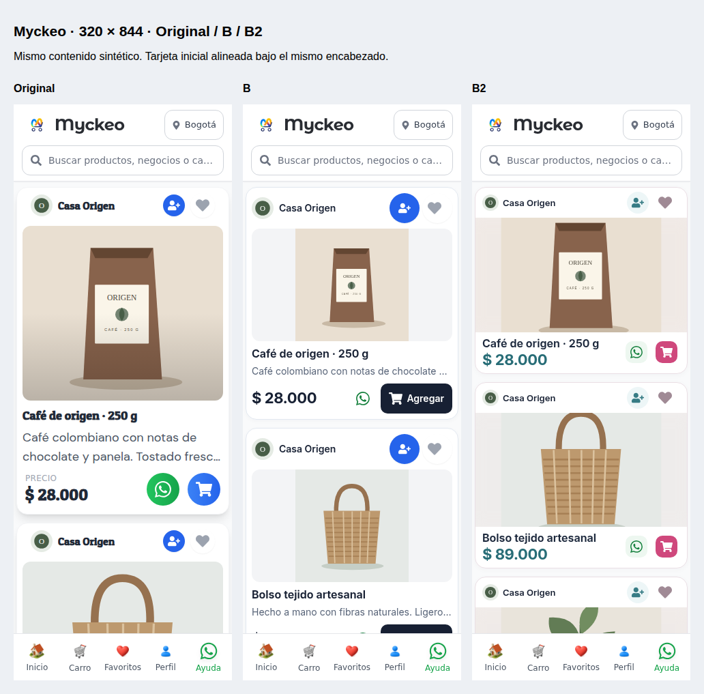
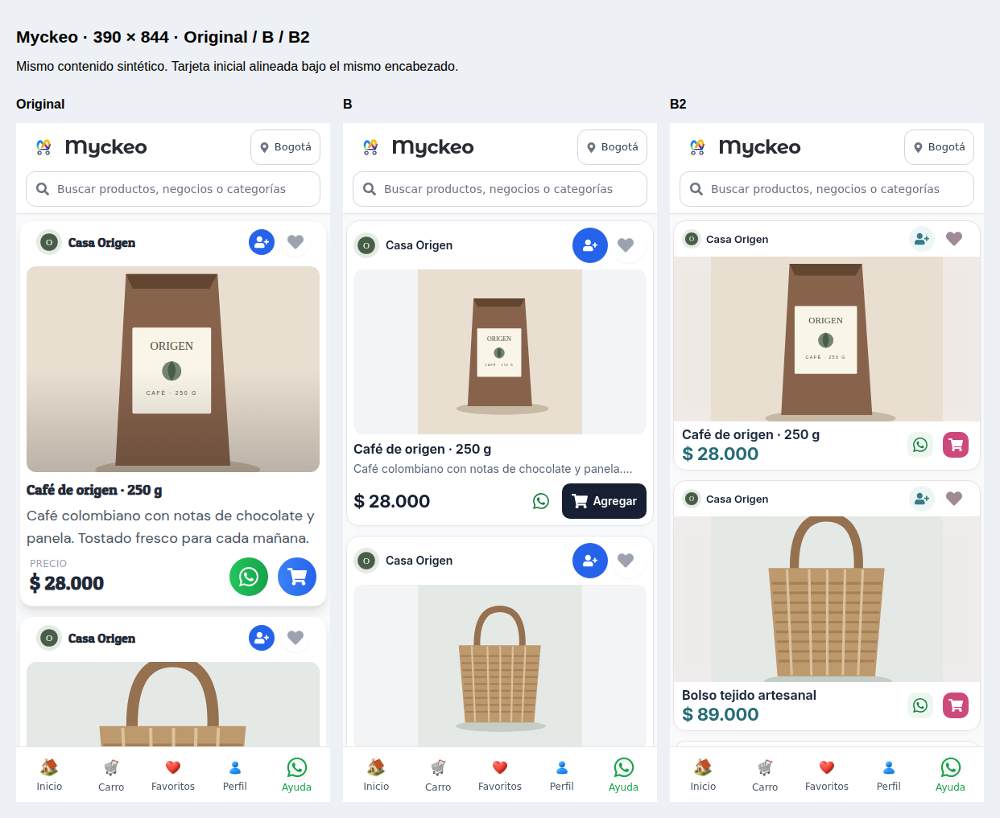
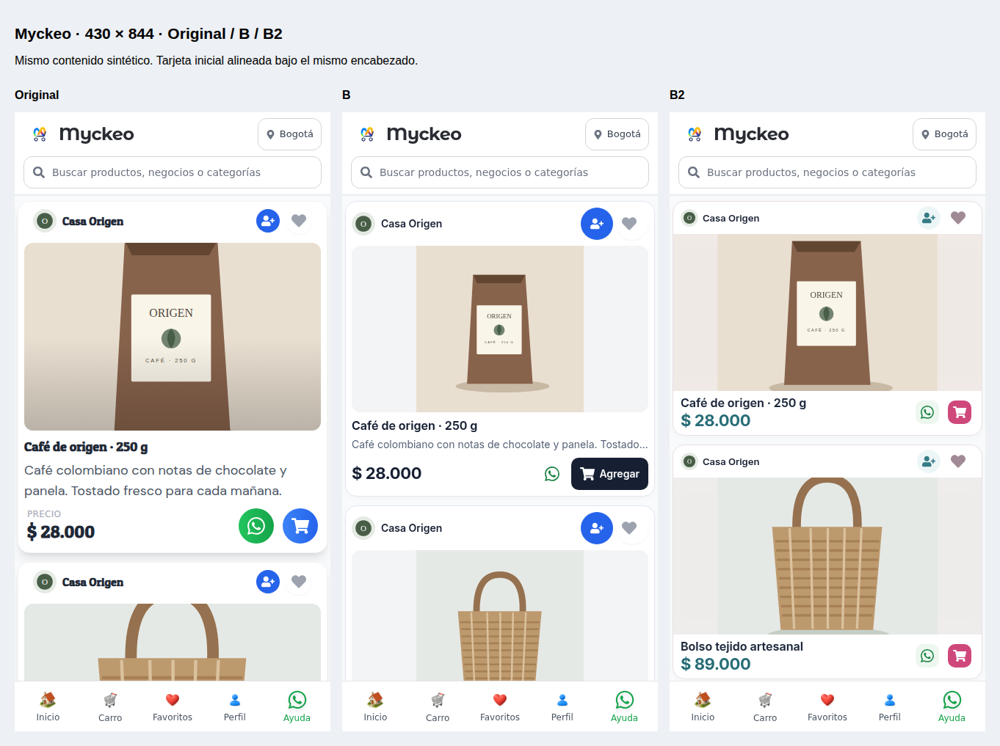

# Myckeo — Refinamiento visual B2 del producto móvil

Estado: `MYCKEO_MOBILE_FEED_VISUAL_REFINEMENT_READY_FOR_REVIEW`

Se refinó exclusivamente la presentación móvil de `ProductCard` en su variante `feed`. La tarjeta pasa a una composición de descubrimiento: foto hasta los bordes, nombre/precio juntos y acciones discretas al lado. La descripción queda en la ficha en móvil. Esta iteración queda para revisión visual; no se realizaron commits, pushes ni despliegues.

## 1. Referencias utilizadas

Se inspeccionaron la imagen oficial de Pinterest Shopping y la vista previa gráfica de Dawn, además del logo local y los colores existentes de Myckeo. Son ejemplos públicos de composición, no una auditoría de sesiones autenticadas ni una reproducción exacta de las versiones actuales de todas esas apps.

| Referencia | Patrón útil | Adaptación y límite |
|---|---|---|
| [Pinterest Shopping](https://business.pinterest.com/shopping/) y [Product Pins](https://help.pinterest.com/en/business/guide/shopping-on-pinterest) | Imagen como entrada al producto y datos comerciales breves próximos a ella. La pieza visual oficial de H&M coloca nombre/precio sobre una fotografía protagonista. | Foto protagonista y precio fácil de localizar. Se conserva una columna móvil; no se copia su cuadrícula ni se superpone texto comercial sobre fotos de contraste impredecible. |
| [Dawn, de Shopify](https://themes.shopify.com/themes/dawn/presets/dawn) | La vista previa muestra fotografías limpias y nombre/precio con poco texto secundario. | Reducir el cuerpo comercial y el marco. No trasladar al feed su hero de portada, espacio editorial amplio o composición desktop de varias columnas. |
| [Guía pública de Shop Ads, TikTok](https://getstarted.tiktok.com/global-shop-ads?lang=en) | Como referencia documental complementaria, presenta tarjetas basadas en imágenes y datos de la ficha. | Identificación y acción comercial breve; no se incorporan video automático, pantalla completa ni señales promocionales adicionales. |

El logo de Myckeo contiene cian, azul, amarillo y transiciones cálidas. Se eligieron dos acentos moderados ya relacionados con la interfaz (`#428f99` y `#d44b7c`): precio/seguimiento en cian oscuro y carrito en rosa. El título conserva el azul oscuro de la identidad. No se traslada todo el gradiente del logo a cada superficie.

## 2. Archivos modificados en esta iteración

| Archivo | Cambio B → B2 |
|---|---|
| [`ProductCard.tsx`](../src/ui/components/productos/ProductCard.tsx) | Detecta la proporción de la imagen entregada mediante su evento de carga, añade un fondo decorativo con la misma imagen para las proporciones que lo necesitan y expone el tipo como atributo de presentación. En el feed, la etiqueta Agotado refleja el estado de deshabilitación ya calculado, incluyendo todas las variantes sin stock. No cambia cálculos ni handlers comerciales. |
| [`feedProductCard.module.css`](../src/ui/components/productos/feedProductCard.module.css) | Composición B2 únicamente hasta 768 px: imagen sin marco interior, altura visual acotada, cuerpo en dos columnas, descripción oculta en móvil, color y botones visualmente menores. Conserva altura automática y reflow. |
| [`build.cjs`](../e2e/mobile-feed/build.cjs), [`serve.cjs`](../e2e/mobile-feed/serve.cjs), [`harness.tsx.txt`](../e2e/mobile-feed/harness.tsx.txt) | Soporte local para B congelada/B2 y fixtures de imagen vertical y horizontal. No añade rutas a la aplicación. |
| [`visual-refinement.config.ts`](../e2e/mobile-feed/visual-refinement.config.ts), [`visual-refinement.spec.ts`](../e2e/mobile-feed/visual-refinement.spec.ts) | Comparaciones, capturas, geometría, controles y comprobaciones funcionales aisladas. |
| [`b-sources`](mobile-feed-visual-refinement/b-sources/) y [evidencia](mobile-feed-visual-refinement/) | Conservan las dos fuentes de B antes de modificarla, bundles, manifiestos SHA-256, resultados y capturas para comparación reproducible. |

La comparación de manifiestos B/B2 identifica **solo los dos primeros archivos como diferencias productivas**. Los cambios de publicaciones, negocios, servicios y feed general que ya existían pertenecen a la fase B; no se alteraron en B2. Tampoco se modificaron `AddFavorites`, `FollowButton`, stores, carrito, variantes, Server Actions, Prisma, Cloudinary, autenticación, ranking, paginación, CI o infraestructura.

## 3. Qué cambió visualmente

- **Foto:** ocupa todo el ancho interior de la tarjeta. Caja de relación 1,85:1, con máximo de 214 px de alto en móvil. Se elimina el marco de 8 px que rodeaba la imagen en B.
- **Nombre y precio:** el nombre mantiene 16 px y dos líneas como máximo; el precio mantiene 22 px. Comparten una columna y el precio adquiere un acento cian oscuro. Los precios largos pueden ocupar más líneas; no se fija la altura de la tarjeta.
- **Descripción:** se retira del resumen móvil para evitar una ficha reducida. Sigue en los datos, ficha completa y presentación desktop B.
- **Acciones:** WhatsApp/carrito quedan a la derecha del nombre/precio. Los iconos miden 18 px y sus fondos aproximadamente 32 px; **las áreas de toque siguen midiendo 44 × 44 px**. El carrito conserva su nombre accesible y su mismo flujo de confirmación/variantes. Los badges de variantes y agotado conservan contexto visible.
- **Negocio:** header de 44 px, avatar de 24 px, nombre de 13 px y follow/favorito con menor peso visual. Sus estados se mantienen; no cambian persistencia ni consultas.
- **Anchos extremos:** el cuerpo pasa a una columna cuando el contenedor es menor de 250 px, para que precio y acciones no se solapen al ampliar texto/zoom. El contenido crece en vertical.

No se introdujeron cuadrículas de dos columnas para discovery móvil, cambios de cadencia ni nuevos tipos de acción. El breakpoint existente de 768 px conserva los clusters que ya tenía B.

### Encuadre por tipo de imagen

La proporción se calcula con las dimensiones naturales del archivo que recibió el navegador, sin pedir otro recurso para medirlo:

| Imagen recibida | Tratamiento B2 | Consecuencia |
|---|---|---|
| Vertical, relación menor de 0,85 | `contain`, con fondo suave derivado de la misma imagen | Conserva todo el archivo principal; evita recortar el objeto para llenar una caja horizontal. |
| Cuadrada o cercana, relación entre 0,85 y 1,3 | `contain` ampliado 1,4 veces y fondo derivado | El objeto gana tamaño sin el recorte más agresivo de un `cover` completo. Existe recorte vertical intencional de la fotografía; no se garantiza conservar cualquier objeto situado en sus bordes. |
| Horizontal, relación desde 1,3 | `cover` centrado | Llena el bloque. Puede recortar bordes para adaptar la proporción; las capturas permiten revisar ese compromiso. |

En el fixture cuadrado se mantiene aproximadamente el **71,4 % del área del archivo fuente**, medido geométricamente; esto **no es un porcentaje del producto reconocido**. El producto de muestra está centrado y conserva su identificación. La imagen vertical conserva el 100 % del archivo principal. Las capas decorativas pueden estar recortadas/desenfocadas porque no sustituyen al contenido principal.

Los presets existentes de Cloudinary pueden entregar una imagen cuadrada aunque el original fuera vertical. Esta detección describe el archivo recibido; no recupera partes que el CDN ya haya recortado. No se modificó Cloudinary.

## 4. Comparación Original / B / B2

Mismo contenido sintético y fuentes locales en las tres versiones. Original usa el bundle anterior a B; B se recompila con sus dos fuentes congeladas; B2 usa los componentes actuales. El header y la navegación global se conservan. La llegada más temprana frente al Original procede de la fase B: B2 modifica la tarjeta, no el preámbulo.

Viewport: **844 px de alto**, escala 1 y fuentes locales cargadas. Header fijo de 113 px y navegación inferior de 69 px: **662 px útiles**, sin cambios entre B y B2. Las medidas son del DOM aislado con datos sintéticos, no de una sesión productiva.

| Ancho | Altura Original | Altura B | Altura B2 | Reducción B → B2 | % viewport Original / B / B2 | Productos completos con el feed alineado: Original / B / B2 |
|---|---:|---:|---:|---:|---|---|
| 320 | 480,0 | 341,0 | **273,6** | 19,8 % | 56,9 / 40,4 / **32,4** % | 1 / 1 / **2** |
| 390 | 480,0 | 380,3 | **311,4** | 18,1 % | 56,9 / 45,1 / **36,9** % | 1 / 1 / **2** |
| 430 | 480,0 | 402,8 | **320,0** | 20,6 % | 56,9 / 47,7 / **37,9** % | 1 / 1 / **2** |

“Feed alineado” significa que la primera tarjeta está 8 px bajo el header y las categorías/pestañas iniciales ya salieron de pantalla. **Al entrar desde el inicio de la página se ve un producto completo y parte del siguiente tanto en B como en B2**, pero B2 deja ver más del segundo. No se afirma que aparezcan dos productos completos antes de desplazar el preámbulo.

| Ancho | Bloque de imagen B | Bloque de imagen B2 | Alto al que se dibuja el archivo cuadrado antes del recorte: B → B2 |
|---|---|---|---|
| 320 | 294,0 × 165,4 | 310,0 × 167,6 | 165,4 → **234,6** |
| 390 | 364,0 × 204,8 | 380,0 × 205,4 | 204,8 → **287,5** |
| 430 | 404,0 × 227,2 | 420,0 × 214,0 | 227,2 → **299,6** |

A 390 px, el bloque fotográfico mantiene aproximadamente su altura y gana 16 px de ancho. El archivo cuadrado se dibuja un **40,4 % más grande en cada eje** que en B antes de recortarse; no se trata de aumentar el tamaño del archivo descargado. La imagen ocupa **66,0 % de la altura de la tarjeta**, frente a 53,8 % en B. El título y el precio mantienen sus tamaños de 16/22 px y los botones mantienen su área táctil.

La tarjeta puede ser más baja principalmente por el cuerpo comercial: se elimina la línea de descripción, se retira padding exterior y se colocan nombre/precio junto a las acciones. El límite de 214 px evita que el bloque fotográfico vuelva a alargar la tarjeta en anchos móviles mayores.

No se atribuyen resultados de conversión o de pruebas de usuarios a estas medidas. Los títulos largos, variantes y precios extensos pueden aumentar la altura y reducir el número de tarjetas completas.







### Capturas para revisar imagen y legibilidad

| Ancho | Llegada B / B2 | Vertical B / B2 | Horizontal B / B2 | Título/precio largo B2 |
|---|---|---|---|---|
| 320 | [B](mobile-feed-visual-refinement/screenshots/b-320-initial.png) · [B2](mobile-feed-visual-refinement/screenshots/b2-320-initial.png) | [B](mobile-feed-visual-refinement/screenshots/b-320-portrait-card.png) · [B2](mobile-feed-visual-refinement/screenshots/b2-320-portrait-card.png) | [B](mobile-feed-visual-refinement/screenshots/b-320-landscape-card.png) · [B2](mobile-feed-visual-refinement/screenshots/b2-320-landscape-card.png) | [Caso largo](mobile-feed-visual-refinement/screenshots/b2-320-long-card.png) |
| 390 | [B](mobile-feed-visual-refinement/screenshots/b-390-initial.png) · [B2](mobile-feed-visual-refinement/screenshots/b2-390-initial.png) | [B](mobile-feed-visual-refinement/screenshots/b-390-portrait-card.png) · [B2](mobile-feed-visual-refinement/screenshots/b2-390-portrait-card.png) | [B](mobile-feed-visual-refinement/screenshots/b-390-landscape-card.png) · [B2](mobile-feed-visual-refinement/screenshots/b2-390-landscape-card.png) | [Caso largo](mobile-feed-visual-refinement/screenshots/b2-390-long-card.png) |
| 430 | [B](mobile-feed-visual-refinement/screenshots/b-430-initial.png) · [B2](mobile-feed-visual-refinement/screenshots/b2-430-initial.png) | [B](mobile-feed-visual-refinement/screenshots/b-430-portrait-card.png) · [B2](mobile-feed-visual-refinement/screenshots/b2-430-portrait-card.png) | [B](mobile-feed-visual-refinement/screenshots/b-430-landscape-card.png) · [B2](mobile-feed-visual-refinement/screenshots/b2-430-landscape-card.png) | [Caso largo](mobile-feed-visual-refinement/screenshots/b2-430-long-card.png) |

## 5. Validaciones y límites

- **25/25 pruebas Playwright aprobadas**, sin fallos ni flaky tests. Incluyen comparaciones a 320/390/430, imágenes verticales/horizontales, controles y precios dentro de sus tarjetas, títulos largos, fallbacks, stock, variantes, carrito, favoritos y follow.
- Regresión en 767/768/769/1024/1440: sin overflow accidental. Desde 769 px las medidas de todas las tarjetas coinciden con B. Publicaciones, negocios y servicios conservan sus alturas en las tres comparaciones móviles.
- `default` y `business_profile`: HTML interior y altura iguales a B. No se activan los estilos B2 fuera del feed móvil.
- Zoom/reflow CSS al 200 % en viewports de 320 y 640 px; escenarios de 568 px de alto, sin recorte de precios/controles. Los objetivos de follow, favorito, WhatsApp y carrito conservan al menos 44 × 44 px.
- El estado Agotado permanece visible en el producto sin stock y con todas sus variantes agotadas, además de mantener el botón deshabilitado.
- `pnpm typecheck`: correcto.
- `pnpm lint`: correcto, con el aviso previo de `_body` sin uso en `src/app/activar/ActivationBootstrap.test.tsx:347`; no se modificó ese archivo.
- `git diff --check`: correcto. Manifiestos B/B2: solo cambian los dos archivos productivos de producto indicados.
- **39 capturas PNG y 19 registros de medición**, incluyendo imágenes y escenarios de comparación. Se inspeccionaron visualmente las comparaciones y los casos de orientación/precio extenso.

Evidencia: [resultados](mobile-feed-visual-refinement/results.json), [medidas originales](mobile-feed-visual-refinement/measurements.json), [manifiesto B](mobile-feed-visual-refinement/b/source-manifest.json) y [manifiesto B2](mobile-feed-visual-refinement/b2/source-manifest.json).

Se reutilizan componentes reales y stores reales en Chromium con fixtures, sesión simulada y respuestas locales de acciones. No hubo escrituras productivas. El adaptador de `next/image` reproduce el layout mediante ``; la optimización de Next, su `srcset` y el consumo real de red no están medidos aquí. El contexto y las restricciones del entorno anterior siguen descritos en [e2e/mobile-feed/README.md](../e2e/mobile-feed/README.md).

El zoom CSS es una emulación de reflow, no el zoom de Safari/iOS. Faltan comprobaciones en teléfonos reales y con fotografías del catálogo, especialmente objetos/textos próximos a los bordes y el coste del desenfoque en dispositivos modestos. No se certifica ausencia de recorte del contenido de todas las fotos; sí se comprueban límites de tarjeta, precio y controles, separando ese problema del encuadre fotográfico intencional.

### Reproducción local

```bash
node e2e/mobile-feed/build.cjs --before
FEED_REVIEW_STAGE=b node e2e/mobile-feed/build.cjs
FEED_REVIEW_STAGE=b2 node e2e/mobile-feed/build.cjs
pnpm exec playwright test --config=e2e/mobile-feed/visual-refinement.config.ts
```

Para inspección manual: `node e2e/mobile-feed/serve.cjs`, luego `http://127.0.0.1:4401/refinement/b/` o `/refinement/b2/`. Para imágenes de prueba añadir `?productMedia=portrait` o `?productMedia=landscape`; para estados, `?view=cases`. No se agregan rutas productivas.

## 6. Conclusión visual y recomendación

La comparación muestra una diferencia visible respecto de B: el producto cuadrado ocupa más del bloque fotográfico, desaparece el párrafo bajo el nombre, el precio se identifica más rápido y las acciones dejan de dominar el ancho. Las superficies suaves y dos acentos de marca aportan personalidad sin replicar el logo multicolor en cada tarjeta.

Recomiendo **B2 para la siguiente revisión móvil**, conservando B en escritorio y las variantes actuales de perfiles/listados. El tratamiento vertical prioriza integridad del archivo y el horizontal prioriza llenar el bloque. Conviene revisar las fotografías reales más difíciles antes de autorizar publicación; los fixtures muestran composición y comportamiento, no todas las posibles categorías del catálogo.

`MYCKEO_MOBILE_FEED_VISUAL_REFINEMENT_READY_FOR_REVIEW`
